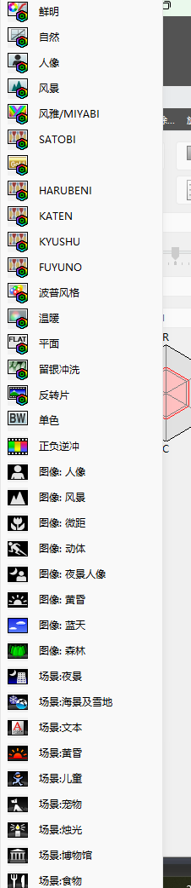
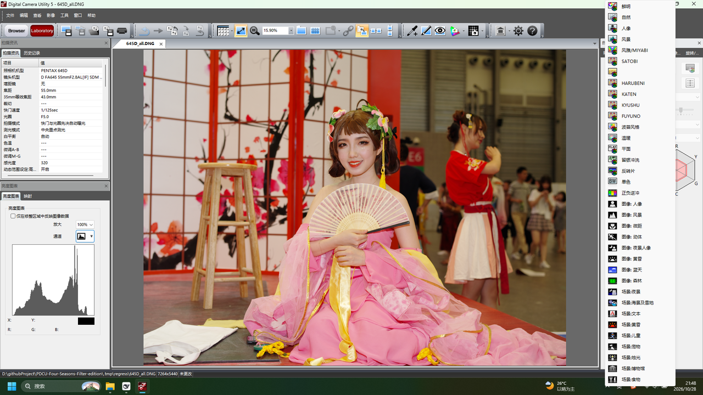
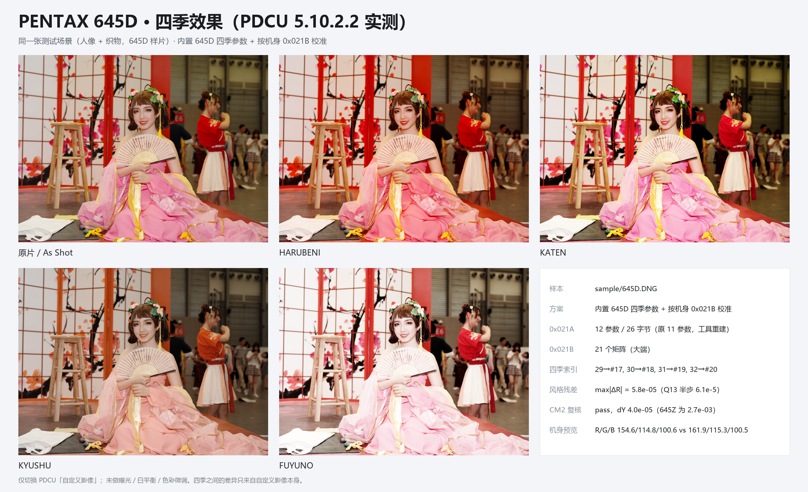
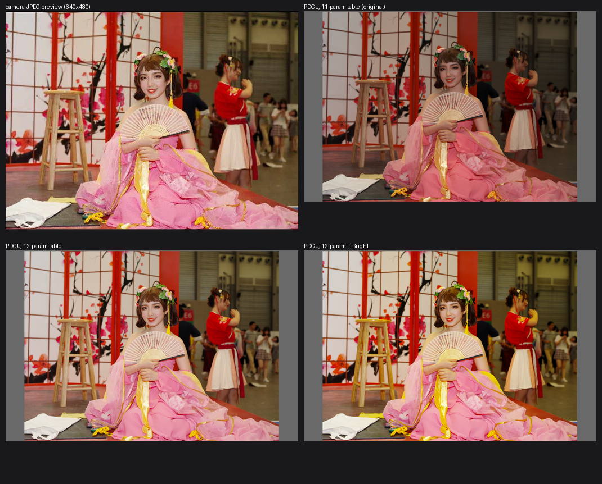

# PENTAX 645D 四季移植（KF 风格表）

日期：2026-10-28

样本：`sample/645D.DNG`（PENTAX 645D，7264×5440，ISO 320，1/125 s，F5.0，
DA645 55mmF2.8 AL[IF] SDM AW）。对照：内置 KF 四季表与 PDCU 5.10.2.2。

## 0. 结论

1. **645D 的 0x021A 是旧布局**：11 个参数、24 字节记录、私有块大端、
   `0x021A` 与 `0x021B` 之间只有 2 B 空隙（表是紧排的）。
2. **PDCU 5.10.2.2 只认 12 参数 / 26 字节布局**。把 KF 的四季记录按 645D 的
   11 参数写进去后，文件结构完全正确（`--list` 四项齐全），但 PDCU 的
   “自定义影像”菜单里**看不到** HARUBENI / KATEN / KYUSHU / FUYUNO；
   把整张 0x021A 重建成 12 参数 / 26 字节后，PDCU **立即列出并能渲染**四项
   （见第 4 节截图）。
3. 四季矩阵 = **KF 四季矩阵 × Y**，其中
   `Y = inv(M_KF[0]) · M_645D[0]`，两台的 mode-0 矩阵都取自各自的 0x021B。
   量化后与解析解相差 **≤0.50 个 Q13 LSB**，相对风格
   `R = M_季节 · inv(M_基准)` 与 KF 的最大差 **5.8×10⁻⁵**。
4. 645D 的 0x021B 基准与它自己的 DNG ColorMatrix2 互证：两条路算出的 Y
   只差 **4.0×10⁻⁵**，所以这次的 Y 不是拟合出来的，而是机身真值。
5. **记录布局升级的副作用（已实测）**：PDCU 对同一张 645D 文件的默认显影会
   从旧的 11 参数路径切到新路径，画面更亮、更接近机身 JPEG 预览
   （R/G/B 均值 154.6/114.8/100.6，预览 161.9/115.3/100.5；旧路径为
   121.2/83.7/74.0）。原有 24 条记录逐字段保留，只多出一个值为 `0xFFFF`
   的参数 10 槽（实测 `0xFFFF` 与 `0` 渲染完全一致）。

输出：`sample/645D_all.DNG`（53,944,955 B），
SHA-256 `E9497DE8099EB53401922103DC46144640EFE416080AE85B36AA40CD07AEBE62`。

## 1. 文件结构

| 项目 | 645D | KF（对照） |
|---|---:|---:|
| 私有块 | `0xC634`，102,400 B | 151,428 B |
| 私有块字节序 | **大端** | 小端 |
| `0x021A` | 602 B，nParams=11，nRecords=24，24 B/条 | 912 B，12，34，26 B/条 |
| 参数 id | (1,2,3,4,5,6,7,8,9,128,129) | (1,…,10,128,129) |
| `0x021B` | 310 B，17 个 18 B 矩阵 | 490 B，27 个 |
| `0x021A` 之后空隙 | 2 B | 0 B（长度已含 390 B 预留） |
| 原生四季 | 无 | 有 |

645D 和 K-30 同属“机内没有 12 参数字段”的一代，但它是**有** 0x021A/0x021B 的，
所以不能走 K-30 的“新建标签”路径；它需要的是一次**记录布局重建**，
并把两张表搬到私有块内的空闲区（`0x021A` 后面只有 2 B，装不下 4 条新记录）。

## 2. 记录布局：11 → 12 参数

参数 id 列表是子集关系：

```
645D:  1 2 3 4 5 6 7 8 9     128 129        (11)
KF:    1 2 3 4 5 6 7 8 9 10 128 129        (12)
```

因此按 **参数 id** 而不是按位置映射：645D 缺的 10 号槽写成 `0xFFFF`
（这些表里通用的“未设置”值），其余槽原样保留，矩阵索引（128 号）含义不变。

实测校验：645D 原有的 24 条记录重建后，逐条把新布局的第 10 槽去掉，
与原始 11 参数记录**逐字段相同**（24/24）。

### 为什么必须升级布局

同一张图、同一套四季记录，只改记录布局，PDCU 5.10.2.2 的表现：

| 0x021A 布局 | 结构检查 | PDCU 菜单 |
|---|---|---|
| 11 参数 / 24 B（原样追加） | 四项齐全 | **没有四季** |
| 12 参数 / 26 B（本文方案） | 四项齐全 | **HARUBENI / KATEN / KYUSHU / FUYUNO 全部出现** |

两种写法都满足“0x021A 含 29–32、索引指向 0x021B 有效矩阵”，差别只在
`nParams` 与记录长度。结论是 PDCU 的四季判定走的是 12 参数这条解析路径；
645D 的 11 参数表在它眼里读不出 29–32。

## 3. 色彩校准

### 3.1 基准矩阵与 Y

```
M_645D[0] = [ 1.53271 -0.53027 -0.00244 ]
            [-0.17175  1.41406 -0.24231 ]
            [ 0.03979 -0.71240  1.67261 ]      (Q13: 12556 -4344 -20 -1407 11584 -1985 326 -5836 13702)

M_KF[0]   = [ 1.56250 -0.64062  0.07812 ]
            [-0.20312  1.49609 -0.29297 ]
            [ 0.03906 -0.44531  1.40625 ]

Y = inv(M_KF[0]) · M_645D[0]
  = [ +0.989157 +0.043917 -0.033075 ]
    [ +0.020958 +0.907996 +0.071047 ]
    [ +0.007459 -0.220285 +1.212827 ]
```

四季矩阵按 `M_645D(季节) = M_KF(季节) · Y` 写入。

### 3.2 CM2 互证

用两台各自的 DNG ColorMatrix2（`0xC622`）构造
`T = diag(1/(CM2·W_D65))·CM2`，再算 `T(645D)·inv(T(KF))`，
与 0x021B 得到的 Y 最大只差 **3.95×10⁻⁵**：

```
CM2 check: pass (0x021B base vs ColorMatrix2, dY 4.0e-05)   # --builtin kf
CM2 check: pass (0x021B base vs ColorMatrix2, dY 1.1e-06)   # --builtin 645d
```

第二行是用内置 645D 数据时日志的样子：donor 的基准就是 645D 自己的基准，
所以只剩量化差；两条独立路径（0x021B 与 ColorMatrix2）在 4×10⁻⁵ 内一致。

这比 645Z / K-S2 的已知偏差（2.7×10⁻³ / 1.3×10⁻²）小两个数量级，
说明 645D 的 0x021B 基准就是它自己的色彩空间，Y 可以放心用。

### 3.3 写出的四季矩阵

| 季节 | 矩阵索引 | Q13（行优先） | q13 残差 | R 与 KF 最大差 |
|---|---:|---|---:|---:|
| HARUBENI | #17 | 13502 −2055 −3255 −2899 15422 −4331 −2096 −297 10585 | 0.38 LSB | 2.7×10⁻⁵ |
| KATEN | #18 | 14603 −6019 −392 −1455 14412 −4764 1159 −7501 14534 | 0.48 LSB | 4.7×10⁻⁵ |
| KYUSHU | #19 | 14019 −7700 1873 936 6969 287 −46 −1222 9460 | 0.44 LSB | 3.1×10⁻⁵ |
| FUYUNO | #20 | 8747 −504 −50 −679 9206 −335 451 −1006 8746 | 0.50 LSB | 5.8×10⁻⁵ |

相对风格 `R = M · inv(M_基准)`：

| 季节 | R |
|---|---|
| HARUBENI | `[[1.0948, 0.1233, -0.2181], [-0.0897, 1.2280, -0.1383], [-0.1511, 0.3309, 0.8202]]` |
| KATEN | `[[1.1519, -0.1092, -0.0427], [0.0188, 1.1608, -0.1795], [0.0539, -0.1002, 1.0463]]` |
| KYUSHU | `[[1.0912, -0.2005, 0.1092], [0.1522, 0.7220, 0.1258], [0.0070, 0.2643, 0.7287]]` |
| FUYUNO | `[[0.7232, 0.2442, 0.0328], [0.0397, 0.8601, 0.1002], [0.0489, 0.2730, 0.6779]]` |

与 KF / K-1 的四季签名一致（文档
[`PDCU-KF四季差异分析.md`](PDCU-KF四季差异分析.md) 第 5 节），
最大差 5.8×10⁻⁵。

### 3.4 风格表检查

用两台已有的 24 个同名模式算 `R` 的中位差得到 **7.3×10⁻²**，即 645D 的
**旧一代风格表**与 KF 不是同一张表（K-3 / 645Z / K-S2 / KP 都是 10⁻⁵ 量级）。
这不是问题：移植的定义就是“把 KF 的四季风格放到 645D 的基准矩阵上”，
`R` 按构造保持不变，所以四季看起来就是 KF 的四季；645D 自己的普通模式
仍用它原来的表。工具对 645D 使用专门的内置数据（`season_645d_data.py`），
不会因为这条检查要求 `--allow-cross-model`。

## 4. PDCU 实测（5.10.2.2）

打开 `645D_all.DNG`，PDCU 识别为 PENTAX 645D，“自定义影像”菜单在
SATOBI 之后列出四项：



完整界面（左侧“拍摄资讯”显示 PENTAX 645D）：



逐项点选后的画面（同一张图，仅切换自定义影像）：



| 画面 | R 均值 | G 均值 | B 均值 | 相对 As Shot |
|---|---:|---:|---:|---|
| As Shot | 154.6 | 114.8 | 100.6 | — |
| HARUBENI | 165.0 | 110.9 | 94.8 | +10.4 / −3.9 / −5.8 |
| KATEN | 165.9 | 123.2 | 110.1 | +11.3 / +8.4 / +9.5 |
| KYUSHU | 147.9 | 117.5 | 102.8 | −6.7 / +2.7 / +2.2 |
| FUYUNO | 180.7 | 151.6 | 144.2 | +26.1 / +36.8 / +43.6 |

HARUBENI 偏暖（R 升、G/B 降）、FUYUNO 明显提亮——这两个方向与
K-3 / K-70 / K-50 的实测一致；KATEN、KYUSHU 的整幅均值随画面内容而变，
不能直接跨照片比较，矩阵层面（第 3.3 节）四条 R 与 KF 完全一致。

### 4.1 记录布局对默认显影的影响

同一张图，三种写法在 PDCU 里的 As Shot 渲染：



| 渲染 | R | G | B | 绿通道 p25/p50/p75 |
|---|---:|---:|---:|---|
| 机身 JPEG 预览（640×480） | 161.9 | 115.3 | 100.5 | 64 / 114 / 172 |
| PDCU，11 参数（原布局） | 121.2 | 83.7 | 74.0 | 43 / 88 / 113 |
| PDCU，12 参数（本方案） | 154.6 | 114.8 | 100.6 | 73 / 105 / 163 |

也就是说：11 参数路径下 PDCU 明显比机身预览暗；升级到 12 参数后两者基本贴合。
这与“PDCU 读不懂 11 参数记录、退回默认显影”的判断一致。两种参数 10 填充值
（`0xFFFF` 与 `0`）渲染逐像素相同，说明补出来的槽本身不参与运算。

## 5. 复现

```powershell
# 结构检查
python tools\dng_season_params.py --target sample\645D.DNG --list

# 生成（自动识别 645D 布局并重建为 12 参数）
python tools\dng_season_params.py --target sample\645D.DNG --builtin 645d ^
    --out sample\645D_all.DNG --overwrite
```

GUI：添加 645D 文件后会自动选中“内置 645D 四季参数”，日志会打印
`0x021A 记录布局：11 参数 / 24 字节 -> 12 参数 / 26 字节` 与表/矩阵的迁移位置。

## 6. 边界与未验证项

- **只验证了一台 645D、一个固件版本的文件。** 其他 645D 文件的私有块大小、
  预览位置可能不同；工具会自动找空闲区，但建议先用 `--list` / `--dry-run` 看计划。
- **“PDCU 只认 12 参数布局”是实测结论**（5.10.2.2），不是规范。若将来版本
  支持 11 参数四季，可以退回更小的改动。
- **记录布局升级会改变 PDCU 的默认显影**（更接近机身 JPEG）。这是数据布局的
  副作用，不是四季矩阵造成的；不希望改变默认显影的用户请不要用 645D 方案。
- `0x021F` 等每张图自己的数据没有改；雷达图形状仍取决于照片本身。
- 如果某个 645D 文件**已经带四季记录但仍是 11 参数布局**（例如第三方工具
  写过），工具会判为 “already has all four” 并跳过；这种文件 PDCU 同样不会
  列出四季，需要先换回原始 DNG 再转换。
- 没有测试把改过的 DNG 写回相机或在 645D 机身上回放。
