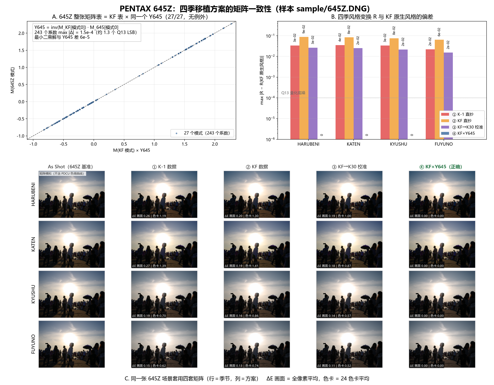

# PENTAX 645Z 四季移植：三套方案验证与选型

日期：2026-10-27
样本：`sample/645Z.DNG`（PENTAX 645Z，私有块 151,552 B）
对照：`sample/KF.DNG`（原生四季）、`sample/IMGP0709.DNG`（K-1 原生四季）、
`sample/K3.DNG`（上一次分析的 K-3）



---

## 0. 结论

**三套里最好的是 ③（KF→K-30 校准值），但它也不是"为 645Z 校准"的那一套。**

| 方案 | 矩阵 | 色卡平均 ΔE（四季） | 色卡最大 ΔE | 画面平均 ΔE |
|---|---|---|---:|---:|
| ① K-1 直抄 | K-1 #22–#25 | 1.19 / 1.39 / 0.70 / 0.62 | 6.9 | 0.15–0.27 |
| ② KF 直抄 | KF #22–#25 | 1.30 / 1.41 / 0.86 / 0.74 | 8.2 | 0.13–0.20 |
| **③ KF→K30 校准** | KF #22–#25 × Y(K-3) | **1.00 / 0.87 / 0.57 / 0.52** | **3.5** | **0.11–0.19** |
| ④ 本文补算 | KF #22–#25 × Y(645Z) | **0.00 / 0.00 / 0.00 / 0.00** | **0.0** | **0.00** |

③ 之所以在三套里最好，不是因为它"懂 645Z"，而是因为它自带一层 **K-3** 的校准，
而 **K-3 的基准矩阵恰好是这三台 donor 里离 645Z 最近的**：

| donor | 基准矩阵 #0 与 645Z 的最大差 |
|---|---:|
| KF | 0.152 |
| K-1 | 0.047 |
| K-3 | 0.043 |

误差几乎完全由这一个数字决定（见 §3）。**真正对 645Z 的做法是 ④**：
`M = M_KF × Y645`，`Y645 = inv(M_KF[0]) · M645Z[0]`。645Z 自己整张
27 个模式矩阵都精确等于 `M_KF × Y645`（1.5×10⁻⁴），所以这层校准就是它固件里
用的那一层——④ 的风格偏差为 0。

---

## 1. 645Z 的结构：和 K-3 同族

| 项目 | 645Z | K-3 | KF |
|---|---:|---:|---:|
| `0x021A` | 1120 B / 27 条 / 26 B（390 B 填充） | 1120 B / 27 条 | 912 B / 34 条 |
| `0x021B` | 364 B / 20 矩阵 | 364 B / 20 矩阵 | 490 B / 27 矩阵 |
| 字节序 | 小端 | 小端 | 小端 |
| 四季 | 无 | 无 | 有 |

- 27 条模式记录与 KF **逐字节相同**，唯一差异是模式 19 的矩阵索引（645Z → #10，
  KF → #11，两者都是基准矩阵副本）。
- 模式 → 矩阵索引的映射与 K-3 完全一致（`{0:0, 1:1, 16:2, 17:3, 18:4, 20:5, 23:6, 24:7, 25:8, 19:10, …}`）。

所以三套方案写进 645Z 后，结构也完全一样：`0x021A` 834 B / 31 条、
`0x021B` 436 B / 24 矩阵、四季指向 #20–#23，**四个文件只差 72 字节**
（`0x293C–0x2983`），改动全部在私有块内。

---

## 2. 关键：645Z 整张表 = KF 表 × 同一个 Y645（27/27，无例外）

```
Y645 = inv(M_KF[模式0]) · M645Z[模式0]
     = [ 0.960078   0.125483  -0.085561 ]
       [-0.025032   1.070903  -0.045871 ]
       [-0.006818   0.021745   0.985073 ]
```

用它预测 645Z 自己的 27 个模式矩阵：

- **27/27 个模式、243 个系数：max |Δ| = 1.5×10⁻⁴**（≈1.3 个 Q13 LSB）；
- 最小二乘解与 Y645 只差 6×10⁻⁵；
- **没有例外**（K-3 有 4 个例外模式 2/6/11/16，645Z 一个都没有）。

各模式相对风格 `R = M(模式)·inv(M(模式0))` 与 KF 的差全部 ≤1.0×10⁻⁴。
也就是说，645Z 是"同一套风格表 + 一次校准"的最干净样本。

### 2.1 与 DNG ColorMatrix2 的关系（一个必须说明的细节）

`T = diag(1/(ColorMatrix2·W_D65))·ColorMatrix2`：

```
|Y645 − T(KF)·inv(T(645Z))|max = 2.65×10⁻³
```

这个差比 K-3 的 1.6×10⁻⁵ 大两个数量级。原因没有查实：两台机身的模式 0 矩阵都是
Q8（1/256 整数倍）存储，但 K-3 的 T 比值与矩阵比值吻合到 1.6×10⁻⁵，645Z 只到
2.65×10⁻³。可以确定的是它不影响方法——27 个模式能用 Y645 复现到 1.5×10⁻⁴，
说明固件用的是矩阵表的这一层。影响很小但可测：若改用 T 比值代替 Y645，R 会差
2.4×10⁻³（约 0.1 ΔE 量级），仍比 ③ 好 10 倍，但比 ④ 的取整误差（≈4×10⁻⁵）大 60 倍。

**结论：校准取矩阵表的 Y645，不取 DNG 的 T 比值。** 因为 27 个模式能用 Y645
复现到 1.5×10⁻⁴，说明固件就是这么算的。

---

## 3. 三套方案的误差来源：只看 donor 基准离目标多远

把风格变换写成 `R = M季节·inv(M基准)`，对"直抄型"方案（① ②）：

```
R方案 = M_donor季节 · inv(M_645[0])
     = R参考 · M_donor[0] · inv(M_645[0])        （用 R_donor ≈ R参考）
```

对 ③（矩阵里已经乘了 K-3 的 Y）：`R方案 = R参考 · M_K3[0] · inv(M_645[0])`。

所以**误差与 donor 基准矩阵到 645Z 基准的距离成正比**，与"哪台相机的四季更好看"
无关。这正好解释了实测排序：

| donor 基准 | 与 645Z #0 的距离 | 对应方案 | 实测 max\|R−R参考\| |
|---|---:|---|---:|
| K-3 | 0.043 | ③ | 2.6×10⁻² |
| K-1 | 0.047 | ① | 3.3×10⁻² |
| KF | 0.152 | ② | 8.7×10⁻² |
| 645Z 自己 | 0 | ④ | 0 |

这也是 readme 里"645Z 套 K-1 数据偏得更多"的定量解释：不是 645Z 特别挑，
而是 K-1 的基准离它比 K-3 远一点，而 KF 离它最远。

---

## 4. 误差量化

### 4.1 风格变换 R 的偏差（四季）

| 季节 | ① K-1 | ② KF | ③ K30 校准 | ④ Y645 |
|---|---:|---:|---:|---:|
| HARUBENI | 3.3×10⁻² | 8.7×10⁻² | 2.6×10⁻² | 0 |
| KATEN | 3.5×10⁻² | 8.3×10⁻² | 2.5×10⁻² | 0 |
| KYUSHU | 3.3×10⁻² | 7.5×10⁻² | 2.1×10⁻² | 0 |
| FUYUNO | 2.2×10⁻² | 6.3×10⁻² | 1.5×10⁻² | 0 |

（Q13 量化底噪 1.2×10⁻⁴）

### 4.2 24 色卡 ΔE（参考 = KF 原生风格）

| 季节 | 方案 | 平均 | 最大（最差色块） |
|---|---|---:|---|
| HARUBENI | ① | 1.19 | 5.94（purple） |
| | ② | 1.30 | 6.29（purple） |
| | ③ | 1.00 | 3.53（purple） |
| | ④ | 0.00 | 0.00 |
| KATEN | ① | 1.39 | 6.85（purple） |
| | ② | 1.41 | 8.20（purple） |
| | ③ | 0.87 | 1.99（yellow） |
| | ④ | 0.00 | 0.00 |
| KYUSHU | ① | 0.70 | 1.67（purple） |
| | ② | 0.86 | 2.72（green） |
| | ③ | 0.57 | 1.38（yellow） |
| | ④ | 0.00 | 0.00 |
| FUYUNO | ① | 0.62 | 1.71（purple） |
| | ② | 0.74 | 2.39（purple） |
| | ③ | 0.52 | 1.29（red） |
| | ④ | 0.00 | 0.00 |

### 4.3 645Z 样张上的画面 ΔE

从 `docs/PDCU-645Z跨机型四季试验.png` 的 As Shot 面板按 `R` 重算，
20,000 像素平均：

| 季节 | ① K-1 | ② KF | ③ K30 | ④ Y645 |
|---|---:|---:|---:|---:|
| HARUBENI | 0.26 | 0.20 | 0.19 | 0.00 |
| KATEN | 0.27 | 0.19 | 0.18 | 0.00 |
| KYUSHU | 0.19 | 0.16 | 0.14 | 0.00 |
| FUYUNO | 0.15 | 0.13 | 0.11 | 0.00 |

这张样张是逆光日落，画面以暖色高光和大面积剪影为主、饱和度低，所以三套直抄
方案的画面差都不到 0.3。**注意 ② 在画面上比 ① 略好、在色卡上比 ① 略差**——
这正是"误差方向不同"的表现；③ 两项都最低，这才是稳定结论。

---

## 5. 建议

1. **短期**：645Z 用三套里的 ③ 最优（`--builtin k30 --allow-cross-model`），
   但要知道它只是"最接近"，色卡均值仍有约 1.0 ΔE、最大 3.5。
2. **要精确**：给 645Z 做 §2 的校准（矩阵 `M_KF季节 × Y645`）。可以做成一
   个内置表 `season_645z_data.py`。
3. **更好的做法（一次解决所有机型）**：让工具在运行时用**目标自己的** `0x021B`
   基准矩阵算 `Y = inv(M_donor[0])·M_target[0]`，再乘到 donor 的四季矩阵上。
   K-3、645Z、以及以后任何有 `0x021B` 的机型都会自动变成精确移植；
   没有 `0x021B` 的 K-30/K-01 继续用内置校准数据。
   建议同时加一个自检：比较 `R_target` 与 `R_donor` 在共有模式上的偏差，
   超过阈值就提示"该机型与 donor 不是同一套风格表，跨机型可能不准"。
4. **readme**：645Z 现在写的是"偏得更多、不建议成品输出"，可以改成"用 K-3/K-30
   校准值较好；精确做法见本文"。

四个测试文件（可直接用 PDCU 打开）：

```
.tmp/645Z_k1.DNG       ① K-1 数据
.tmp/645Z_kf.DNG       ② KF 数据
.tmp/645Z_k30.DNG      ③ KF→K30 校准（三套里最好）
.tmp/645Z_kfY645.DNG   ④ KF×Y645（精确，本次补算）
```

四个文件结构一致：`0x021A` 834 B / 31 条、`0x021B` 436 B / 24 矩阵、
四季 → #20–#23；彼此只差 72 字节矩阵。

---

## 6. 边界与未验证项

- **没有在 PDCU 里实测**（本机未装）。四季是否出现在菜单，是按 `0x021A` 的
  29–32 记录 + 有效矩阵索引判定的。
- **ΔE 是矩阵模型**（线性 sRGB → Lab），不含 PDCU 的色调曲线与局部适应；它衡量
  的是矩阵层差异。
- **画面 ΔE 的基准图**来自 `docs/PDCU-645Z跨机型四季试验.png`（K-1 数据在
  PDCU 里的预览），不是 raw 解码。
- **645Z 没有官方四季数据**，"正确"只能定义为"与 KF 原生风格一致"。
- ④ 的矩阵按 Q13 取整写入，与理论值差 ≤6×10⁻⁵（不足 1 个 LSB）。

---

## 7. 复现

| 脚本（`.tmp`） | 作用 |
|---|---|
| `z645_calib.py` | Y645、27/27 单校准检验、逐模式 R |
| `z645_schemes.py` | 四套方案的 R 与色卡 ΔE |
| `z645_scene.py` | 画面 ΔE、Y645 与 T 比值对比 |
| `z645_make.py` | 生成 ④ `.tmp/645Z_kfY645.DNG` |
| `z645_check2.py` | 四个输出文件的结构与逐字节校验 |
| `z645_figure.py` | 生成本文插图 |

---

版权所有 © 2026 KimHoLau X deepseek harness
