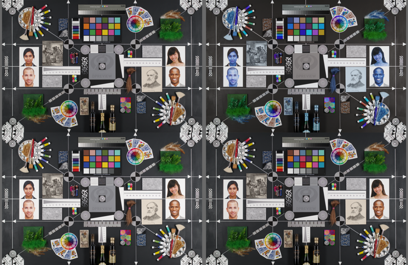

# PDCU 的 As Shot 用的是哪张矩阵？

日期：2026-10-27

K-S2 的 `0x021B` 基准矩阵与它自己的 ColorMatrix2 相差 **1.3×10⁻²**（九台里最大）。
这直接影响两件事：四季的 `Y` 该从哪儿算，以及九机型文档里 K-S2 的 ΔE 代理值
（0.53 / 3.08）算不算数。本实验用“只改一处”的四份 DNG 把这个问题钉死。

## 方法

样本：`sample/KS2.dng`（PENTAX K-S2，私有块 `0x021A` 27 条 / `0x021B` 20 个矩阵）。

四份文件大小完全相同，每份只改一处：

| 文件 | 改动 |
|---|---|
| A | 原样 |
| B | `0x021B` 第 0 号矩阵的 R/B 两行对调（`[2,1,0]`） |
| C | `0x021B` 第 0 号矩阵每个系数 ×1.2 |
| D | `0xC621` / `0xC622`（ColorMatrix1 / ColorMatrix2）的 R/B 行对调，`0x021B` 原样 |

渲染：PDCU 5.10.2.2 直接打开文件 → Laboratory，等 12 s，用 PrintWindow 抓画布
（1326×869），**不切换“自定义影像”**，也就是保持相机记录的 As Shot。

## 结果

| 文件 | 改动 | 平均 RGB | 与 A 的平均差 / 最大差 | 变化像素(>2) |
|---|---|---|---:|---:|
| A | 原样 | 93.66 / 91.60 / 88.63 | — | — |
| B | `0x021B[0]` R/B 行对调 | 88.62 / 91.59 / 93.67 | 8.35 / 220 | 70.0% |
| C | `0x021B[0]` ×1.2 | 102.65 / 100.76 / 97.65 | 9.06 / 22 | 96.4% |
| D | `0xC621`+`0xC622` R/B 行对调 | 93.66 / 91.60 / 88.63 | **0 / 0** | **0.0%** |

## 结论

1. **As Shot 直接乘 `0x021B[0]`**：把第 0 号矩阵的 R/B 行对调，画面里 R 与 B
   精确互换（B 的均值 88.62/91.59/93.67 正好是 A 的倒序）；×1.2 后整体提亮
   （色调曲线压缩，均值只涨约 9.6%）。矩阵行 0 = R、行 1 = G、行 2 = B。
2. **PDCU 的 As Shot 渲染不看 DNG ColorMatrix1/2**：把 `0xC621`、`0xC622` 的
   R/B 行对调，输出与 A **逐像素完全相同（0 个像素变化）**。
3. 所以对 K-S2：工具从 `0x021B[0]` 推 `Y` 是**正确**的；CM2 与基准差
   1.3×10⁻² 只是元数据层面的矛盾。PDCU 的四季和 As Shot 都在 `0x021B` 空间里，
   `R = M季节 · inv(M基准)` 成立，四季风格就是 KF 的风格。
4. 九机型文档里 645Z / K-S2 的 ΔE 代理值偏高（0.39 / 3.08），原因就是它用 CM2
   反推 `T(cam)`，而 PDCU 不用 CM2。这个指标只反映“CM2 与基准的一致性”，
   不反映渲染偏差。
5. 可重复性：A 与 D 是两次独立启动、内容不同的文件，渲染均值和逐像素完全相同，
   说明抓图流程是确定性的。

## 导出（另存 JPEG）也一样

屏幕渲染之外，又用同一套文件跑了 PDCU 的“文件 → 将处理的影像另存为…”
（JPEG，5472×3648，标准压缩，全部用对话框默认设置）：

| 文件 | 导出大小 | 与 A 的像素差 | 说明 |
|---|---:|---:|---|
| A | 12,476,435 B | — | 基准 |
| B | 12,495,098 B | 平均 8.80 / 最大 223，78.6% 像素变化 | R/B 精确互换，控制组生效 |
| D | 12,476,435 B | **0 / 0** | 像素逐点相同 |

A 与 D 的 JPEG 字节不同（SHA 不同），但逐字节比较只有 **5 个字节**不同：EXIF 的
DateTime（导出时刻，偏移 275–278）和缩略图偏移（6112–6113）；像素数据完全一致。
所以导出管线和屏幕渲染一样，只乘 `0x021B`，不读 ColorMatrix1/2。

## 边界

- 屏幕渲染（Laboratory 画布）和“另存 JPEG”都测了；PDCU 的其它导出格式
  （TIFF / DNG）没有逐一验证，按同一管线推断行为相同。
- 只测了 K-S2 一台。但“As Shot 乘 `0x021B`、不看 CM”属于程序逻辑，理应跨机型
  一致；九台渲染比值的一致性也从侧面支持这一点。
- 这里的 As Shot 是文件里相机记录的影像模式。这份样本的 As Shot 落在 `0x021B`
  的第 0 号矩阵上（改它立即生效）。若某张样张拍摄时选的是别的模式，As Shot 会
  指向别的矩阵，但结论（用 `0x021B`、不用 CM）不变。
- 屏幕部分抓的是 PDCU 画布（1326×869，含缩放）；导出部分用的是 PDCU 全尺寸
  JPEG（5472×3648），两者是不同路径、分别比较的。

## 复现

- B：取 `0x021B` 后第 0 个 18 字节矩阵，按行序 `[2,1,0]` 重排；
- C：每个系数 ×1.2，四舍五入并裁剪到 int16；
- D：`0xC621` / `0xC622` 的 9 个 rational，按行序 `[2,1,0]` 重排；
- 渲染流程与九机型实测相同（PDCU 5.10.2.2 → Laboratory → PrintWindow）；
- 导出流程：同一 Laboratory 会话 → 文件 → 将处理的影像另存为… → JPEG /
  5472×3648 / 标准压缩；比较时解码成像素，不比文件哈希（EXIF 时间戳每次都变）。

四份文件大小均为 22,288,882 B，SHA-256 前 16 位：

    A 17E103EEB4088C6C    B 2AD44F00DBD0D64D
    C CA5D773B509B247C    D 6F0CD85EA1A0D479

---

版权所有 © 2026 KimHoLau X deepseek harness
