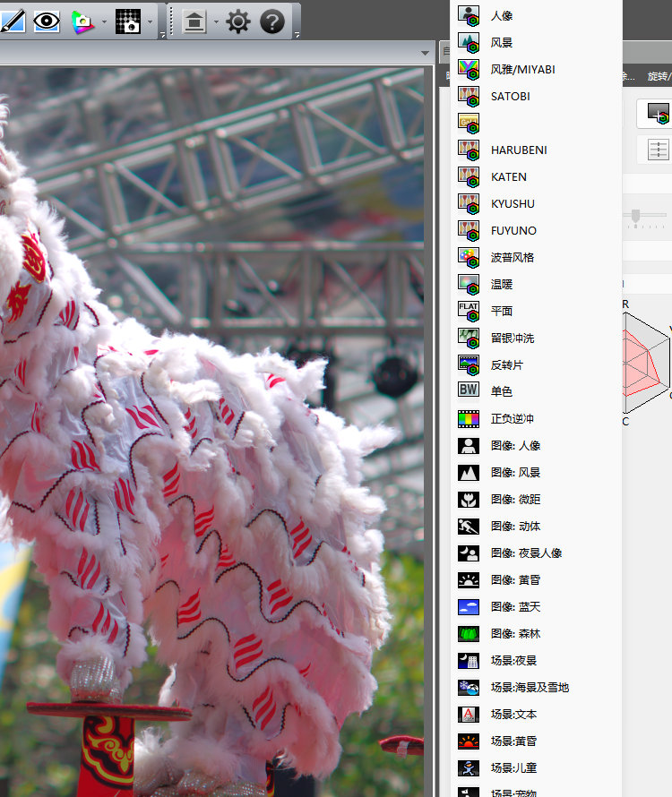

# PENTAX K-01 移植 KF 四季数据实测

日期：2026-10-26（2026-10-27 用当前 `sample/K01.DNG` 复核并重算矩阵）

| 项目 | 文件 |
|---|---|
| 目标 | `sample/K01.DNG`（PENTAX K-01，固件 K-01 Ver 1.05） |
| 数据来源 | `sample/KF.DNG`（PENTAX KF，固件 1.33） |
| 输出 | `sample/K01_KF_all.DNG` |
| 工具 | `tools/dng_season_params.py --builtin k01` |
| 内置数据 | `tools/season_k01_data.py` |

## 1. 结论

K-01 和 K-30 同属“私有块大端、没有 `0x021A` / `0x021B`”的结构，但布局不是
完全相同：

| 项目 | K-30 | K-01 |
|---|---:|---:|
| DNG 字节序 | `MM`（大端） | `MM`（大端） |
| 私有块 | 102,400 B | 102,400 B |
| 私有 IFD 条目 | 100 | **95** |
| `0x021A` / `0x021B` | 不存在 | 不存在 |
| 预览 JPEG 起点 | 私有 +32,610 | 私有 +32,258 |
| 预览长度 | 37,306 B | 39,584 B |
| 预览后空闲区 | +69,916..+77,650 | +71,842..+77,560 |

工具按目标实际条目数和 JPEG 长度寻找空闲区，因此两种布局共用同一套“新建标签”
逻辑，K-01 不需要单独写一套结构代码。

## 2. 文件结构

K-01 样本：

```
文件大小        14,928,589 B
私有块          文件 0x37E..0x1937E（102,400 B）
私有 IFD 条目   95
0x021A / 0x021B 不存在
0x0200           私有 +1,156，8 B
0x0201           私有 +1,164，8 B
0x0205           私有 +1,172，25 B
预览 JPEG        私有 +32,258，39,584 B（到 +71,842）
0x0005 偏移      私有 +77,560
```

95 条 IFD 之后直接是数据。新建两个条目需要 24 B，会覆盖
`0x0200` / `0x0201` / `0x0205` 的开头，因此工具：

1. 把这三个小标签搬到预览 JPEG 后的空闲区（私有 +71,842 起）；
2. 在原位置重建 97 条 IFD，按标签号插入 `0x021A` / `0x021B`；
3. 把 KF 的 4 条四季记录、4 个矩阵转成大端；
4. 用 K-01 的 DNG ColorMatrix2 校准四季矩阵。

输出结构：

| 项目 | 位置 | 长度 |
|---|---:|---:|
| `0x021A` | 文件 0x11C4A | 132 B / 4 条 |
| `0x021B` | 文件 0x11CCE | 76 B / 4 个矩阵 |
| `0x0200` 新位置 | 私有 +71,842 | 8 B |
| `0x0201` 新位置 | 私有 +71,850 | 8 B |
| `0x0205` 新位置 | 私有 +71,858 | 25 B |

四季记录：29→#0、30→#1、31→#2、32→#3。

## 3. 颜色校准

K-01 样本的 DNG ColorMatrix2（`0xC622`，直接读有理数计算 `Y`，不经过四舍五入）：

```
K-01 CM2 = [[ 0.885361 -0.267563 -0.118576]
            [-0.399536  1.230118  0.188065]
            [-0.098602  0.172852  0.657135]]
KF   CM2 = [[ 0.82346 -0.21082 -0.12932]
            [-0.43587  1.29533  0.15146]
            [-0.10701  0.19185  0.59303]]
```

用 `T = diag(1/(CM2·W))·CM2`（D65）计算：

```
Y = T(KF) · inverse(T(K-01))
M(K-01 season) = M(KF season) · Y
```

Y 为：

```
Y = [[ 0.97373585  0.09584011 -0.06957596]
     [-0.00980552  1.06806399 -0.05825847]
     [-0.00514295  0.04111060  0.96403235]]
```

四个校准后的矩阵（Q13，行和 8192，个别行 8193 是取整误差）：

| 季节 | 9 个 int16 |
|---|---|
| HARUBENI | `13423, -2443, -2788, -3285, 16618, -5141, -2227, 2122, 8297` |
| KATEN | `14589, -6269, -128, -1822, 15422, -5407, 1150, -5070, 12112` |
| KYUSHU | `14031, -7692, 1853, 693, 8176, -677, -159, 889, 7462` |
| FUYUNO | `8635, -125, -318, -961, 10524, -1371, 336, 992, 6865` |

与 K-30 同一水准：Y 最大只差 **2.74×10⁻⁵**；36 个 Q13 系数里 **34 个完全
相同**，只有 KYUSHU 第 1 项（14031 vs 14032）和 FUYUNO 第 9 项（6865 vs 6864）
各差 1 个 LSB。把两套表作用在同一底片上，HARUBENI / KATEN 逐像素相同，
KYUSHU / FUYUNO 的 ΔE76 最大 0.02 / 0.003。Y 与 K-3 的差 K-01 为 1.50×10⁻⁵
（K-30 2.19×10⁻⁵、K-50 3.65×10⁻⁵），三台同档，K-01 不低。工具仍按 K-01
自己的 ColorMatrix2 单独校准。

## 4. PDCU 实测

用原版 PDCU 5.10.2.2 打开 `sample/K01_KF_all.DNG`：

- 相机识别为 **PENTAX K-01**；
- “自定义影像”列表原有机型项保持不变；
- 列表中出现 **HARUBENI / KATEN / KYUSHU / FUYUNO** 四项；
- 四项都能选中并改变画面。



上面的截图与菜单检查来自 2026-10-26 的旧矩阵；2026-10-27 按当前样张重算后只有
2 个系数各动 1 个 LSB（HARUBENI 第 4 项、KATEN 第 1 项），标签结构完全相同。

2026-10-28 用当前 v2.1 表重新生成 `K01_all.DNG` 并重跑 PDCU 复核：四项仍在
“自定义影像”菜单里，四项都能选中并改变画面（相对原片平均差 6.9 / 13.9 /
10.3 / 42.1），说明当前矩阵可用。

## 5. 完整性校验

对 `sample/K01.DNG` 与 `sample/K01_KF_all.DNG` 逐字节比较：

| 检查 | 结果 |
|---|---|
| 文件大小 | 相同，14,928,589 B |
| 私有块偏移 / 长度 | 相同，0x37E / 102,400 B |
| 私有 IFD 条目数 | 95 → 97 |
| `0x0200` / `0x0201` / `0x0205` | 内容逐字节相同，仅位置变化 |
| 其余私有标签 | 逐字节相同 |
| JPEG 预览 | 逐字节相同 |
| raw 像素 | 未改动 |
| 私有块之外 | 未改动 |
| 差异字节 | 339 B，全部落在私有块 0x37E..0x1937E 内 |
| 四季矩阵索引 | 29→#0、30→#1、31→#2、32→#3，均在 0..3 内 |

输出 SHA-256：

```
06B87D743391237AC54EDC847CA8FA97982EDF87BC568F3311E5415B813B3745
```

## 6. 复现

```powershell
python tools\dng_season_params.py --target sample\K01.DNG --builtin k01 ^
    --out sample\K01_KF_all.DNG --overwrite
```

GUI v1.7 添加 K-01 文件后会自动选择“内置 KF→K-30 / K-01 四季参数”，
处理时会按机型选择 K-01 数据。

## 7. 边界

- K-01 没有机内四季，也没有 `0x021B` 可对照；本移植是“新建标签 + 色彩空间校准”，
  不是官方固件功能。
- 2026-10-27 用当前 `sample/K01.DNG` 的 `0xC622` 有理数重算：Y 与旧值差 9.1×10⁻⁶，
  四季矩阵只有 2 个系数各差 1 个 LSB，输出 SHA 随之改变。
- 校准基于 `sample/K01.DNG` 的 ColorMatrix2，未在所有 K-01 机身上逐台验证。
- 只改 `0x021A` / `0x021B` 和三个被挤占的小标签的位置，不改 raw、预览、
  `0x021F` 等每张图的数据。
- 雷达图仍按当前照片计算，不同照片形状不同。

---

版权所有 © 2026 KimHoLau X deepseek harness