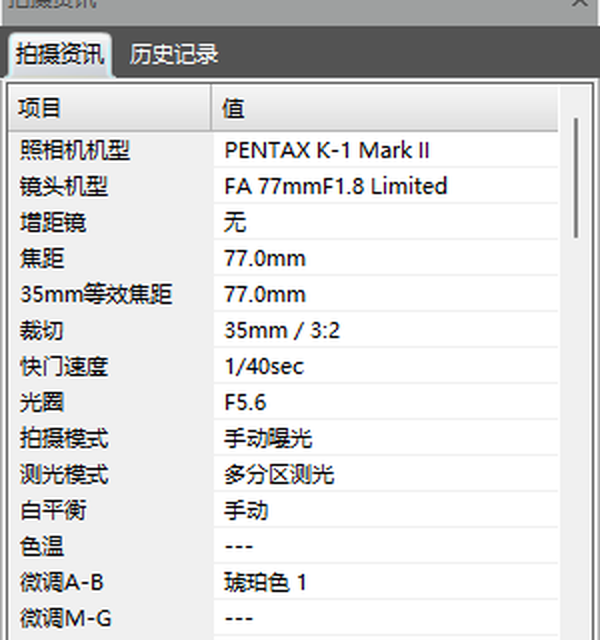
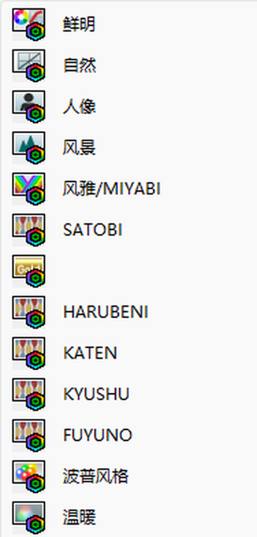
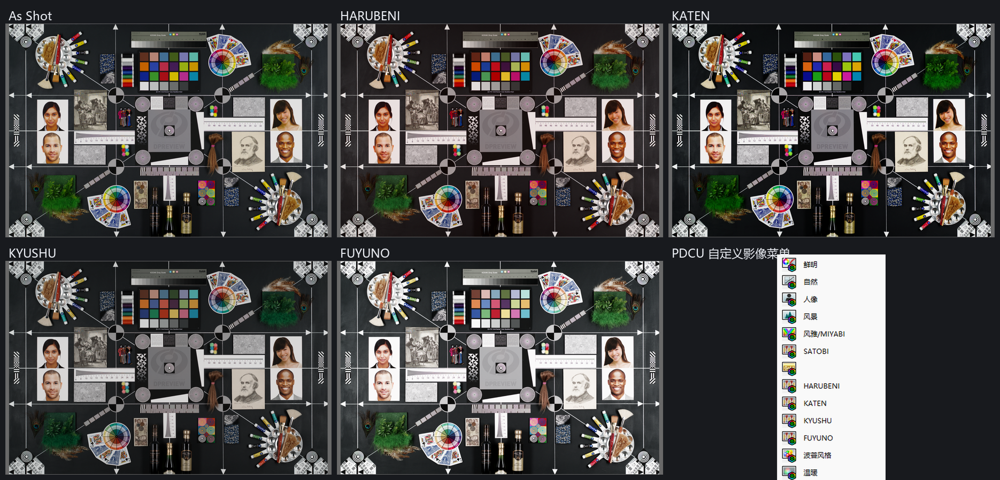

# PENTAX K-1 Mark II 四季移植实测

日期：2026-10-29

| 项目 | 文件 |
|---|---|
| 目标 | `sample/K1ii.dng`（PENTAX K-1 Mark II，固件 Ver. 1.01） |
| 数据来源 | 内置 K-1 原生四季表（`sample/K1.dng` 的 29–32 四条记录与四个矩阵） |
| 输出 | `sample/K1ii_all.dng` |
| 工具 | `tools/dng_season_params.py --builtin k1ii` |
| 内置数据 | `tools/season_k1ii_data.py` |
| 验证数据 | [`PDCU-K1II-验证数据.json`](PDCU-K1II-验证数据.json) |

## 1. 结论

K-1 Mark II 不是“需要推算”的机型：它的私有块与 K-1 属于同一套表。

| 检查项 | K-1 Mark II | 对照：K-1 |
|---|---|---|
| `0x021A` 记录 | 28 条 / 12 参数 / 26 B | 28 条 / 12 参数 / 26 B |
| `0x021B` 矩阵 | 21 个 / 18 B | 21 个 / 18 B |
| 28 条模式记录 | **与 K-1 逐字节相同** | — |
| 21 个基础矩阵 | **与 K-1 逐字节相同** | — |
| ColorMatrix2 隐含的输入校准 | 与 K-1 相差 **2.15×10⁻⁵** | — |
| 移植校准 | **Y = I**（无需再校准） | — |

因此内置 K-1 四季表可以直接写入 K-1 Mark II：四季矩阵与 K-1 **逐字节相同**，
相对风格残差为 **0**；与 KF 原生四季的风格差仍只有 **4.7×10⁻⁵～7.3×10⁻⁵**，
和 K-1 原生表对 KF 的差完全一致（<1 个 Q13 LSB）。

PDCU 5.10.2.2 实测：

- 识别为 **PENTAX K-1 Mark II**；
- “自定义影像”列表出现 **HARUBENI / KATEN / KYUSHU / FUYUNO** 四项；
- 四项都能选中并改变画面；
- 补丁前后 **As Shot 逐像素完全相同**（0 个像素变化、最大差 0）。

## 2. 文件结构

K-1 Mark II 样本：

```
文件大小        49,912,238 B
私有块          文件 0x3A6..0x2761A（160,372 B），小端
私有 IFD 条目   121
0x021A          文件 0x250A..0x2984（1,146 B，28 条，尾部 390 B 保留）
0x021B          文件 0x2986..0x2B04（382 B，21 个矩阵）
0x021C          文件 0x2B06（距 0x021B 仅 2 B，18 B）
```

K-1 Mark II 的私有块比 K-1 大 496 B，但 0x021A 同样留了 390 B 的保留尾。
新增四条记录后整表是 860 B，仍能原地放下（1,146 → 860 B）。0x021B 后面
只有 2 B 空位（0x021C 在 0x2B06），所以工具把矩阵表搬到新表尾的空闲区：

| 项目 | 补前 | 补后 |
|---|---:|---:|
| `0x021A` 偏移 | 0x250A | 0x250A（原地） |
| `0x021A` 长度 / 记录数 | 1,146 B / 28 | **860 B / 32** |
| `0x021B` 偏移 | 0x2986 | **0x2866**（迁移） |
| `0x021B` 长度 / 矩阵数 | 382 B / 21 | **454 B / 25** |
| 私有 IFD 条目 | 121 | 121（不变） |

四季记录索引：**29→#21、30→#22、31→#23、32→#24**。

## 3. 精确性

### 3.1 与 K-1 逐字节相同

对 `sample/K1ii.dng` 和 `sample/K1.dng` 比较：

| 内容 | 结果 |
|---|---|
| 28 条 `0x021A` 模式记录 | 逐字节相同 |
| 21 个 `0x021B` 基础矩阵 | 逐字节相同 |
| 模式 0 基准矩阵 | 9 个 Q13 系数全部相同 |
| 其余 20 个基础矩阵 | 全部相同 |

基准矩阵（Q13，小端）：

```
12032, -3872,    32
-1856, 12576, -2528
  288, -3392, 11296
```

所以 `Y = inv(M_K1[0])·M_K1II[0] = I`，工具日志为
`no correction needed (same base colour matrix)`。
`CM2 check` 用 K-1 Mark II 自己的 `0xC622` 复核 `0x021B` 基准：
**pass，dY 1.4×10⁻⁶**。

两条 ColorMatrix2 本身并不完全相同（最大元素差 0.0369），但它们隐含的
输入变换只差 2.15×10⁻⁵；真正决定 PDCU 显影的是逐字节相同的 `0x021B` 表，
所以这不影响移植结果。

### 3.2 写入的四季矩阵

| 季节 | 索引 | 9 个 Q13 系数 |
|---|---:|---|
| HARUBENI | #21 | `12882, -1949, -2741, -3399, 16261, -4670, -2196, 1965, 8423` |
| KATEN | #22 | `14049, -5687, -170, -1980, 15134, -4962, 1137, -5018, 12073` |
| KYUSHU | #23 | `13532, -7116, 1776, 528, 8064, -400, -197, 825, 7564` |
| FUYUNO | #24 | `8257, 159, -224, -1090, 10323, -1041, 277, 945, 6970` |

这四组数与 K-1 的 22–25 号矩阵逐字节相同，只是把记录里的矩阵索引从
22–25 重编号为 21–24（目标只有 21 个基础矩阵）。

相对风格 `R = M季节 · inv(M基准)`：

| 季节 | vs K-1 | vs KF 原生 |
|---|---:|---:|
| HARUBENI | **0** | 7.02×10⁻⁵ |
| KATEN | **0** | 5.88×10⁻⁵ |
| KYUSHU | **0** | 7.30×10⁻⁵ |
| FUYUNO | **0** | 4.69×10⁻⁵ |

Q13 一个 LSB 是 1.22×10⁻⁴，所以与 KF 的差仍小于 1 个 LSB；K-1 原生的
四季表本来就是这样（K-1 自己的四季表与 KF 的四季表并非逐字节相同）。

## 4. PDCU 实测

用原版 PDCU 5.10.2.2 打开 `sample/K1ii_all.dng`：

- 相机识别为 **PENTAX K-1 Mark II**；
- “自定义影像”列表原有机型项（鲜明 / 自然 / 人像 / 风景 / 风雅 / SATOBI 等）保持不变；
- 列表中出现 **HARUBENI / KATEN / KYUSHU / FUYUNO** 四项；
- 四项都能选中并改变画面。







### 4.1 As Shot 不变

同一台机器、同样的 PDCU 设置，分别打开原片 `sample/K1ii.dng` 和补丁后的
`sample/K1ii_all.dng`，抓取图像画布：

| 对比 | 结果 |
|---|---|
| 原片 As Shot 均值 | 84.78 / 83.64 / 79.59 |
| 补丁后 As Shot 均值 | 84.78 / 83.64 / 79.59 |
| 平均绝对差 / 最大差 | **0.0 / 0.0** |
| 变化像素 | **0.0%** |
| 逐像素完全相同 | **是** |

补丁只新增 29–32 四条季节记录和四个矩阵，没有改动任何已有模式记录或
`0x021B[0]`，所以 PDCU 的默认显影路径不变。

### 4.2 四季/As Shot 比值

按九机实测同样的方法，用画布均值计算
`ratio(season) = mean_rgb(season) / mean_rgb(As Shot)`：

| 季节 | K-1 Mark II 比值 R/G/B | 九机均值 R/G/B | 与九机原始比值最大差 | 与 K-1 原始比值最大差 | 与 K-1 色向最大差 |
|---|---|---|---:|---:|---:|
| HARUBENI | 1.0431 / 0.9419 / 0.9399 | 1.0339 / 0.9317 / 0.9218 | 1.96% | 0.34% | 0.41% |
| KATEN | 0.9446 / 0.9322 / 0.9311 | 0.9378 / 0.9254 / 0.9180 | 1.43% | 0.82% | 0.27% |
| KYUSHU | 0.9181 / 0.9193 / 0.9393 | 0.9083 / 0.9096 / 0.9226 | 1.81% | 0.58% | 0.25% |
| FUYUNO | 1.2462 / 1.2510 / 1.2911 | 1.2399 / 1.2510 / 1.2867 | 0.52% | 0.82% | 0.53% |

九机内部的原始比值最大差是 3.6%–4.7%，K-1 Mark II 与九机均值只差
0.52%–1.96%；与同为原生表的 K-1 比，原始比值差 0.34%–0.82%，色向差
≤0.53%，属于同一台机身在不同次渲染中的重复性量级。

四季相对 As Shot 的画布平均绝对差为 **5.40 / 13.90 / 7.73 / 21.89**
（RGB 0–255），四个模式不是同一个画面。

## 5. 完整性校验

对 `sample/K1ii.dng` 与 `sample/K1ii_all.dng` 逐字节比较：

| 检查 | 结果 |
|---|---|
| 文件大小 | 相同，49,912,238 B |
| 私有块偏移 / 长度 | 相同，0x3A6 / 160,372 B |
| 私有 IFD 条目数 | 121 → 121 |
| 其余 119 个私有标签 | 内容逐字节相同 |
| JPEG 预览 | 逐字节相同 |
| raw 像素 / 私有块之外 | 未改动（前缀与尾部逐字节相同） |
| 差异字节 | **524 B，28 段，全部落在私有块 0x3A6..0x2761A 内** |
| 四季矩阵索引 | 29→#21、30→#22、31→#23、32→#24，均在 0..24 内 |

输出 SHA-256：

```
33FCCDF4D3DC42B0ED242673C9F0A7DCDABB5A07F247D86287B0058696971493
```

原片 SHA-256：

```
F219F34D4748BC6BC8CE8A6213743FE3D3761B71CA102C9A8847E6D74D453978
```

CLI 与 GUI 自检（`--selftest-k1ii`）生成的输出逐字节相同，SHA-256 均为上值。

## 6. 复现

```powershell
python tools\dng_season_params.py --target sample\K1ii.dng --builtin k1ii ^
    --out sample\K1ii_all.dng --overwrite
```

GUI v2.4 添加 K-1 Mark II 文件后会自动选择“内置 K-1 / K-1 Mark II 四季参数”，
处理时按机型选择 `k1ii` 数据。

自检：

```powershell
python tools\dng_season_gui.py --selftest-k1ii sample\K1ii.dng .tmp\K1ii_gui.dng
Get-FileHash .tmp\K1ii_gui.dng -Algorithm SHA256
```

本次全部数值（结构、基准矩阵、四季矩阵、风格残差、渲染比值、As Shot 对比）
在 [`PDCU-K1II-验证数据.json`](PDCU-K1II-验证数据.json)。

## 7. 边界

- K-1 Mark II 与 K-1 使用同一块 36.4 MP 传感器和同一套色彩滤镜，且样本的
  28 条模式记录、21 个基础矩阵都与 K-1 逐字节相同；本移植是**同一张原生表的
  直接复用**，不是按 ColorMatrix2 外推，也不是“近似同门”的估计。
- 内置数据来自一份 K-1 Mark II 样本（`sample/K1ii.dng`，固件 1.01）；
  目前没有再拿第二份 K-1 Mark II 文件交叉验证，但逐字节相同的表已经排除了
  机型内差异的可能。
- 只改 `0x021A` / `0x021B` 及其重定位的空闲区，不改 raw、预览、
  `0x021F` 等每张图的数据。
- PDCU 菜单截图与渲染来自 1920×1080 屏、PDCU 5.10.2.2、默认“颜色”设置；
  雷达图仍按当前照片计算，不同照片形状不同。
- 只验证 PDCU 5.10.2.2；Lightroom / Capture One / dcraw 本来就不读 Pentax
  四季，未逐一测试。

---

版权所有 © 2026 KimHoLau X deepseek harness
