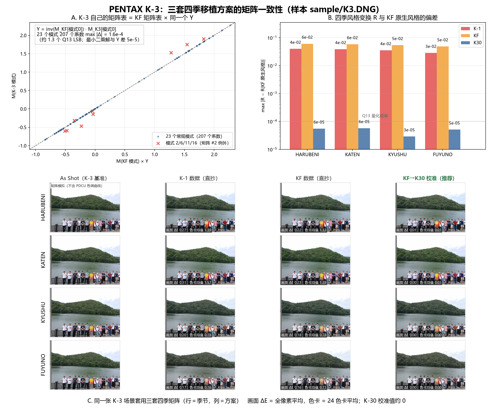

# PENTAX K-3 四季移植：三套方案对比与选型

> **补注（2026-10-27 晚）**：`season_k30_data.py` 已改为按 K-30 自身
> ColorMatrix2 校准（见 [PDCU-K30-KF四季移植.md](PDCU-K30-KF四季移植.md)），
> 不再用 K-3 基准代理。因此本文 ③ 号方案用的表有 6 个 Q13 系数与
> 2026-10-27 上午的版本差 1 个 LSB，③ 与精确解从“逐字节相同”变成
> “最多差 1 个 Q13 LSB”；方案排序与结论不变。工具对这些机型实际走的是
> “KF + 运行时按自身 0x021B 校准”。

日期：2026-10-27
样本：`sample/K3.DNG`（PENTAX K-3 初代，私有块 151,552 B）
候选 donor：`sample/IMGP0709.DNG`（K-1 原生四季）、`sample/KF.DNG`（KF 原生四季）、
`season_k30_data.py`（KF→K-30/K-01 校准值）



---

## 0. 结论

**用第三套（KF→K-30 校准矩阵）。** 它和 K-3 自己的色彩表用同一个校准，
四季风格与 KF 原生风格的偏差 **6×10⁻⁵**（量化底噪量级），24 色卡 ΔE **≤0.02**。

方案 1（K-1 数据直抄）和方案 2（KF 数据直抄）都是把外机型的矩阵原样写进 K-3，
风格变换 R 偏 **3%–6%**，色卡平均 ΔE 0.7–1.6、饱和色最大 9–10；在这张 K-3 风景
样张上画面平均 ΔE 0.2–0.3。两者误差同量级、方向不同，**谁也不比谁更对**。

根因不在"哪台机器的四季更好看"，而在**校准层**：K-3 的 20 个 `0x021B` 矩阵
里，23 个常规模式都精确等于 `M(KF) × Y`（残差 1.6×10⁻⁴），而 `Y` 又正好等于
DNG ColorMatrix2 推出的 `T(KF)·inv(T(K-3))`（差 1.6×10⁻⁵）。四季矩阵必须
走同一层 `Y`，否则就是把别的机身的色彩空间直接盖到 K-3 上。

---

## 1. 三套方案在 K-3 上落到同一结构，最终只差 72 字节

| 方案 | 数据来源 | 字节序 | 0x021A 记录 | 0x021B 矩阵 |
|---|---|---|---:|---:|
| ① K-1 四季 | `season_k1_data.py`（#22–#25） | 小端 | 26 B × 4 | 18 B × 4 |
| ② KF 四季 | `season_kf_data.py`（#22–#25） | 小端 | 26 B × 4 | 18 B × 4 |
| ③ KF→K-30 | `season_k30_data.py`（#0–#3） | 大端→小端 | 26 B × 4 | 18 B × 4 |

三条命令（都加了 `--allow-cross-model`，因为 donor 的机型名不是 K-3）：

```powershell
python tools\dng_season_params.py --target sample\K3.DNG --builtin k1  --out .tmp\K3_k1.DNG  --allow-cross-model --overwrite
python tools\dng_season_params.py --target sample\K3.DNG --builtin kf  --out .tmp\K3_kf.DNG  --allow-cross-model --overwrite
python tools\dng_season_params.py --target sample\K3.DNG --builtin k30 --out .tmp\K3_k30.DNG --allow-cross-model --overwrite
```

三个输出结构完全一致（`nRecords 27→31`、矩阵 `20→24`、29–32 → `#20–#23`），
而且：

- **四条四季记录逐字节相同**（`1d00…1400` / `1e00…1500` / `1f00…1600` / `2000…1700`），
  只有记录末尾的矩阵索引不同（20/21/22/23）。K-1 与 KF 的 `0x021A` 表本来就
  逐字节相同，K-30 那份又是 KF 的大端副本（转换回来后一致）。
- **三个文件只有 72 字节不同**，全部落在 `0x2934–0x297B`，即新加的第 20–23 号
  3×3 矩阵。
- 改动全部在私有块内（`0x766–0x297B`），raw 条带（`0x33960` 起 29,000,006 B）
  与预览完全未动。

也就是说：**三套方案的差别，100% 是那 4 个颜色矩阵**；模式定义、色调参数、
雷达图逻辑、菜单项都一模一样。

---

## 2. K-3 自己的表说明了正确的移植规则

### 2.1 结构事实

| 项目 | K-3 | KF | K-1 |
|---|---:|---:|---:|
| `0x021A` | 1120 B / 27 条 / 26 B | 912 B / 34 条 | 912 B / 34 条 |
| `0x021B` | 364 B / 20 矩阵 | 490 B / 27 矩阵 | 490 B / 27 矩阵 |
| 四季 | 无 | 有 | 有 |

K-3 与 KF 共有的 27 个模式里，**26 条记录逐字节相同**，唯一差异是模式 19 的
矩阵索引（K-3 指向 #10，KF 指向 #11，两者都是基准矩阵的副本——K-3 只有 20 个
矩阵，KF 有 27 个）。

### 2.2 关键：23 个模式 = KF 表 × 同一个 Y

令 `Y = inv(M_KF[模式0]) · M_K3[模式0]`：

```
Y = [ 0.973741   0.095850  -0.069591 ]
    [-0.009796   1.068062  -0.058266 ]
    [-0.005150   0.041113   0.964038 ]
```

用它预测 K-3 自己的 27 个模式矩阵：

- **23 个模式、207 个系数：max |Δ| = 1.6×10⁻⁴**（约 1.3 个 Q13 LSB），
  最小二乘解与这个 `Y` 只差 5.4×10⁻⁵；
- 只有**模式 2 / 6 / 11 / 16**（都指向矩阵 #2）偏离 0.254——K-3 给这一格
  留了一张自己的矩阵，是 K-3 固件的特例，与四季无关（四季是新增索引）。

也就是说：**K-3 的色彩表就是 KF 的色彩表乘上 `Y`**。这不是拟合巧合——`Y` 同时
等于两台机身 DNG 色彩矩阵推出的校准比：

```
T = diag(1/(ColorMatrix2 · W_D65)) · ColorMatrix2
|Y − T(KF)·inv(T(K-3))|max = 1.6×10⁻⁵
```

这与 `docs/PDCU-KF四季差异分析.md` 里 KF↔K-1 的关系（`X = T(K-1)·inv(T(KF))`，
2.5×10⁻⁵）是同一条规律：**Pentax 按机身色彩空间做同一套风格表，矩阵只差一次
输入校准**。K-3 也在这条线上。

### 2.3 四季风格在 K-1 / KF 上是同一个

定义 `R = M季节 · inv(M基准)`（用户实际看到的"季节味道"）：

| 季节 | R 的 KF vs K-1 最大差 |
|---|---:|
| HARUBENI / KATEN / KYUSHU / FUYUNO | ≤ 7.3×10⁻⁵ |

所以"用 K-1 的四季还是 KF 的四季"本身不构成差别——**必须先校准，再用**。
校准之后两者等价（`M(KF季节)·Y` 与 `M(K-1季节)·Z` 差 1.2×10⁻⁴）。

---

## 3. 方案 ③ 为什么是对的

`season_k30_data.py` 的矩阵定义是 `M(KF季节) × Y`，而 `Y` 用的正是
"K-3 基准矩阵"（当时以 K-3 作为 K-30 的基准代理）。用这份数据反推：

- 反推的 `Y` 与本次 `sample/K3.DNG` 算出的 `Y` 差 **2.7×10⁻⁵**；
- 反推的 K-3 基准矩阵与 `K3.DNG` 实际的 #0 差 **4.4×10⁻⁵**；
- 写进 K-3 后的 `R` 与 KF 原生 `R` 差 **6×10⁻⁵**（四个季节全部）。

换句话说，这份原本给 K-30 用的数据，**恰好就是按 K-3 的基准矩阵校准的**，
对 K-3 不是"近似"，而是精确。

---

## 4. 误差量化

### 4.1 风格变换 R 的偏差

| 季节 | ① K-1 直抄 | ② KF 直抄 | ③ KF→K-30 校准 |
|---|---:|---:|---:|
| HARUBENI | 4.0×10⁻² | 6.0×10⁻² | 6×10⁻⁵ |
| KATEN | 3.9×10⁻² | 5.8×10⁻² | 6×10⁻⁵ |
| KYUSHU | 3.5×10⁻² | 5.4×10⁻² | 3×10⁻⁵ |
| FUYUNO | 2.8×10⁻² | 4.9×10⁻² | 5×10⁻⁵ |

（Q13 量化底噪 1.2×10⁻⁴；方案 ③ 已经落在底噪以下。）

### 4.2 24 色卡 ΔE（参考 = KF 原生风格）

| 季节 | 方案 | 平均 | p95 | 最大（最差色块） |
|---|---|---:|---:|---|
| HARUBENI | ① | 1.39 | 3.76 | 8.78（purple） |
| | ② | 1.33 | 3.66 | 9.02（purple） |
| | ③ | 0.01 | 0.01 | 0.01 |
| KATEN | ① | 1.57 | 4.19 | 9.02（purple） |
| | ② | 1.39 | 4.11 | 9.96（purple） |
| | ③ | 0.01 | 0.02 | 0.02 |
| KYUSHU | ① | 0.78 | 1.61 | 2.10（purple） |
| | ② | 0.78 | 2.25 | 2.59（purple） |
| | ③ | 0.00 | 0.00 | 0.00 |
| FUYUNO | ① | 0.76 | 1.68 | 2.42（purple） |
| | ② | 0.71 | 1.81 | 2.75（purple） |
| | ③ | 0.00 | 0.01 | 0.01 |

饱和原色上偏差更直观：KYUSHU 的纯蓝 ①5.7 / ②7.4，FUYUNO 的纯蓝 ①7.5 / ②8.8，
FUYUNO 的品红 ②5.2——都是肉眼能看出的量级（ΔE>2 已可辨）。

### 4.3 这张 K-3 样张上的实际差异

从 PDCU 已有的 K-3 预览（`docs/PDCU-K3跨机型四季试验.png` 的 As Shot 面板）
按 `R` 重算，全画面 20,000 像素平均 ΔE：

| 季节 | ① K-1 | ② KF | ③ 校准 |
|---|---:|---:|---:|
| HARUBENI | 0.27 | 0.22 | 0.01 |
| KATEN | 0.31 | 0.23 | 0.00 |
| KYUSHU | 0.20 | 0.18 | 0.00 |
| FUYUNO | 0.17 | 0.16 | 0.00 |

这张样张是绿树/灰水/多云天空，色域集中在中低饱和，所以直抄方案的误差只有
0.2–0.3。**但换到紫、蓝、品红这类饱和主体（花、霓虹、衣物），误差会到 5–10**
——也就是"照片里那朵紫色花明显不一样"的程度。

---

## 5. 方案 ① 和 ② 谁更好？

都不好，而且**没有稳定优劣**：

- 按 `R` 的最大系数偏差，① 更接近（3–4% vs 4–6%）；
- 按色卡平均 ΔE，② 略低（1.33/1.39/0.78/0.71 vs 1.39/1.57/0.78/0.76）；
- 按最大 ΔE，① 略低（8.78/9.02 vs 9.02/9.96）。

原因是两者偏差矩阵的形状不同：① 集中在 (R,R) −4.0% 与 (B,G) +3.6% 两个元素
（红通道增益 + 绿→蓝串色）；② 集中在 (R,G) −6.0%、(R,B) +4.5%、(B,G) +3.9%
这一组交叉项（绿→红/蓝的整体色相旋转）。它们对不同颜色作用不同，谁在某个
指标上占先纯属分布巧合。**把 K-3 的四季交给它们，等于接受 3%–6% 的风格走样。**

---

## 6. 实测与校验

三个测试文件已生成（可直接用 PDCU 打开）：

```
.tmp/K3_k1.DNG    ① K-1 数据
.tmp/K3_kf.DNG    ② KF 数据
.tmp/K3_k30.DNG   ③ KF→K-30 校准（推荐）
```

结构校验（工具自带 verify）：

```
tag 0x021A : 834 B, nRecords=31, recordSize=26
tag 0x021B : 436 B, matrices=24 x 18 B
season     : 29/HARUBENI->#20  30/KATEN->#21  31/KYUSHU->#22  32/FUYUNO->#23
```

> 注：K-3 原表的 1120 B 里有 390 B 保留填充；工具按 `nRecords` 重建紧凑表，
> 所以 0x021A 变成 834 B，并把 0x021B 前移到 `0x27C8`（旧矩阵区回收）。
> 这是工具对所有机型的统一行为（K-70/K-30/K-01 同样如此），不影响解析。

---

## 7. 建议

1. **短期**：K-3 用 `--builtin k30 --allow-cross-model`。矩阵就是需要的那一组，
   结构也不用改（K-3 本来就有 `0x021A`/`0x021B`、小端）。
2. **正式做法**：在 `tools/` 增一个 K-3 内置表（`season_k3_data.py`：
   `MODEL='PENTAX K-3'`、`PRIV_ENDIAN='<'`、`BLOCK_COUNT=4`、记录同 KF、
   矩阵用 `season_k30_data.py` 的数值），工具自动识别，用户不必勾"跨机型"，
   也不会再看到 "camera model mismatch" 警告。
3. **readme**：K-3 可以从"其他跨机型实验"一栏挪到正式支持——它的依据不是
   "K-1 数据近似"，而是"K-3 自己的表证明了同一套校准"。
4. **通用做法**：645Z 的同款分析表明，同一个 `Y` 规则也适用于它
   （27/27 个模式 = KF × Y645）。所以更彻底的做法是让工具运行时按目标的
   `0x021B` 基准矩阵算 `Y`，一次覆盖 K-3、645Z 及以后所有有矩阵表的机型，
   见 [`docs/PDCU-645Z-四季三方案对比.md`](PDCU-645Z-四季三方案对比.md) §5。

---

## 8. 边界与未验证项

- **没有在 PDCU 里实测菜单和渲染**（本机未装 PDCU）。"四季会出现在菜单里"是按
  `0x021A` 的 29–32 记录 + 有效矩阵索引判定的；预览图是按矩阵模型推的，
  不是 PDCU 导出图。
- **色卡 ΔE 是简化模型**：线性 sRGB → Lab，没有 PDCU 的色调曲线、局部适应等
  环节。它衡量的是"矩阵层"的差异，不是最终成片的全部差异。
- **画面 ΔE 的基准图**来自 `docs/PDCU-K3跨机型四季试验.png`（K-1 数据在 PDCU
  里的预览），不是原始 raw 解码。
- **模式 2/6/11/16 的矩阵 #2 例外没有解释**。它不影响四季（新增 #20–#23），
  但说明 K-3 的固件在这一格上确实做了机型专属处理。
- **K-3 没有官方四季数据**，所以"正确"的定义只能是"与 KF 原生风格一致"。
  如果 Pentax 当年给 K-3 做过四季，理论上还可能有第三种调法，无法从现有样本证实。

---

## 9. 复现

脚本（均在 `.tmp`，只读样本，输出在 `.tmp`）：

| 脚本 | 作用 |
|---|---|
| `.tmp/k3_scheme_e.py` | 三套方案的 R 与 R_ref 对比 |
| `.tmp/k3_scheme_g.py` | 色卡 / 画面 ΔE |
| `.tmp/k3_scheme_j.py` | 27 个模式的相对风格 R 跨机型对比 |
| `.tmp/k3_scheme_k.py` | `M_K3 = M_KF × Y` 的单校准检验 |
| `.tmp/k3_final_numbers.py` | `Y` vs `T` 比值、量化误差、汇总表 |
| `.tmp/k3_figure.py` | 生成本文插图 |

---

版权所有 © 2026 KimHoLau X deepseek harness
