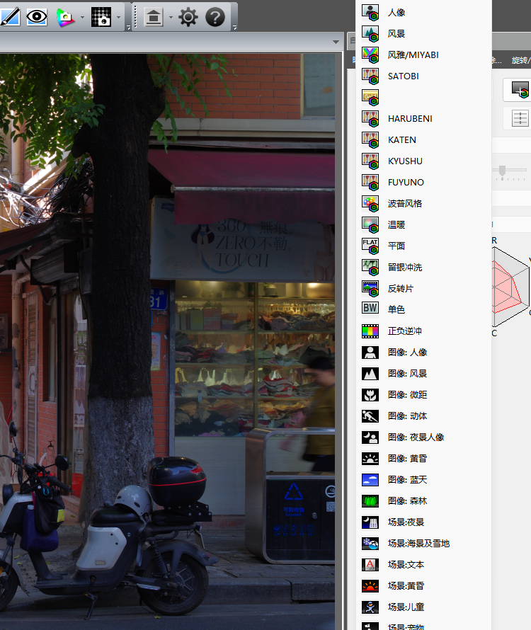

# PENTAX K-30 移植 KF 四季数据实测

日期：2026-10-26（2026-10-27 更新：改为按 K-30 自身 ColorMatrix2 校准）

| 项目 | 文件 |
|---|---|
| 目标 | `sample/K30.DNG`（PENTAX K-30，固件 1.06） |
| 数据来源 | `sample/KF.DNG`（PENTAX KF，固件 1.33） |
| 输出 | `sample/K30_KF_all.DNG` |
| 工具 | `tools/dng_season_params.py --builtin k30` |
| 内置数据 | `tools/season_k30_data.py` |

## 1. 结论

K-30 的私有块里**根本没有** `0x021A`（模式表）和 `0x021B`（3×3 矩阵表）。
所以 K-30 不能像 K-70 那样“在已有表后面追加”，必须先**新建这两个标签**。

工具对 K-30 做了三件事（v1.6 起；矩阵基准在 2026-10-27 改为 K-30 自身 ColorMatrix2）：

1. 在私有 IFD 中新建 `0x021A` / `0x021B` 两个条目；
2. 把 KF 的 4 条四季记录和 4 个矩阵按 K-30 的**大端**私有块重新编码；
3. 按 K-30 自己的 ColorMatrix2（`0xC622`）校准 KF 四季矩阵，保留 KF 四季“相对于本机型基准模式”
   的调色比例。

输出文件大小不变，raw、JPEG 预览和其余私有标签均未改动。

## 2. K-30 的文件结构

| 项目 | K-30 | KF |
|---|---:|---:|
| DNG 字节序 | `MM`（大端） | `II`（小端） |
| 私有块 | 102,400 B | 151,428 B |
| 私有 IFD 条目 | 100 | 119 |
| `0x021A` | **不存在** | 912 B / 34 条 |
| `0x021B` | **不存在** | 490 B / 27 个矩阵 |
| `0x0200` / `0x0201` / `0x0205` | 8 / 8 / 32 B，紧跟 IFD | 同上 |
| 预览 JPEG | 私有 +32,610，长 37,306 B | 私有 +? |

K-30 的 IFD 正好在 100 条 × 12 字节后结束，紧接着就是 `0x0200` 的数据。
新建两个条目需要 24 B，会覆盖 `0x0200`、`0x0201` 和 `0x0205` 的开头。
工具把这三个标签的数据整体搬到预览 JPEG 之后的空闲区（私有 +69,916 起），
再在原位置重建 102 条 IFD，并按标签号排序插入 `0x021A` / `0x021B`。

输出布局：

| 项目 | 位置（文件偏移） | 长度 |
|---|---:|---:|
| `0x021A` | 0x114CA | 132 B（4 条 × 26 B） |
| `0x021B` | 0x1154E | 76 B（4 个 × 18 B） |
| `0x0200` 新位置 | 私有 +69,916 | 8 B |
| `0x0201` 新位置 | 私有 +69,924 | 8 B |
| `0x0205` 新位置 | 私有 +69,932 | 32 B |

四季记录：

| 模式 | 名称 | 矩阵索引 |
|---:|---|---:|
| 29 | HARUBENI | 0 |
| 30 | KATEN | 1 |
| 31 | KYUSHU | 2 |
| 32 | FUYUNO | 3 |

## 3. 颜色校准

K-30 没有 `0x021B` 基准表，但它的 DNG 里有 ColorMatrix2（`0xC622`），
所以用和 K-50 / K-01 完全相同的构造离线校准：

```
T(CM2) = diag(1/(CM2·W))·CM2            W = D65
Y      = T(KF) · inverse(T(K-30))
M(K-30 season) = M(KF season) · Y
```

样本（固件 1.06）的 ColorMatrix2 与 K-3 逐项不同，但很接近：

```
K-30 CM2 = [[ 0.890884 -0.269226 -0.119308]
            [-0.399536  1.230118  0.188065]
            [-0.099106  0.173721  0.660431]]
K-3  CM2 = [[ 0.87117  -0.26328  -0.11667 ]
            [-0.39954   1.23012   0.18806 ]
            [-0.10432   0.18292   0.69543 ]]
```

Y 与旧版（把 K-3 基准当代理）相差 2.2×10⁻⁵，算出的四季矩阵在 36 个 Q13
系数里只有 6 个差 1 个 LSB；`M(KF base)·Y` 量化后仍然正好落在 K-3 基准矩阵
`12512, -4352, 32, …` 上。Y 为：

```
Y = [[ 0.97376321  0.09583067 -0.06959387]
     [-0.00980614  1.06806411 -0.05825798]
     [-0.00513760  0.04111023  0.96402737]]
```

四个校准后的矩阵（Q13，行和 8192，个别行 8193 是取整误差）：

| 季节 | 9 个 int16 |
|---|---|
| HARUBENI | `13423, -2443, -2788, -3285, 16618, -5141, -2227, 2122, 8297` |
| KATEN | `14589, -6269, -128, -1822, 15422, -5407, 1150, -5070, 12112` |
| KYUSHU | `14032, -7692, 1853, 693, 8176, -677, -159, 889, 7462` |
| FUYUNO | `8635, -125, -318, -961, 10524, -1371, 336, 992, 6864` |

`0x021A` 表头的 12 个参数使用 KF/K-1 的同一组
`[1,2,3,4,5,6,7,8,9,10,128,129]`，记录字段按大端 u16 写入。

## 4. PDCU 实测

用原版 PDCU 5.10.2.2 打开 `sample/K30_KF_all.DNG`：

- 相机识别为 **PENTAX K-30**；
- “自定义影像”列表中原有的 鲜明 / 自然 / 人像 / 风景 / 风雅 / SATOBI /
  波普 / 温暖 / 平面 / 留银冲洗 / 反转片 / 单色 / 正负逆冲 保持不变；
- 列表中出现 **HARUBENI / KATEN / KYUSHU / FUYUNO** 四项；
- 四项都能选中，选中后画面会改变。



这里只记录“PDCU 能列出并渲染四项”这一结构事实；具体颜色请直接用 PDCU
打开 `sample/K30_KF_all.DNG` 对比。屏幕预览受缩放、颜色设置和拍摄场景影响，
不适合作为矩阵数值的定量依据。

上面的截图与菜单检查来自 2026-10-26 的旧矩阵；2026-10-27 的新矩阵只动了
6 个 Q13 系数各 1 个 LSB，标签结构完全相同，因此没有重跑 PDCU。

## 5. 完整性校验

对 `sample/K30.DNG` 与 `sample/K30_KF_all.DNG` 逐字节比较：

| 检查 | 结果 |
|---|---|
| 文件大小 | 相同，14,367,772 B |
| DNG 私有块偏移 / 长度 | 相同，0x37E / 102,400 B |
| 私有 IFD 之前的前缀 | 完全相同 |
| 私有 IFD 条目数 | 100 → 102 |
| `0x0200` / `0x0201` / `0x0205` 数据 | 逐字节相同，仅位置变化 |
| 其余私有标签数据 | 逐字节相同 |
| JPEG 预览数据 | 逐字节相同 |
| raw 像素 | 未改动 |
| 私有块之外 | 未改动 |
| 差异字节 | 348 B，全部落在私有块 0x37E..0x1937E 内 |
| 四季矩阵索引 | 29→#0、30→#1、31→#2、32→#3，均在 0..3 内 |

输出 SHA-256：

```
328E52A671C26AA5E8524003E51F78A2F55475AA9665E4C6EECA5EB648A25AEC
```

## 6. 复现

```powershell
# 查看 K-30 原始结构（0x021A/0x021B 会显示 absent）
python tools\dng_season_params.py --target sample\K30.DNG --list

# 生成四季输出
python tools\dng_season_params.py --target sample\K30.DNG --builtin k30 ^
    --out sample\K30_KF_all.DNG --overwrite
```

GUI v1.6 添加 K-30 文件后会自动切换到“内置 KF→K-30 四季参数”，
也可以手动选择。

## 7. 边界

- K-30 没有机内四季数据，本移植是**新建标签 + 色彩空间校准**，不是官方固件功能。
- 校准基准是 K-30 自己的 DNG ColorMatrix2（`0xC622`，见 `sample/K30.DNG`），
  不是 K-3 的代理值；`M(KF base)·Y` 量化后仍正好落回 K-3 基准矩阵，
  Y 与 K-3 版相差 2.2×10⁻⁵，四季矩阵只有 6 个系数差 1 个 LSB。
  如果以后拿到带四季的 K-30 donor，应以该 donor 重新拟合。
- 2026-10-26 的 v1.6 内置表用的是“K-3 基准代理”，本文已改为 K-30 自身
  ColorMatrix2；`PDCU-K3-…`、`PDCU-K3II-…`、`PDCU-K52-…` 三篇对比文档里
  ③ 号方案用的是旧表，与各自精确解的差从 0 变成 ≤1 LSB，排序与结论不变。
- 只改 `0x021A` / `0x021B` 和三个被挤占的小标签的位置，不改 raw、预览、
  `0x021F` 等每张图的数据。
- 雷达图仍按当前照片计算，不同照片形状不同。
- 本文的亮度表来自 PDCU 屏幕预览截图，不是 PDCU 导出的最终 JPEG；
  导出时的渲染设置可能不同。
- K-01 与 K-30 同属“无 0x021A/0x021B、私有块大端”的结构，但 IFD 条目数
  和预览偏移不同；K-01 的单独校准与实测见
  [PDCU-K01-KF四季移植.md](PDCU-K01-KF四季移植.md)。

---

版权所有 © 2026 KimHoLau X deepseek harness
