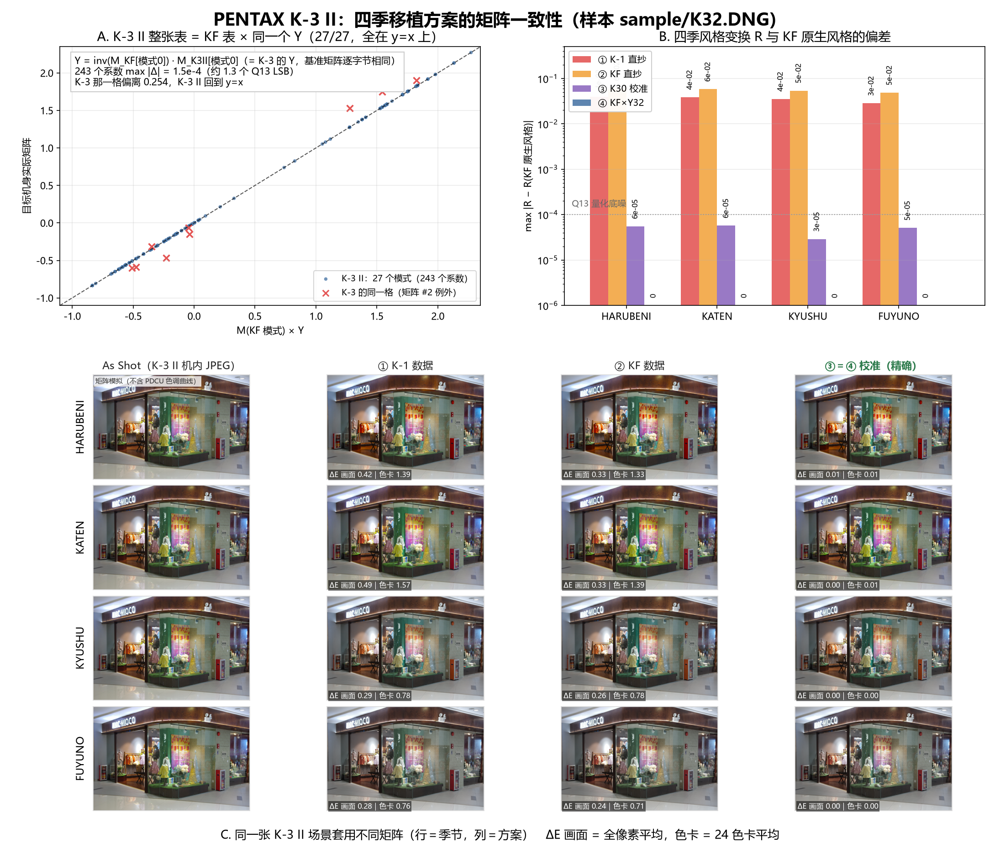

# PENTAX K-3 II 四季移植：三套方案验证

> **补注（2026-10-27 晚）**：`season_k30_data.py` 已改为按 K-30 自身
> ColorMatrix2 校准（见 [PDCU-K30-KF四季移植.md](PDCU-K30-KF四季移植.md)），
> 不再用 K-3 基准代理。因此本文 ③ 号方案用的表有 6 个 Q13 系数与
> 2026-10-27 上午的版本差 1 个 LSB，③ 与精确解从“逐字节相同”变成
> “最多差 1 个 Q13 LSB”；方案排序与结论不变。工具对这些机型实际走的是
> “KF + 运行时按自身 0x021B 校准”。

日期：2026-10-27
样本：`sample/K32.DNG`（PENTAX K-3 II，私有块 151,552 B）
对照：`sample/KF.DNG`、`sample/IMGP0709.DNG`（K-1）、`sample/K3.DNG`（K-3）



---

## 0. 结论

**K-3 II 直接用 ③（KF→K-30 校准值），而且它就是精确解——不需要再单独校准。**

原因很简单：K-3 II 的 `0x021B` 表与 K-3 **只差第 2 号矩阵一格**，基准矩阵 #0
**逐字节相同**，于是

```
Y32 = inv(M_KF[0]) · M_K3II[0]  ≡  Y(K-3)  ≡  season_k30_data.py 里用的那个 Y
```

三条命令/脚本写出来的 ③ 与"专门按 Y32 算"的 ④，**72 字节矩阵完全相同**（差 0.0）。

| 方案 | 矩阵 | R 最大偏差 | 色卡平均 ΔE（四季） | 色卡最大 |
|---|---|---:|---|---:|
| ① K-1 直抄 | K-1 #22–#25 | 4.0×10⁻² | 1.39 / 1.57 / 0.78 / 0.76 | 9.0 |
| ② KF 直抄 | KF #22–#25 | 6.0×10⁻² | 1.33 / 1.39 / 0.78 / 0.71 | 10.0 |
| **③ KF→K30 校准** | KF × Y(K-3) | **6×10⁻⁵** | **0.01 / 0.01 / 0.00 / 0.00** | **0.02** |
| ④ KF×Y32（对照） | KF × Y32 | 0（与 ③ 逐字节同） | 0.00 | 0.00 |

另外一个副产品：**K-3 的第 2 号矩阵偏离规则 0.254，而 K-3 II 的同一格恰好落在
`M_KF[#2] × Y` 上**——这反过来证明了 Y 规则，也说明 K-3 那一格是初代固件的特例，
不是"K-3 世代有另一套风格"。

---

## 1. 结构：与 K-3 同族，且几乎同一张表

| 项目 | K-3 II | K-3 | KF |
|---|---:|---:|---:|
| `0x021A` | 1120 B / 27 条 / 26 B（390 B 填充） | 1120 B / 27 条 | 912 B / 34 条 |
| `0x021B` | 364 B / 20 矩阵 | 364 B / 20 矩阵 | 490 B / 27 矩阵 |
| 字节序 | 小端 | 小端 | 小端 |
| 四季 | 无 | 无 | 有 |

- 27 条模式记录与 KF **逐字节相同**，唯一差异是模式 19 的矩阵索引（10 vs 11）。
- 模式 → 矩阵索引映射与 K-3 完全一致。
- **与 K-3 的 20 个矩阵逐格比较：19 个完全相同，只有 #2 不同（max |Δ| = 0.2535）。**
  K-3 II 的 #2 正是 `M_KF[#2] × Y` 的结果，K-3 的 #2 不是。

四个输出（①②③④）结构完全一致：`0x021A` 834 B / 31 条、`0x021B` 436 B /
24 矩阵、四季 → #20–#23，彼此**只差 72 字节**（`0x2944–0x298B`），改动全部在
私有块内（`0x76A–0x298B`）。

---

## 2. 校准：Y32 与 K-3 的 Y 是同一个

```
Y32 = inv(M_KF[模式0]) · M_K3II[模式0]
    = [ 0.973741   0.095850  -0.069591 ]
      [-0.009796   1.068062  -0.058266 ]
      [-0.005150   0.041113   0.964038 ]
```

- **27/27 个模式、243 个系数：max |Δ| = 1.5×10⁻⁴**（≈1.3 个 Q13 LSB），无例外；
- 最小二乘解与 Y32 差 3.9×10⁻⁵；
- 各模式相对风格 `R` 与 KF 的差全部 ≤9×10⁻⁵。

和 K-3 一样（K-3 是 23/27，有 4 个例外），和 645Z 一样（27/27）——三台机身、三张表，
都落在"同一套风格 + 一次校准"这条线上。

### 2.1 K-3 的例外在 K-3 II 上被"修正"了

| 模式（矩阵 #2） | K-3 | K-3 II |
|---|---:|---:|
| `|M − M_KF·Y|max` | 0.2535 | 1.0×10⁻⁴ |

即：K-3 II 的 0x021B 表 = K-3 的表，**除了** #2 这一格；而这一格在 K-3 II 上回到
规则值。这也解释了为什么 K-3 的分析里那 4 个模式（2/6/11/16）是"例外"：它们都指向
同一格 #2。

---

## 3. 三套方案的误差

### 3.1 风格变换 R 的偏差

| 季节 | ① K-1 | ② KF | ③ K30 校准 | ④ Y32 |
|---|---:|---:|---:|---:|
| HARUBENI | 3.96×10⁻² | 6.05×10⁻² | 6×10⁻⁵ | 0 |
| KATEN | 3.86×10⁻² | 5.81×10⁻² | 6×10⁻⁵ | 0 |
| KYUSHU | 3.53×10⁻² | 5.39×10⁻² | 3×10⁻⁵ | 0 |
| FUYUNO | 2.83×10⁻² | 4.85×10⁻² | 5×10⁻⁵ | 0 |

（Q13 量化底噪 1.2×10⁻⁴）

### 3.2 24 色卡 ΔE（参考 = KF 原生风格）

| 季节 | ① 平均/最大 | ② 平均/最大 | ③ 平均/最大 |
|---|---|---|---|
| HARUBENI | 1.39 / 8.78（purple） | 1.33 / 9.02（purple） | 0.01 / 0.01 |
| KATEN | 1.57 / 9.02（purple） | 1.39 / 9.96（purple） | 0.01 / 0.02 |
| KYUSHU | 0.78 / 2.10（purple） | 0.78 / 2.59（purple） | 0.00 / 0.00 |
| FUYUNO | 0.76 / 2.42（purple） | 0.71 / 2.75（purple） | 0.00 / 0.01 |

### 3.3 K-3 II 样张上的画面 ΔE

基准图用 `sample/K32.DNG` 自带的机内 JPEG 预览（6016×4000，缩到 1200×798），
20,000 像素平均：

| 季节 | ① K-1 | ② KF | ③ K30 |
|---|---:|---:|---:|
| HARUBENI | 0.42 | 0.33 | 0.01 |
| KATEN | 0.49 | 0.33 | 0.00 |
| KYUSHU | 0.29 | 0.26 | 0.00 |
| FUYUNO | 0.28 | 0.24 | 0.00 |

这张样张是商场橱窗（绿色展台、粉/黄服装、暖光），比 K-3 的风景饱和得多，所以直抄
方案的画面差也更大（0.3–0.5 vs K-3 的 0.2–0.3）。**② 的画面与色卡均值都略低于 ①，
但色卡最大偏差反而更大**（9.0 对 8.8）：两者误差方向不同，谁也谈不上更对；③ 才是稳定最优。

---

## 4. 建议

1. **K-3 II 直接内置 ③ 的矩阵即可**，不需要单独写 `season_k3ii_data.py` —— 它的
   校准值就是 `season_k30_data.py` 的数值（写出来逐字节相同）。
   工具侧要做的只是"允许 K-3 II 使用这份数据"：把 K-3 与 K-3 II 一起关联到这份
   校准数据（两台基准矩阵相同），避免用户勾"跨机型"。
   注意 **645Z 不能进这个白名单**——它的基准矩阵与 K-3 不同，需要自己的 Y（见
   `docs/PDCU-645Z-四季三方案对比.md`）。
2. **通用做法仍然推荐**（见 `docs/PDCU-645Z-四季三方案对比.md` §5）：运行时按目标
   `0x021B` 算 `Y = inv(M_donor[0])·M_target[0]`。对 K-3 II 它会算出与 ③ 完全
   相同的矩阵，对 645Z 会算出 ④，一套逻辑覆盖三台。
3. **readme**：K-3 初代与 K-3 II 可以从"其他跨机型实验"挪到正式支持。

测试文件（可直接用 PDCU 打开）：

```
.tmp/K32_k1.DNG     ① K-1 数据
.tmp/K32_kf.DNG     ② KF 数据
.tmp/K32_k30.DNG    ③ KF→K30 校准（推荐，= ④）
.tmp/K32_kfY32.DNG  ④ KF×Y32（与 ③ 的 72 字节矩阵完全相同）
```

---

## 5. 边界与未验证项

- **没有在 PDCU 里实测**（本机未装）。四季是否出现在菜单，是按 `0x021A` 的 29–32
  记录 + 有效矩阵索引判定的。
- **画面基准是机内 JPEG**，不是 PDCU 导出：它同样带相机自己的色调曲线，作为"套用
  矩阵后长什么样"的近似比截图更稳定，但仍不是 PDCU 的渲染结果。
- **ΔE 是矩阵模型**（线性 sRGB → Lab），不含 PDCU 的色调曲线与局部适应。
- **K-3 II 没有官方四季数据**，"正确"只能定义为"与 KF 原生风格一致"。
- ③ 与 ④ 的矩阵按 Q13 取整，和理论值差 ≤6×10⁻⁵（不足 1 个 LSB）。

---

## 6. 复现

| 脚本（`.tmp`） | 作用 |
|---|---|
| `k32_calib.py` | Y32、27/27 单校准检验、逐模式 R |
| `k32_tables.py` | K-3 II 与 K-3 的逐格矩阵对比 |
| `k32_numbers.py` | 四套方案 R 与色卡/画面 ΔE |
| `k32_preview.py` | 提取机内 JPEG 预览 |
| `k32_make.py` | 生成 ④ `.tmp/K32_kfY32.DNG` |
| `k32_check2.py` | 四个输出文件的结构与逐字节校验 |
| `k32_figure.py` | 生成本文插图 |

---

版权所有 © 2026 KimHoLau X deepseek harness
