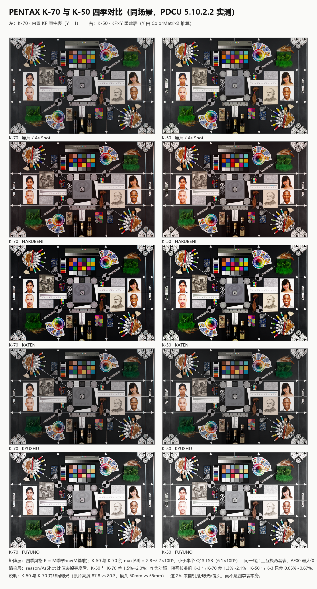
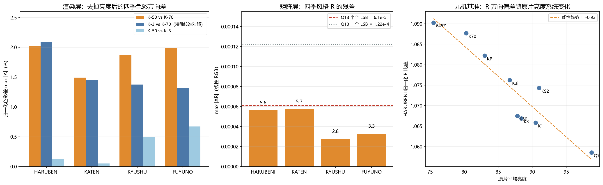

# PDCU K-50 → 四季移植：以 K-70 为基准的水准判定

日期：2026-10-28

样本：`sample/K50.dng`（PENTAX K-50，2013-11-26，50 mm f/5.6 1/40 ISO100，4928×3264）
与 `sample/K70.dng`（PENTAX K-70，2016-08-23，55 mm f/5.6 1/40 ISO100，6000×4000）。
同一张测试场景（ColorChecker + 人像 + 织物/羽毛/酒瓶），但不是同一次拍摄、不是同一支镜头。

渲染：Digital Camera Utility 5 **5.10.2.2**，只切“自定义影像”，不做曝光/白平衡/色彩微调。



## 0. 结论

**达到 K-70 级别。** 这里的“级别”指四季**风格变换**，也就是用户切到
HARUBENI / KATEN / KYUSHU / FUYUNO 时颜色被推向哪里、推多少：

- **矩阵层**：K-50 的四季风格 `R = M季节·inv(M基准)` 与 K-70 的最大差
  **5.7×10⁻⁵**，小于 **半个 Q13 LSB（6.1×10⁻⁵）**；把两套风格作用在同一张
  底片上，ΔE00 中位数 0.0001–0.0025、最大 0.05，远低于可见阈值。
- **渲染层**：同场景实测，K-50 与“精确校准”的 K-3 只差 **0.05%–0.67%**；
  而 K-3 与 K-70 本身差 **1.3%–2.1%**，K-50 与 K-70 差 **1.5%–2.0%**。
  也就是说，K-50 与 K-70 的那 2% 并不是 K-50 的移植误差——它和 K-3（精确表）
  与 K-70 的差同量级，来源是机身/曝光/镜头，不是四季表。
- **无回归**：打补丁前后 K-50 的 As Shot 逐像素完全相同（0 个像素变化），
  raw 条带、预览、文件大小都不变，只改私有块内 347 字节。

**两个限定**（见 §6）：K-50 的表是**推算**，不是官方固件数据；结构上它只有
四季所需的最小集（4 条记录 + 4 个矩阵），不是 K-70 那种完整机内表。

## 1. 两个样本先对齐事实

| | K-70（基准） | K-50（被评判） |
|---|---|---|
| 文件 | sample/K70.dng | sample/K50.dng |
| 分辨率 | 6000×4000 | 4928×3264 |
| 拍摄 | 2016-08-23，55 mm f/5.6 1/40 ISO100 | 2013-11-26，50 mm f/5.6 1/40 ISO100 |
| 镜头 | smc PENTAX-DA* 55mm F1.4 SDM | smc PENTAX-D FA 50mm F2.8 MACRO |
| 原片平均亮度 | 80.3 | 87.8 |
| 私有块字节序 | 小端 | **大端** |
| 原 0x021A / 0x021B | 28 条 / 21 矩阵 | **都没有** |
| 补后 | 32 条 / 25 矩阵 | **4 条 / 4 矩阵（新建）** |
| 四季数据来源 | 内置 KF 原生表，Y = I | KF×Y，Y 由 ColorMatrix2 推算 |

两台不是同曝光：原片亮度差 9%，镜头不同（50 mm vs 55 mm），所以**不能拿
绝对像素直接比**；比较必须走“季节/原片”的比值或矩阵。这一点与
[九机型实测](PDCU-九机型四季实测.md) 一致。

## 2. 复现

```
python tools\dng_season_params.py --target sample\K50.dng --builtin k50 --out .tmp\k50eval\out\K50_all.dng --overwrite
python tools\dng_season_params.py --target sample\K70.dng --builtin kf  --out .tmp\k50eval\out\K70_all.dng --overwrite
python .tmp\k50eval\matrix.py       # 矩阵层：Y、R、残差、色卡 dE
python .tmp\k50eval\verify_struct.py # 结构层：逐字节 diff
python .tmp\k50eval\render_cmp.py    # 渲染层：比值与色差
```

本次生成物（不覆盖原文件）：`.tmp/k50eval/out/K50_all.dng`、`K70_all.dng`。
哈希与九机型实测的记录一致：

    K50_all  D45021DE23B86628A4D3D3E862782C4149C06614AAD07E53017B044CB4F75F1A
    K70_all  5B44C9C1E9970C50928232255F74385FE15841345D8278E47BC77AFE422570D6

## 3. 结构层：K-50 是“重建”，不是“覆盖”

| 检查 | K-50 | K-70 |
|---|---|---|
| 文件大小 | 16,589,474 → 不变 | 33,587,710 → 不变 |
| 私有块外字节 | 逐字节相同 | 逐字节相同 |
| 改动字节 | **347 B**（100 段） | **523 B**（24 段） |
| IFD 条目 | 100 → 102（新增 0x021A/0x021B） | 119 → 119 |
| 记录 / 矩阵 | 0 / 0 → 4 / 4 | 28 / 21 → 32 / 25 |
| 预览、raw 条带 | 不触碰 | 不触碰 |

K-50 的私有块是大端；工具把 `0x0200/0x0201/0x0205` 搬到预览 JPEG 后的空闲区，
按目标实际条目数重建 IFD，再写入大端的四季记录与矩阵。PDCU 打开后状态栏
仍是 `4928×3264 未更改`，EXIF 机型/镜头/曝光完整，菜单列出四项。

## 4. 矩阵层：残差小于半个 LSB

定义与九机型实测相同：

    Y = T(KF) · inv(T(cam))，  T(cam) = diag(1/(CM2·W_D65)) · CM2
    M季节 = M_KF季节 · Y
    R = M季节 · inv(M基准)     ← 用户看到的“季节味道”

注意一个容易误读的点：因为基准和季节矩阵同乘 Y，**R 对 Y 不敏感**
（`(S·Y)·(B·Y)⁻¹ = S·B⁻¹`）。所以矩阵残差只证明“四季风格的形状”与 K-70
一致；Y 本身准不准，决定的是四季的**绝对颜色**是否落在 K-50 自己的色彩空间里。
Y 的准确性由 §5 的同场景渲染（与精确校准的 K-3 差 ≤0.67%）和 3.65×10⁻⁵ 的
Y 旁证共同保证。

| 季节 | K-50 vs K-70 的 maxΔR | 折合 Q13 |
|---|---:|---:|
| HARUBENI (29) | 5.62×10⁻⁵ | 0.46 LSB |
| KATEN (30) | 5.73×10⁻⁵ | 0.47 LSB |
| KYUSHU (31) | 2.75×10⁻⁵ | 0.23 LSB |
| FUYUNO (32) | 3.28×10⁻⁵ | 0.27 LSB |

Q13 半个 LSB = 6.10×10⁻⁵，一个 LSB = 1.22×10⁻⁴。四项全部 < 半个 LSB。

> K-50 没有基准矩阵块，表中的 R 按 Y 反推出的基准 `MKF·Y` 计算；这与 PDCU
> 实际渲染的关系由 §5 的同场景实测比值独立复核。

K-50 由 CM2 推出来的 Y 与 K-3 由 0x021B 基准算出的 Y 只差 **3.65×10⁻⁵**。
四季记录的前 11 个参数（除矩阵块指针外）与 KF 逐字段相同——所以菜单里的
锐度/饱和度等模式参数也没有被改动。

把两套风格（R 矩阵，作用在线性 RGB 上）分别作用到**同一张底片**的 As Shot
像素上，K-50 与 K-70 的输出色差：

| 季节 | ΔE00 中位数 | ΔE00 p99 | ΔE00 最大 |
|---|---:|---:|---:|
| HARUBENI | 0.0022 | 0.0044 | 0.047 |
| KATEN | 0.0025 | 0.0076 | 0.039 |
| KYUSHU | 0.0001 | 0.0010 | 0.005 |
| FUYUNO | 0.0001 | 0.0022 | 0.006 |

矩阵模型下的 ColorChecker ΔE（D65）也同量级：K-50 平均 0.001–0.007、
最大 0.017；K-70 平均 0.0003、最大 0.0017。两者都远小于 1。

## 5. 渲染层：K-50 与“精确表”的 K-3 几乎重合

同一台机器、同一 PDCU 5.10.2.2，逐文件打开后抓图像画布（1326×869），比较

    ratio(season) = mean_rgb(season) / mean_rgb(As Shot)

| 季节 | K-70 比值 R/G/B | K-50 比值 R/G/B |
|---|---|---|
| HARUBENI | 1.0269 / 0.9118 / 0.8936 | 1.0424 / 0.9435 / 0.9436 |
| KATEN | 0.9251 / 0.9036 / 0.8920 | 0.9457 / 0.9381 / 0.9388 |
| KYUSHU | 0.8981 / 0.8965 / 0.8999 | 0.9160 / 0.9196 / 0.9465 |
| FUYUNO | 1.2285 / 1.2378 / 1.2606 | 1.2438 / 1.2628 / 1.3195 |

绝对比值含机身亮度差。把比值向量按亮度归一，只留“色彩方向”，再算跨机身
最大差（本次重渲染 K-50 / K-70 / K-3）：

| 季节 | K-50 vs K-70 | **K-3 vs K-70**（精确校准对照） | **K-50 vs K-3** |
|---|---:|---:|---:|
| HARUBENI | 2.02% | 2.08% | **0.13%** |
| KATEN | 1.49% | 1.45% | **0.05%** |
| KYUSHU | 1.87% | 1.37% | **0.49%** |
| FUYUNO | 1.99% | 1.32% | **0.67%** |

K-3 是有 0x021B 基准、按机身精确校准的机型（风格残差 5.7×10⁻⁵），可以当作
“如果 K-50 也有精确表会是什么样”的同曝光参照。**K-50 与 K-3 的差只有
0.05%–0.67%，而 K-3 与 K-70 的差本身就有 1.3%–2.1%**——这说明 K-50 与 K-70
那 2% 的差不是 K-50 移植表带来的，而是机身/曝光/镜头层面的。

九机基准也支持这个归因：HARUBENI 的归一化 R 比值与原片亮度线性相关
**r = −0.93**（原片越亮，R 方向越收敛）。K-50（87.8）与 K-3（88.4）落在
同一条线上几乎重合，K-70（80.3）在另一端。



### 5.1 季节之间的区分仍然成立

四个季节的方向与九机型实测一致，K-50 没有“四季都一样”的退化：

- HARUBENI：提亮、偏暖（R↑，G/B↓）；
- KATEN：偏暖黄、略压暗；
- KYUSHU：压暗、偏冷、低饱和；
- FUYUNO：明显提亮、去饱和偏冷（高调）。

K-50 各季节相对 As Shot 的平均像素差为 5.5 / 14.1 / 8.2 / 23.8（K-70 为
9.2 / 18.3 / 8.6 / 20.7），四个季节都明显区别于原片。

## 6. 与 K-70 的真实差距：数据来源，不是效果

1. **K-70 是原生表，K-50 是推算表。** K-70 的 21 个基础矩阵与 KF 逐字节相同，
   Y = I，四季矩阵就是 KF 原值；K-50 没有 0x021A/0x021B，Y 由它自己的
   ColorMatrix2 反推。可信度来自三重旁证（Y 与 K-3 差 3.65×10⁻⁵、渲染与 K-3
   差 ≤0.67%、写出的矩阵与 K-30 内置值差 ≤1 LSB），但它**不是官方 K-50
   固件数据**。若将来出现 K-50 官方四季样本，应以官方为准复核。
2. **结构是最小集。** K-70 私有块 119 条、0x021A 32 条、0x021B 25 个矩阵；
   K-50 只有 102 条、4 条、4 个矩阵，且**没有基准矩阵块**。PDCU 的 As Shot
   走它自己的 K-50 路径（打补丁前后逐像素相同），四季走 4 个矩阵——功能完整，
   但不是“把 K-70 的整张表搬过去”。
3. **按图像自带的数据没动。** 例如 0x021F，K-70 有 2048 B、K-50 只有 21 B，
   工具不补也不改；雷达/场景相关的东西仍按 K-50 自己的文件走。
4. **只验证了 PDCU 5.10.2.2。** Lightroom / Capture One / dcraw 不读 Pentax
   四季，未测。

## 7. 判定

| 维度 | 判定 |
|---|---|
| 菜单能否列出四季 | ✅ 能，四项齐全 |
| 四季能否渲染 | ✅ 能，四个季节互相区分且方向正确 |
| 四季风格是否等同 K-70 | ✅ maxΔR 5.7×10⁻⁵（< 半个 LSB），同底片 ΔE00 < 0.05 |
| 端到端是否等同“精确表”机身 | ✅ 与 K-3 差 0.05%–0.67% |
| As Shot 是否被改坏 | ✅ 逐像素相同 |
| 文件/raw/预览是否被改坏 | ✅ 私有块外零改动 |
| 数据是否官方 K-50 数据 | ❌ 推算值（高置信度，但不是固件原表） |
| 结构是否等同 K-70 完整表 | ❌ 最小集（4 记录 + 4 矩阵，无基准块） |

**一句话：效果层面达到 K-70 级别；数据层面是“高置信度推算 + 最小结构”，
不是 K-70 那种官方原生表。**

## 8. 附：K-30 与 K-50 是同一级别吗

**是，而且几乎是同一张表。** 两台都走“无 0x021A/0x021B → 大端重建 IFD →
4 条记录 + 4 个矩阵 → 各自 ColorMatrix2 校准”的同一条路径，置信档也相同
（都是推算，不是官方固件数据）。

四季矩阵共 36 个 Q13 系数，**33 个完全相同，3 个差 1 个 LSB**：

| 季节 | 位置 | K-30 | K-50 |
|---|---|---:|---:|
| HARUBENI | 第 9 个 | 8297 | 8296 |
| KATEN | 第 8 个 | −5070 | −5069 |
| KYUSHU | 第 1 个 | 14032 | 14031 |

其他对照：

| 项目 | 数值 |
|---|---|
| 隐含基准矩阵（9 个 int） | 完全相同，都量化到 K-3 基准 12512, −4352, 32, … |
| Y 差（K-30 vs K-50） | 3.23×10⁻⁵ |
| Y 与 K-3 的差 | K-30 **2.19×10⁻⁵**，K-50 3.65×10⁻⁵ |
| 风格 R 的最大差 | 9.5×10⁻⁵（0.78 个 Q13 LSB） |
| 同一底片上 K-30 表 vs K-50 表的 ΔE76 | 中位数 ≤0.0022，最大 0.2（KATEN 极暗/高光点），FUYUNO 逐像素相同 |
| 结构改动 | K-30 348 B，K-50 347 B；都是 102 条目、4 记录、4 矩阵 |

两台这么接近的原因：`sample/K30.DNG` 与 `sample/K50.dng` 的 ColorMatrix2
只差一个整体行缩放（第一行 1.0326×，第二行相同，第三行差 0.14%），而
T(CM2) = diag(1/(CM2·W))·CM2 的 D65 归一化把这个缩放消掉，所以 Y 只差
3×10⁻⁵ 量级。

**差别在证据强度，不在效果：**

- K-50 有同场景 ColorChecker 的九机实测、与 K-3 的渲染对照（0.05%–0.67%）、
  以及 As Shot 逐像素不变的回归验证。
- K-30 的样本是街景，没有同场景定量色差；本次只用当前 v2.1 表重新渲染确认
  PDCU 能列出四项、四项都能渲染且互相区分（相对原片平均差 7.1 / 15.5 /
  10.8 / 32.4），没有做逐色块 ΔE。
- 但 K-30 的 Y 离 K-3 更近、矩阵与 K-50 只差 1 个 LSB，所以**没有理由把
  K-30 排在 K-50 之下**；K-50 的矩阵层结论可以外推到 K-30。

限定与 §6 相同：两者都不是官方数据；在各自机身上，绝对颜色仍受机身色彩空间
影响。这里的“同一级别”指四季**风格变换**，不是“两台机身出片完全一样”。

---

版权所有 © 2026 KimHoLau X deepseek harness