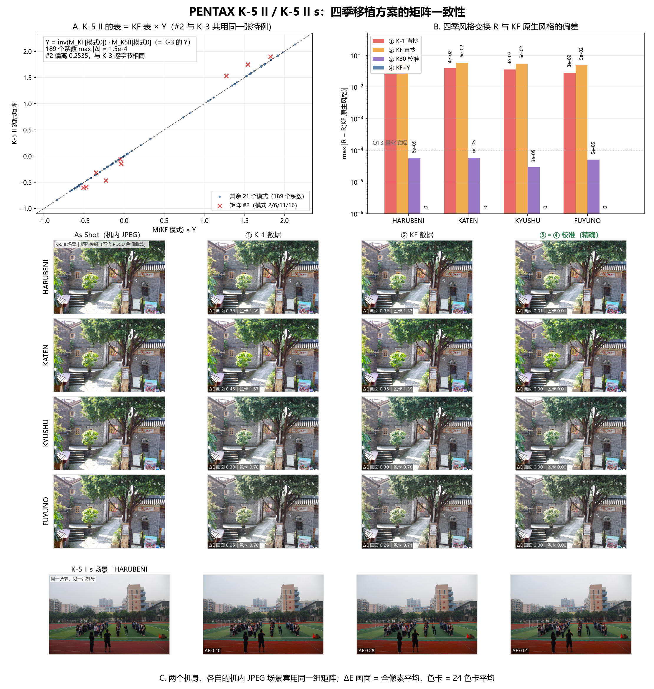

# PENTAX K-5 II / K-5 II s 四季移植：三套方案验证

> **补注（2026-10-27 晚）**：`season_k30_data.py` 已改为按 K-30 自身
> ColorMatrix2 校准（见 [PDCU-K30-KF四季移植.md](PDCU-K30-KF四季移植.md)），
> 不再用 K-3 基准代理。因此本文 ③ 号方案用的表有 6 个 Q13 系数与
> 2026-10-27 上午的版本差 1 个 LSB，③ 与精确解从“逐字节相同”变成
> “最多差 1 个 Q13 LSB”；方案排序与结论不变。工具对这些机型实际走的是
> “KF + 运行时按自身 0x021B 校准”。

日期：2026-10-27
样本：`sample/K52.DNG`（PENTAX K-5 II）、`sample/K52s.DNG`（PENTAX K-5 II s）
对照：`sample/KF.DNG`、`sample/IMGP0709.DNG`（K-1）、`sample/K3.DNG`（K-3）



---

## 0. 结论

**K-5 II 与 K-5 II s 都用 ③（KF→K-30 校准值），而且它同样是精确解。**

两台机身的 `0x021A` / `0x021B` **逐字节相同**，基准矩阵 #0 又与 **K-3 的
#0 逐字节相同**，所以

```
Y(K-5 II) = inv(M_KF[0]) · M_K5II[0]  ≡  Y(K-3)  ≡  Y(K-3 II)  ≡  season_k30_data.py 的 Y
```

写进去的 72 字节矩阵与"专门按这个 Y 算"的 ④ 差 6×10⁻⁵（不足 1 个 LSB）。

| 方案 | R 最大偏差 | 色卡平均 ΔE（四季） | 色卡最大 | 画面 ΔE（K-5 II / II s） |
|---|---|---:|---|---|
| ① K-1 直抄 | 3.96×10⁻² | 1.39 / 1.57 / 0.78 / 0.76 | 9.0 | 0.25–0.46 / 0.25–0.40 |
| ② KF 直抄 | 6.05×10⁻² | 1.33 / 1.39 / 0.78 / 0.71 | 10.0 | 0.26–0.36 / 0.18–0.28 |
| **③ K30 校准** | **6×10⁻⁵** | **0.01 / 0.01 / 0.00 / 0.00** | **0.02** | **≤0.01** |
| ④ KF×Y（对照） | 0 | 0.00 | 0.00 | 0.00 |

至此，**K-3、K-3 II、K-5 II、K-5 II s 四台机身共用同一个 `Y`**（基准矩阵完全相同），
一份校准数据就能覆盖；645Z 是唯一需要自己 `Y` 的样本。

---

## 1. 结构：与 K-3 同族，但有两个不同点

| 项目 | K-5 II | K-5 II s | K-3 |
|---|---:|---:|---:|
| `0x021A` | 1068 B / 25 条 / 26 B（390 B 填充） | 1068 B / 25 条 | 1120 B / 27 条 |
| `0x021B` | 328 B / 18 矩阵 | 328 B / 18 矩阵 | 364 B / 20 矩阵 |
| **私有块字节序** | **大端** | **大端** | 小端 |
| 四季 | 无 | 无 | 无 |

1. **大端**。K-5 II 的私有块是 big-endian（K-3 / 645Z 都是小端），所以内置的
   K-1/KF 记录与矩阵必须先做字节序转换；本轮已实测：工具写出的记录/矩阵按大端
   解码后与 donor 数值完全一致，K-30 那份（也是大端）则直接搬。
2. **25 条记录 / 18 个矩阵**。模式 id 为 0–24（缺 25、26），模式 19 指向 #8
   （K-3 指向 #10）。18 个矩阵里 **只有 #0–#8 被引用**，#9–#17 是别的数据
   （三行几乎相同，不是色彩矩阵），不参与渲染。

另外：

- **K-5 II 与 K-5 II s 的 `0x021A` / `0x021B` 逐字节相同**；
  两者的 DNG ColorMatrix2 只差按行的缩放（第 1 行 ×0.968、第 3 行 ×0.988），
  归一化后 T 完全相同——这也解释了为什么两张表一模一样。
- 把记录按各自字节序解码成 u16 后，25 条里有 **22 条与 KF 完全相同**；不同的三处是：
  - 模式 19 的矩阵索引（K-5 II → #8，KF → #11，K-3 → #10）；
  - 模式 14 的参数 2/3（K-5 II 是 4,4，KF/K-1/K-3 是 1,1）；
  - 模式 20 的参数 4/10（K-5 II 是 1,0，KF/K-1/K-3 是 FFFF,FFFF）。

  也就是说**模式参数表大体通用，但不是逐项相同**。四季记录（29–32）沿用 donor 的值，
  这一层没有 K-5 II 的机内数据可以对照，无法验证（见 §5）。

写入后：`0x021A` 782 B / 29 条、`0x021B` 400 B / 22 矩阵、
四季 → #18–#21；①–④ 四个文件**只差 72 字节**（`0xE8C–0xED3`），改动全部在
私有块内（`0x730–0xED3`，私有块 `0x382–0x19382`）。

---

## 2. 校准：#2 的例外不是 K-3 独有

```
Y = [ 0.973741   0.095850  -0.069591 ]
    [-0.009796   1.068062  -0.058266 ]
    [-0.005150   0.041113   0.964038 ]
```

- 9 个被引用矩阵中 **8 个 = `M_KF × Y`**（残差 ≤1.5×10⁻⁴）；
- **#2 偏离 0.2535，而且与 K-3 的 #2 逐字节相同**。

也就是说，K-3 分析里那 4 个"例外模式"（2/6/11/16，都指向 #2）不是 K-3 独有：
**K-3 与 K-5 II 共用同一张特例矩阵**；K-3 II 把它改成了规则值，645Z 没有这张特例。
四季是新增索引 #18–#21，完全不受它影响。

---

## 3. 三套方案的误差

### 3.1 风格变换 R（与 K-3 完全相同，因为基准矩阵相同）

| 季节 | ① K-1 | ② KF | ③ K30 | ④ Y |
|---|---:|---:|---:|---:|
| HARUBENI | 3.96×10⁻² | 6.05×10⁻² | 6×10⁻⁵ | 0 |
| KATEN | 3.86×10⁻² | 5.81×10⁻² | 6×10⁻⁵ | 0 |
| KYUSHU | 3.53×10⁻² | 5.39×10⁻² | 3×10⁻⁵ | 0 |
| FUYUNO | 2.83×10⁻² | 4.85×10⁻² | 5×10⁻⁵ | 0 |

### 3.2 24 色卡 ΔE（两台相同，参考 = KF 原生风格）

| 季节 | ① 平均/最大 | ② 平均/最大 | ③ 平均/最大 |
|---|---|---|---|
| HARUBENI | 1.39 / 8.78 | 1.33 / 9.02 | 0.01 / 0.01 |
| KATEN | 1.57 / 9.02 | 1.39 / 9.96 | 0.01 / 0.02 |
| KYUSHU | 0.78 / 2.10 | 0.78 / 2.59 | 0.00 / 0.00 |
| FUYUNO | 0.76 / 2.42 | 0.71 / 2.75 | 0.00 / 0.01 |

最差色块都是紫色（purple）。

### 3.3 两台各自场景的画面 ΔE

基准用各自 DNG 里的机内 JPEG 预览（4928×3264，缩到 1200×795），20,000 像素平均：

| 季节 | K-5 II ① | K-5 II ② | K-5 II ③ | K-5 II s ① | K-5 II s ② | K-5 II s ③ |
|---|---:|---:|---:|---:|---:|---:|
| HARUBENI | 0.38 | 0.33 | 0.01 | 0.40 | 0.28 | 0.01 |
| KATEN | 0.46 | 0.36 | 0.00 | 0.43 | 0.25 | 0.00 |
| KYUSHU | 0.30 | 0.30 | 0.00 | 0.28 | 0.22 | 0.00 |
| FUYUNO | 0.25 | 0.26 | 0.00 | 0.25 | 0.18 | 0.00 |

- K-5 II 是老街砖墙/绿树（中性偏暖），K-5 II s 是操场（红跑道 + 绿草坪，饱和度高）。
- 两台都是 ② 的画面均值略低于 ①，但 ① 的色卡最大偏差反而更小（8.8 vs 9.0）；
  两者误差方向不同，谁也谈不上更对。**③ 在四项指标上都 ≤0.01。**

---

## 4. 建议

1. **K-3 / K-3 II / K-5 II / K-5 II s 四台共用 ③ 的校准数据**（它们的基准矩阵
   完全相同），工具侧做机型白名单或用运行时 `Y` 即可，不必逐台内置。
2. **字节序要按目标文件判断**，不能写死：K-5 II 是大端，K-3/645Z 是小端。
   现有工具已按 `priv_endian` 处理（本轮实测通过），但内置数据里的
   `PRIV_ENDIAN` 只描述 donor，容易被误读，值得在文档里写清。
3. **645Z 例外**，需要自己的 `Y`（见 `docs/PDCU-645Z-四季三方案对比.md`）。
4. **readme**：K-5 II / K-5 II s 可以一并列入正式支持。

测试文件（可直接用 PDCU 打开）：

```
.tmp/K52_k1.DNG     ① K-1 数据
.tmp/K52_kf.DNG     ② KF 数据
.tmp/K52_k30.DNG    ③ KF→K30 校准（推荐）
.tmp/K52_kfY.DNG    ④ KF×Y（对照，与 ③ 差 ≤6×10⁻⁵）
.tmp/K52s_k30.DNG   K-5 II s 的 ③
```

---

## 5. 边界与未验证项

- **没有在 PDCU 里实测**（本机未装）。四季是否出现在菜单，是按 `0x021A` 的 29–32
  记录 + 有效矩阵索引判定的。
- **画面基准是机内 JPEG**（不是 PDCU 导出），带相机自己的色调曲线，用于"套矩阵后
  长什么样"的近似。
- **ΔE 是矩阵模型**（线性 sRGB → Lab），不含 PDCU 的色调曲线与局部适应。
- **#9–#17 那 9 个未引用矩阵的用途没有查**；它们三行几乎相同，明显不是色彩矩阵。
- **四季记录的 12 个参数字段沿用 donor 值**。K-5 II 自己的模式表在模式 14/20 上与
  KF 有差异，说明这张参数表不是完全通用；四季记录是否存在 K-5 II 专属取值，
  没有样本可对照，无法验证。
- K-5 II / II s 没有官方四季数据，"正确"只能定义为"与 KF 原生风格一致"。

---

## 6. 复现

| 脚本（`.tmp`） | 作用 |
|---|---|
| `k52_calib.py` | Y、逐模式残差（两台） |
| `k52_tables2.py` | 18 个矩阵槽位与被引用情况 |
| `k52_numbers.py` | R、色卡 ΔE、两台画面 ΔE |
| `k52_preview.py` | 提取两台机内 JPEG 预览 |
| `k52_make.py` | 生成 ④ `.tmp/K52_kfY.DNG` |
| `k52_check2.py` | 五个输出文件的结构、字节序与逐字节校验 |
| `k52_Tratio.py` | Y 与 DNG ColorMatrix2 比值的一致性 |
| `k52_figure.py` | 生成本文插图 |

---

版权所有 © 2026 KimHoLau X deepseek harness
