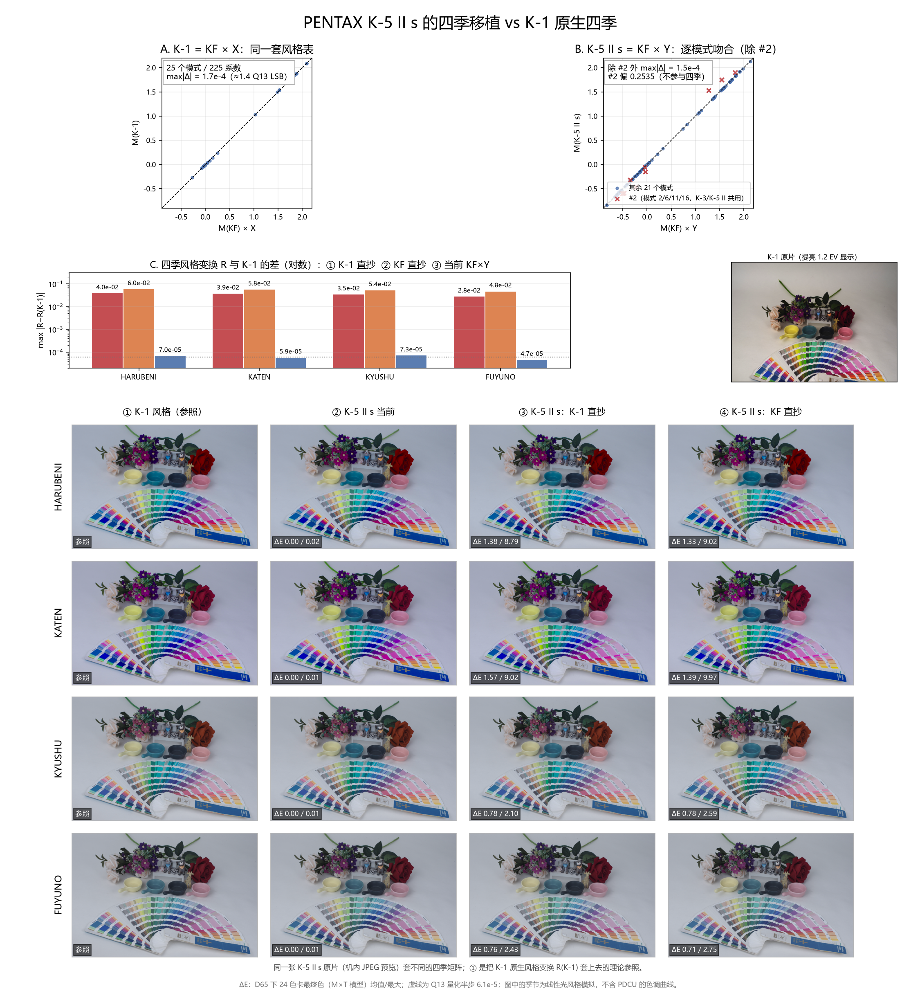
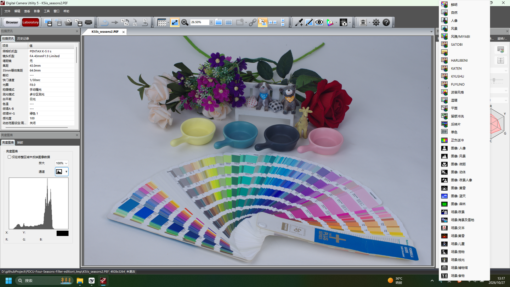
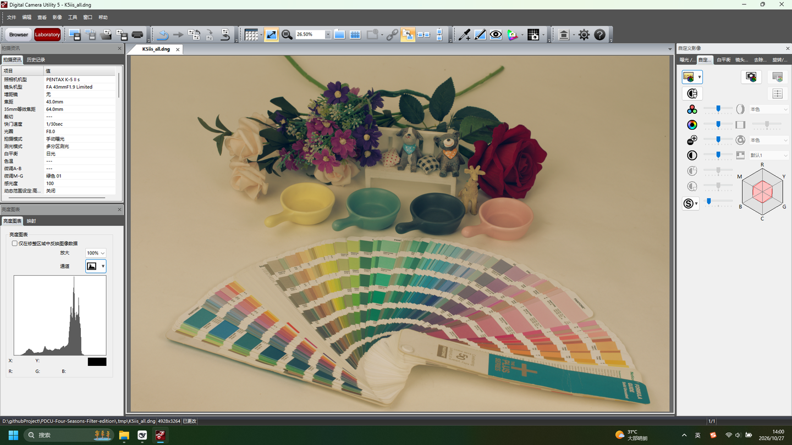

# PENTAX K-5 II s 四季移植 vs K-1 原生四季

日期：2026-10-27

样本：

- `sample/K5iis.dng`（PENTAX K-5 II s，DCU 5.10.2 另存 DNG，**原本无四季**）
- `sample/K5iis_all.dng`（本次补好的 K-5 II s 四季 DNG，PDCU 实测可用）
- `sample/K1.DNG`（PENTAX K-1，机内原生四季）
- 当前移植文件：`.tmp/K5iis_seasons2.PEF`（K-5 II s + KF→K-5 II s 四季）
- 对照：`sample/KF.DNG`、`sample/K52s.DNG`、`.tmp/n_K52s_kf.DNG`（工具 v1.8 输出）



---

## 0. 结论

**是。当前 K-5 II s 的四季（`M = M_KF × Y`）是这几条方案里离 K-1 原生四季最近的一条，而且已经到上限。**

- 风格变换 `R = M季节 · inv(M基准)` 与 K-1 的差：**≤ 7.3×10⁻⁵**，
  与 Q13 量化半步（6.1×10⁻⁵）同量级，仍小于 1 个 LSB（1.22×10⁻⁴）。
- 24 色卡最终色 ΔE（D65）：**平均 ≤0.004，最大 0.02**；A 光源下最大 0.04。
  0.02 已经在可见阈值以下。
- 直接照抄 K-1 矩阵：R 差 **2.8–4.0×10⁻²**，色卡平均 ΔE **0.76–1.57**、最大 **8.8–9.0**。
- 直接照抄 KF 矩阵：R 差 **4.8–6.1×10⁻²**，色卡最大 ΔE **9.97**。
- 用 K-1 当 donor 再按同一 Y 校准（对照 ④）：与当前同级（≤0.01 ΔE）。

也就是说，**决定“像不像 K-1”的是有没有乘 Y，而不是选 KF 还是 K-1 当 donor**。
当前实现已经乘了 Y，所以它和“专门拿 K-1 数据再校准”在数值上是同一档。

两个必须说明的前提：

1. **`sample/K5iis.dng` 原本没有四季，但可以补。** 它是 DCU 另存的 DNG，MakerNote
   里只有 25 条模式记录 / 18 个矩阵；补丁后生成 `sample/K5iis_all.dng`（29 条 /
   22 矩阵，EXIF MakerNote 路径），PDCU 5.10.2.2 已实测能列出并应用四季。做法见 §2.1。
2. **K-1 的四季是机内原生数据。** `K1.DNG` 的 `0x021A` 与 `sample/KF.DNG`
   逐字节相同，矩阵满足 `M(K-1) = M(KF)·X`；它不是被补进去的四季，而是参照本身。

---

## 1. 两张样本里到底有什么

| 项目 | `K1.DNG` | `K5iis.dng` | `K5iis_all.dng`（本次） | 当前 PEF |
|---|---|---|---|---|
| 机型 | PENTAX K-1 | PENTAX K-5 II s | PENTAX K-5 II s | PENTAX K-5 II s |
| 写入者 | `PENTAX K-1 Ver. 2.50`（机内） | `Digital Camera Utility 5 Ver.5.10.2` | 本补丁 | 工具补丁 |
| `0x021A` | 912 B / 34 条 / 26 B | 1068 B / 25 条（390 B 填充） | 782 B / 29 条 | 1068 B / 29 条 |
| `0x021B` | 490 B / 27 矩阵 | 328 B / 18 矩阵 | 400 B / 22 矩阵 | 400 B / 22 矩阵 |
| 四季 | 29–32 → #22–25 | **无** | 29–32 → #18–21 | 29–32 → #18–21 |
| 私有块位置 | `0xC634`（160,692 B） | EXIF MakerNote `0x927C`（34,696 B） | EXIF MakerNote `0x927C` | PEF MakerNote |

文件 SHA-256：

```
K1.DNG              203147275F930C92CD059F410F821031330F3FCFF6C72B832A72D81A26D6B418
K5iis.dng           A5A11BC1A3207D6460F2F47354D105B3256F891EE778DAEB5FD54DAF03D0CB7A
K5iis_all.dng       211D97592D783E19C0FDAE2B6C6F92483B481E3C02EDCBCB401BA54F636A4EFA
K5iis_seasons2.PEF  7CE2AB62CD5266EA095EEBA472EED55C737B21A257DBA6B8FB7D7A5124275CE1
n_K52s_kf.DNG       D71DC31721A0E3DDE7DB956426728ABDE0061D6A7CEEBE5E4B63987769CD6F7E
```

### 1.1 K-1 与 KF 是同一套风格表

`K1.DNG` 与 `sample/KF.DNG` 的整张 `0x021A` 表 SHA-256 都是：

```
d06eb14e5f1481d6c7df962c808f97d1419c45b4d8979d3b7c22e752eb64b5fe
```

两台各 27 个矩阵，满足 `M(K-1) = M(KF) · X`，其中

```
X = inv(M_KF[0]) · M_K-1[0]
  = [ 0.92936   0.12628  -0.05564 ]
    [-0.02710   1.05002  -0.02293 ]
    [-0.00940   0.03456   0.97484 ]
```

取 25 个共有模式、225 个系数比较，**max|Δ| = 1.7×10⁻⁴**。这就是“同一风格、按机身校准”的
关系，不是近似调色。

### 1.2 K-5 II s 的基准表

`K5iis.dng` 的 18 个矩阵与 `sample/K52s.DNG` **逐字节相同**（max diff = 0），
`0x021A` 的 25 条记录也相同（只有 390 B 填充区不同）。所以 K52s 上算出的 Y
对这张 K-5 II s 完全适用。

25 个模式里，除 #2 的四个模式（2/6/11/16）外，其余 21 个模式满足
`M(K-5 II s) = M(KF)·Y`，**max|Δ| = 1.5×10⁻⁴，median 1.2×10⁻⁴**。
#2 偏离 0.2535，与 K-3 的 #2 逐字节相同，是这两台机身共用的一张特例矩阵；
四季使用新增的 #18–#21，不经过 #2，所以不受影响。

```
Y = inv(M_KF[0]) · M_K-5[0]
  = [ 0.97374   0.09585  -0.06959 ]
    [-0.00980   1.06806  -0.05827 ]
    [-0.00515   0.04111   0.96404 ]
```

---

## 2. 当前 K-5 II s 的四季数据

`.tmp/K5iis_seasons2.PEF` 的 MakerNote 里：

- `0x021A`：nParams=12，nRecords=29（原 25 + 四季 4）；
- `0x021B`：count=22（原 18 + 四季矩阵 4）；
- 29/HARUBENI → #18，30/KATEN → #19，31/KYUSHU → #20，32/FUYUNO → #21。

逐字节校验：

| 检查 | 结果 |
|---|---|
| PEF 矩阵 #0–17 vs `sample/K52s.DNG` | 完全一致（max diff 0） |
| PEF 矩阵 #18–21 vs `n_K52s_kf.DNG` #18–21 | 完全一致（max diff 0） |
| `n_K52s_kf.DNG` 四季矩阵 vs `M_KF·Y` | max 5.9×10⁻⁵（量化级） |
| 四季记录 12 个参数 vs K-1/KF 记录 | 相同，只有矩阵索引 22–25 → 18–21 |

PDCU 5.10.2.2 打开这个 PEF 后，自定义影像菜单出现 HARUBENI / KATEN / KYUSHU /
FUYUNO 四项，说明 PDCU 按追加的 22 号矩阵表解析。



### 2.1 `K5iis.dng` → 四季 DNG：可以补，已实测

v1.8 会拒绝这张 DNG，是因为它把 Pentax MakerNote 放在 EXIF `0x927C`，而不是
`0xC634`。MakerNote 的内部结构其实与相机 DNG 相同：97 个条目，`0x021A`
1068 B / 25 条，`0x021B` 328 B / 18 矩阵。补丁做法：

1. `0x021A` 的记录区是 28 + 25×26 = 678 B，标签里还有 390 B 填充；把 4 条四季
   记录写到第 25–28 条（文件偏移 4412），`nRecords` 改成 29，标签长度改成 782；
2. 新建 22 矩阵表（4 + 22×18 = 400 B），放在 4412 + 104 = 4516；`0x021B`
   条目改成 count=400、offset=4516；
3. 记录与矩阵从 PEF 补丁复制（大端，索引 18–21），所以数值与 PEF 版完全相同。

文件大小不变（18,901,811 B），只改了 494 字节。产物：
`sample/K5iis_all.dng`，SHA-256 `211D9759…`。PDCU 5.10.2.2 打开后：

- 自定义影像菜单出现 HARUBENI / KATEN / KYUSHU / FUYUNO；
- 选 HARUBENI 是官方金色图标 + 金色调画面，选 FUYUNO 是去饱和/偏冷的画面；
- 说明追加的 #18–#21 矩阵确实被读取并参与渲染。




v1.9 起这条路径已并入工具：`Dng` 会识别 EXIF `0x927C`、绝对偏移、`0x021A`
变长和 `0x021B` 重定位；GUI 选中文件后按机身校准，直接写出 `_all` DNG。
上面的手工补丁与 v1.9 工具输出**逐字节相同**（SHA-256 `211D9759…`）。
`0x021A` 标签长度被缩到精确值 782 B，PDCU 5.10.2.2 接受，其它软件未逐一测试。

---

## 3. 为什么“直抄”反而不像

比较两台机身的四季，不能直接比矩阵数值，因为矩阵是写在**各自相机的输入色彩空间**里的。
把“相对本机型基准”的部分抽出来：

```
R = M季节 · inv(M基准)
```

R 才是“这个季节把颜色往哪儿推”的定义。最终颜色则可以写成
`M季节 · T机身`，其中 T 是 DNG ColorMatrix 加白平衡归一化后的输入变换。
于是：

- **K-1 直抄**：R' = M_K1 · inv(M_K5)，不是 R(K-1)。它把 K-1 的输入校准
  套在 K-5 的传感器上，颜色整体偏；最终色也不等于 K-1 的最终色。
- **KF 直抄**：同理，而且 K-5 与 KF 的 Y 更大（最大 0.096，K-1→K-5 只有 0.046），
  所以偏得更多。
- **正确写法**：`M_K5季节 = M_K1季节 · inv(M_K1基准) · M_K5基准`。
  这就是当前实现乘的 Y。

Y 不是拟合出来的经验值。它同时等于两台机身的 DNG 输入变换比：

```
Y ≈ T(KF) · inv(T(K-5 II s))
```

D65 下差 **1.6×10⁻⁵**，A 光源下差 **2.5×10⁻³**。这说明 Pentax 的 `0x021B`
表就是“同一套风格表 × 一次机身输入校准”，所以这个校准式是结构性的，不是碰巧。

---

## 4. 数值对比

### 4.1 风格变换 R（max|R − R(K-1)|）

| 季节 | ① K-1 直抄 | ② KF 直抄 | **③ 当前 KF×Y** | ④ K-1×Y |
|---|---:|---:|---:|---:|
| HARUBENI | 3.96×10⁻² | 6.05×10⁻² | **7.0×10⁻⁵** | 0 |
| KATEN | 3.86×10⁻² | 5.81×10⁻² | **5.9×10⁻⁵** | 0 |
| KYUSHU | 3.52×10⁻² | 5.40×10⁻² | **7.3×10⁻⁵** | 0 |
| FUYUNO | 2.83×10⁻² | 4.85×10⁻² | **4.7×10⁻⁵** | 0 |

④ 是“拿 K-1 当 donor、再按 `Y1 = inv(M_K1[0])·M_K5[0]` 校准”的对照，
用来证明校准之后 donor 是 K-1 还是 KF 没有区别。

### 4.2 24 色卡最终色 ΔE（D65，平均 / 最大）

| 季节 | ① K-1 直抄 | ② KF 直抄 | **③ 当前** | ④ K-1×Y |
|---|---|---|---|---|
| HARUBENI | 1.38 / 8.79 | 1.33 / 9.02 | **0.00 / 0.02** | 0.00 / 0.00 |
| KATEN | 1.57 / 9.02 | 1.39 / 9.97 | **0.00 / 0.01** | 0.00 / 0.00 |
| KYUSHU | 0.78 / 2.10 | 0.78 / 2.59 | **0.00 / 0.01** | 0.00 / 0.00 |
| FUYUNO | 0.76 / 2.43 | 0.71 / 2.75 | **0.00 / 0.01** | 0.00 / 0.00 |

A 光源下同一张表的最大值：

| 季节 | ① | ② | **③** | ④ |
|---|---:|---:|---:|---:|
| HARUBENI | 13.30 | 13.02 | **0.03** | 0.03 |
| KATEN | 17.04 | 17.36 | **0.04** | 0.04 |
| KYUSHU | 5.13 | 6.39 | **0.01** | 0.01 |
| FUYUNO | 6.15 | 7.02 | **0.00** | 0.01 |

### 4.3 画面 ΔE（同一张 K-5 II s 原片，风格模型）

| 季节 | ① K-1 直抄（均值/P95） | ② KF 直抄 | **③ 当前** |
|---|---|---|---|
| HARUBENI | 0.67 / 1.71 | 0.60 / 1.99 | **0.00 / 0.00** |
| KATEN | 0.75 / 1.75 | 0.64 / 2.00 | **0.00 / 0.00** |
| KYUSHU | 0.40 / 1.23 | 0.41 / 1.54 | **0.00 / 0.00** |
| FUYUNO | 0.41 / 1.28 | 0.41 / 1.71 | **0.00 / 0.00** |

排序在所有指标上一致：

```
③ 当前 ≈ ④ K-1×Y  ≪  ① K-1 直抄  <  ② KF 直抄
```

---

## 5. 四个容易踩的点

1. **“K-1 直抄”听起来最像 K-1，实际不是。** 矩阵带着机身的输入校准；
   直接搬等于把 K-1 的输入空间套到 K-5 上。R 差 3–4×10⁻²，色卡最大 9 ΔE。
2. **KF 直抄更远。** K-5 II s 与 KF 的基准差（Y 最大 0.096）比与 K-1 的差
   （0.046）大，所以“不校准直接搬 KF”比搬 K-1 还偏。
3. **#2 是特例，不是误差。** K-5 II s 的 #2 与 K-3 的 #2 逐字节相同，
   服务模式 2/6/11/16；四季用 #18–#21，不经过它。所以“逐模式吻合”要写
   “除 #2 外”。
4. **量化级。** Q13 的 1 个 LSB 是 1.22×10⁻⁴；当前 R 差 4.7–7.3×10⁻⁵，
   在 Q13 半步 6.1×10⁻⁵ 上下，仍小于 1 个 LSB。色卡最大 0.02 ΔE 也已经低于可见阈值。

---

## 6. 实践建议

1. **现在有两个可用的四季载体。** `sample/K5iis_all.dng`（DNG 形态，v1.9 工具输出，
   与手工补丁逐字节相同）和 `.tmp/K5iis_seasons2.PEF`（PEF 形态）；两边写入的
   四季矩阵逐字节相同。
2. **`sample/K5iis.dng` 本身没有四季，但 v1.9 可以直接补。** `--list` 会正常
   读出 25 条 / 18 矩阵，并提示缺 29–32；直接加文件或运行 CLI 即可生成
   `K5iis_all.dng`（§2.1），不需要再手工改 MakerNote。
3. **v1.9 已把 EXIF MakerNote 分支固化。** `Dng` 识别 `0x927C`、绝对偏移、
   `0x021A` 变长和 `0x021B` 重定位；GUI/CLI 不需要额外选项。
4. **DCU 另存不能当“保存四季”。** 这张源 DNG 是 DCU 另存的，四季没有留下来
   （25 条 / 18 矩阵），IFD0 的 DateTime 也被改成了另存时间 13:24:14；
   原始拍摄时间在 EXIF `0x9003`。补好的 `K5iis_all.dng` 若再经 DCU 另存，
   四季是否保留没有测。
5. **不需要 K-1 当 donor。** KF 数据 + Y 已经和“K-1 数据 + Y”同级；
   当前内置 KF 数据的路径没问题。

---

## 7. 复现

| 脚本（`.tmp`） | 作用 |
|---|---|
| `tools/dng_season_params.py` | v1.9 主工具：`--target sample\K5iis.dng --builtin kf --out sample\K5iis_all.dng` |
| `k1k5_numbers.py` | 读三台机身的矩阵，算 Y、风格 R、色卡 ΔE（D65/A）、画面 ΔE |
| `k1k5_figure.py` | 生成本文插图 |
| `s13_checks.py` | PEF 逐字节校验（#0–17、#18–21、四季记录参数） |
| `s10_dngmn.py` | 解析 `K5iis.dng` 的 EXIF MakerNote，确认 25 条 / 18 矩阵 |
| `s16_mnlayout.py` | 解析 MakerNote 的条目布局与空闲区 |
| `patch_dng_mn.py` | 给 `K5iis.dng` 的 MakerNote 补四季，生成 `sample/K5iis_all.dng` |
| `s17_verify.py` | 校验补丁后的记录/矩阵与逐字节差异 |
| `s2_style.py` | 纯矩阵层面的风格对比（早期版本） |

---

## 8. 边界与未验证项

- **ΔE 是简化模型**：`M季节 · T机身`，没有 PDCU 的色调曲线、局部适应、
  锐化/降噪。色卡的 0.02 是“矩阵层”的差，不等于逐像素渲染的差。
- **画面 ΔE 是把 R 套在机内 JPEG 上**，线性化后再编码；高光裁剪、JPEG 压缩、
  曝光归一都会带来误差。K-1 预览比 K-5 II s 暗约 1.2 EV，图里只做了显示归一。
- **没有用 PDCU 批量导出四季图做像素级对比**；只在 PDCU 5.10.2.2 里目视确认了
  菜单、HARUBENI（金色）和 FUYUNO（去饱和/偏冷）的实际渲染。
- **DNG 补丁只在这一张样本、PDCU 5.10.2.2 上验证。** v1.9 工具路径与手工补丁
  输出逐字节相同；`0x021A` 长度从 1068 B 缩到 782 B；PDCU 接受，其它软件
  （Lightroom / Capture One）通常本来就不读 Pentax 四季，未逐一测试。
- **没有验证 PDCU 对 22 矩阵表的所有边界**：只验证了这四项能显示、能改变画面；
  矩阵表追加在 PEF 空闲区（`0x8CA0`）和 DNG MakerNote（4516）是否在所有
  PDCU 版本都稳定，没有逐个版本测。
- **K-5 II s 的 #9–#17 不是色彩矩阵**（与 K-3 文档一致，三行几乎相同），
  不参与比较；四季只用 #18–#21。
- **K-1 的机内 JPEG 预览不是 PDCU 渲染**；如果 K-1 拍摄时选了别的自定义影像，
  预览会带那层基础色调，本文只把 R 当作相对变化套上去。

---

版权所有 © 2026 KimHoLau X deepseek harness