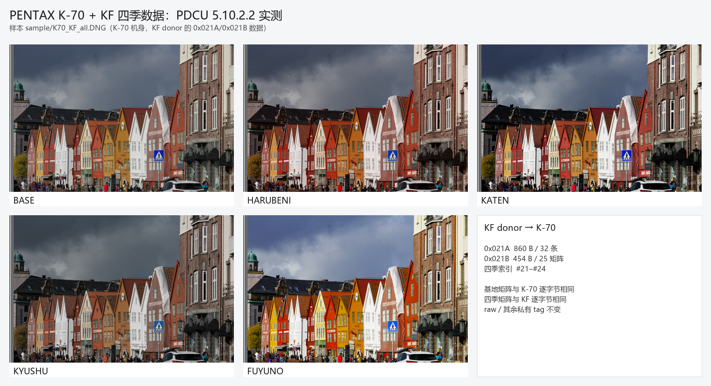

# PENTAX K-70 移植 KF 四季数据实测

日期：2026-10-26

| 项目 | 文件 |
|---|---|
| 目标 | `sample/K70.DNG`（PENTAX K-70，Ver. 1.16） |
| Donor | `sample/KF.DNG`（PENTAX KF，Ver. 1.33） |
| 输出 | `sample/K70_KF_all.DNG` |
| 工具 | `tools/dng_season_params.py` |

## 1. 命令

```powershell
python tools\dng_season_params.py --target sample\K70.DNG --donor sample\KF.DNG ^
    --out sample\K70_KF_all.DNG --allow-cross-model --overwrite
```

工具会打印：

```
WARNING: camera model mismatch: target 'PENTAX K-70', donor 'PENTAX KF'
WARNING: UniqueCameraModel mismatch: 'PENTAX K-70' vs 'PENTAX KF'
```

对 KF → K-70 这一对，这个警告是**保守提示**：两台机器的 `0x021B` 前 21 个基础矩阵
逐字节相同，KF 的四季矩阵就是在同一套 K-70 色彩引擎上校准的。详见
[`PDCU-KF四季差异分析.md`](PDCU-KF四季差异分析.md)。

GUI v1.4 起已经内置 KF 四季数据，K-70 用户可以直接选“内置 KF 四季参数
（适用于 PENTAX KF / K-70）”，不需要准备 donor 文件，也不需要勾选跨机型复选框。
添加 K-70 文件后，GUI 会自动识别机型并切换到内置 KF。

## 2. 输出结构

| 项目 | 原始 K70.DNG | 输出 K70_KF_all.DNG |
|---|---:|---:|
| 文件大小 | 31,600,349 B | 31,600,349 B |
| `0x021A` | 1146 B / 28 条（含 390 B 保留） | 860 B / 32 条 |
| `0x021B` | 382 B / 21 个矩阵（0xFF2） | 454 B / 25 个矩阵（0xED2） |
| 四季 | 无 | 29→#21、30→#22、31→#23、32→#24 |

输出的四季记录来自 KF，矩阵也来自 KF；因为 K-70 的 `0x021B` 只有 21 个槽位，
工具把 KF 的 #22–#25 重映射到 K-70 的 #21–#24。

## 3. 完整性校验

对原始 `sample/K70.DNG` 与输出 `sample/K70_KF_all.DNG` 做逐字节比较：

| 检查 | 结果 |
|---|---|
| 文件大小 | 相同（31,600,349 B） |
| 私有块之前的前缀 | 完全相同（SHA-256 前缀一致） |
| 私有块之后的 31,448,259 B | 完全相同（SHA-256 一致） |
| raw 数据（offset 0x256E0 起） | 完全相同，SHA-256 `6e783f0c…6e22ed` |
| 私有 tag 变化 | 只有 `0x021A`、`0x021B` |
| `0x021B` #0–#20 | 与原始 K-70 逐字节相同 |
| `0x021B` #21–#24 | 与 KF 的 #22–#25 逐字节相同 |
| 四季记录 | 除矩阵索引外与 KF 的记录逐字节相同 |
| 所有模式索引 | 都在 25 个矩阵范围内 |

输出文件 SHA-256：

```
21641B6B8CFA8B3CE673071E78D37B69701EE9A75D8ED6B0FD5848F8A4F6E026
```

## 4. PDCU 实测

用原版 **PDCU 5.10.2.2** 打开 `sample/K70_KF_all.DNG`：

- 相机识别为 **PENTAX K-70**；
- “自定义影像”下拉列表中出现了 **HARUBENI / KATEN / KYUSHU / FUYUNO**；
- 四项都能正常渲染，画面有明显区别；
- 原始 `K70.DNG` 不出现这四项。

实拍对比（同一张照片，PDCU 5.10.2.2 直接截图）：



| 模式 | 与 BASE 的平均差 /255 | 观感 |
|---|---:|---|
| HARUBENI | 7.74 | 轻微偏暖、提亮，变化最小 |
| KATEN | 12.94 | 明显偏暖黄，红/橙更饱和 |
| KYUSHU | 9.93 | 压暗、偏冷/低饱和，红蓝对比更强 |
| FUYUNO | 24.52 | 明显高调、提亮，偏冷 |

这四组数值与 K-3 初代用 K-1 donor 的跨机型试验在同一量级，但原因不同：
K-3 的偏色来自基础矩阵不匹配；K-70 这里的基础矩阵与 KF 完全相同，画面变化就是
KF 四季本身的风格。判断是否“正确”应看矩阵是否等价，而不是看与 BASE 的平均差。

## 5. 注意

- 源文件 `sample/K70.DNG` 没有被修改；输出是独立文件。
- 只改 `0x021A` 季节记录和 `0x021B` 3×3 矩阵，不改 raw、preview 或每张图自己的
  `0x021F` 数据。
- 雷达图仍按当前照片计算，不同照片不会得到完全相同的形状。
- 工具默认会拒绝跨机型；本次使用 `--allow-cross-model`。对 KF → K-70 这一对，
  基础矩阵逐字节相同，属于“跨机型但颜色精确等价”的特例；其他机型不要直接套用。
- 如果以后要把这个特例做进 GUI，建议按“基础 21 个矩阵是否相同”判断，而不是只看
  机型字符串。

---

版权所有 © 2026 KimHoLau X deepseek harness
