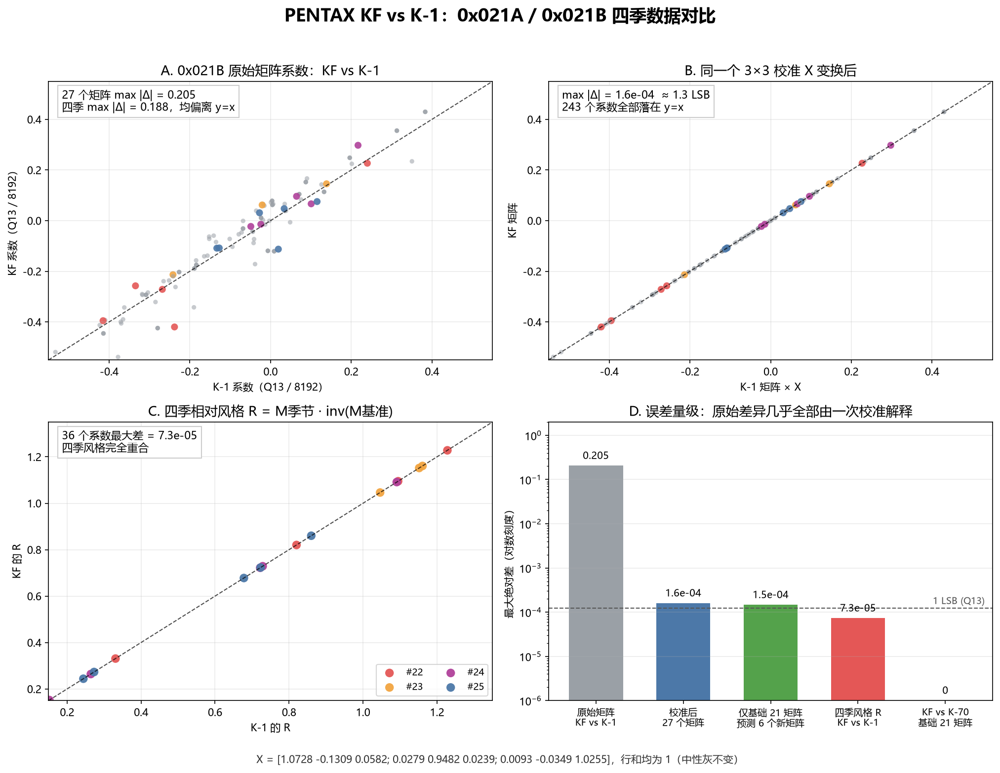

# PENTAX KF 四季自定义影像数据对比分析

日期：2026-10-26

样本：

- 分析对象：`sample/KF.DNG`（PENTAX KF，固件 Ver. 1.33）
- 对照机型：`sample/IMGP0709.DNG`（K-1，Ver. 2.50，原生四季）
- 对照机型：`sample/K70.DNG`（K-70，Ver. 1.16，无机内四季）
- 对照机型：`sample/IMGP4929.DNG`（K-3 初代）、`sample/IMGP2674.DNG`（645Z）

## 0. 结论

**KF 的四季与 K-1 是同一套风格，不是另一套四季；差异只在机型色彩校准层，而且这层差异已经被 KF 的矩阵精确抵消。**

具体证据：

1. `KF.DNG` 原生带齐四季，不需要补丁：
   - `0x021A` 912 B，nRecords=34，26 B/条；
   - `0x021B` 490 B，27 个 18 B 的 3×3 矩阵；
   - 29/HARUBENI → #22，30/KATEN → #23，31/KYUSHU → #24，32/FUYUNO → #25。
2. KF 的整个 `0x021A` 表与 K-1 **逐字节相同**（912 B 的 SHA-256 都是
   `d06eb14e5f1481d6c7df962c808f97d1419c45b4d8979d3b7c22e752eb64b5fe`）。
   34 条模式记录（含四季、28 和 33）全部一致。
3. KF 的 `0x021B` 27 个矩阵与 K-1 的原始数值全部不同，但存在一个固定的
   3×3 校准 X，使 `M(KF) = M(K-1) · X` 对全部 27 个矩阵成立：
   243 个系数最大误差 **1.6×10⁻⁴**（约 1.3 个 Q13 LSB）。
4. X 正好等于两台相机 DNG 色彩矩阵 + 白平衡后的输入校准之比
   `T(K-1) · inv(T(KF))`（D65 下最大差 2.5×10⁻⁵）。因此同一场景的最终颜色
   也几乎相同：四季的最终 ΔE 在 D65 下最大 **0.014**，在 A 光源下最大 **0.55**，
   都低于可见阈值。
5. 四季相对本机型基准模式的风格变换 `R = M季节 · inv(M基准)` 在 KF 与 K-1 上
   最大差 **7.3×10⁻⁵**，四条季节曲线完全重合。
6. KF 的前 21 个矩阵与 K-70 **逐字节相同**；KF 比 K-70 多 6 条记录 / 6 个矩阵
   （模式 28、29–32、33）。所以从数据看 KF 是“K-70 色彩引擎 + K-1 扩展模式表”的实现，
   而且矩阵按 KF 校准过；它不像用旧工具把 K-1 矩阵直接拷进去的结果。

因此，如果问“KF 的四季和之前机型有没有差异”：

- **风格定义：没有差异。** KF 与 K-1 的四季记录、相对风格完全一致，最终颜色在
  模型估算下也一致。
- **原始矩阵数值：有差异。** 但这是 KF/K-70 传感器与 K-1 的输入色彩空间差异，
  不是四季特有的调色差异；同一差异也存在于两者的普通自定义影像模式之间。
- **与 K-3 初代 / 645Z 的跨机型补丁不是一回事。** 那两台没有原生四季，套用
  K-1 矩阵只是近似；KF 是原生、且矩阵已按 KF 校准过。



## 1. 文件结构

`KF.DNG` 是标准 Pentax DNG：

| 项目 | KF | K-1 | K-70 |
|---|---:|---:|---:|
| 机型 | PENTAX KF | PENTAX K-1 | PENTAX K-70 |
| 固件 | 1.33 | 2.50 | 1.16 |
| 私有块 | 151,428 B | 160,692 B | 151,164 B |
| `0x021A` 长度 | 912 B | 912 B | 1146 B（含 390 B 保留） |
| `0x021A` nRecords | 34 | 34 | 28 |
| `0x021A` 记录大小 | 26 B | 26 B | 26 B |
| `0x021B` 长度 | 490 B | 490 B | 382 B |
| `0x021B` 矩阵数 | 27 | 27 | 21 |
| 四季 | 有 | 有 | 无 |

KF 的 `0x021A` 尺寸和 34 条记录与 K-1 完全一致，不是 K-70 的 1146 B
带填充布局；这也支持“KF 使用 K-1 的扩展模式表布局”的判断。

## 2. 0x021A：与 K-1 逐字节相同

34 条记录的 id 和 26 字节内容全部相同，包括：

| 模式 | 名称 | 矩阵索引 | 记录（hex） |
|---:|---|---:|---|
| 28 | （扩展模式） | 21 | `1c000100020001000100ffffffff000000000000ffff15000000` |
| 29 | HARUBENI | 22 | `1d00010002000300ffffffffffff00000000feff040016000000` |
| 30 | KATEN | 23 | `1e000100080004000100ffffffff00000300fdffffff17000000` |
| 31 | KYUSHU | 24 | `1f000100040001000100ffffffffffff0000ffffffff18000000` |
| 32 | FUYUNO | 25 | `20000100080004000100ffffffff0300fcff0400ffff19000000` |
| 33 | （扩展模式） | 26 | `21000100010005000100ffffffff000000000000ffff1a000000` |

整张表的 SHA-256：

```
KF  : d06eb14e5f1481d6c7df962c808f97d1419c45b4d8979d3b7c22e752eb64b5fe
K-1 : d06eb14e5f1481d6c7df962c808f97d1419c45b4d8979d3b7c22e752eb64b5fe
```

每条记录的 12 个 u16 参数也逐字节相同（本次没有逐项解码其含义），因此四季的
“非颜色参数”没有机型差异。

## 3. 0x021B：原始矩阵不同，但只差一次校准

矩阵是 9 个 int16，按 Q13（行和 8192）解释。KF 与 K-1 的 27 个矩阵逐项比较：

| 矩阵 | 对应 | 原始 max\|Δ\| |
|---:|---|---:|
| #22 | HARUBENI | 0.1819 |
| #23 | KATEN | 0.1880 |
| #24 | KYUSHU | 0.1790 |
| #25 | FUYUNO | 0.1320 |
| 全部 27 个 | — | 0.2053 |

但用最小二乘拟合一个 3×3 的 X，使 `M(KF) ≈ M(K-1) · X`，得到：

```
X = [ 1.0728  -0.1309   0.0582
      0.0279   0.9482   0.0239
      0.0093  -0.0349   1.0255 ]
```

- 27 个矩阵、243 个系数，最大残差 **1.59×10⁻⁴**，RMS 5×10⁻⁵；
- X 的三行行和都等于 1，说明它不改变中性灰/白平衡，只改变颜色混合；
- 只用前 21 个“非四季”矩阵拟合 X，再预测 #21–#26 六个新矩阵，最大误差仍是
  **1.46×10⁻⁴**。也就是说，四季矩阵不是单独手调的，而是从同一套 K-1 风格表
  经同一个校准推导出来的。

## 4. X 就是两台相机的输入色彩校准之比

用 DNG 的 ColorMatrix2（D65）和白平衡构造相机输入变换：

```
T = diag(1 / (CM2 · W_D65)) · CM2
```

其中 W_D65 = (0.95047, 1, 1.08883)。计算 `T(K-1) · inv(T(KF))`，与上面拟合的 X
最大只差 **2.5×10⁻⁵**；用 ColorMatrix1（A 光源）时最大差 2.4×10⁻³。

把 `M(KF) = M(K-1)·X` 和 `X ≈ T(K-1)·inv(T(KF))` 代入：

```
M(KF)·T(KF) ≈ M(K-1)·T(K-1)
```

即：**同一场景经过两台相机各自的输入校准后，四季矩阵给出的最终颜色几乎相同。**
用 24 色 ColorChecker 的 XYZ 值估算：

| 季节 | 原始矩阵 max\|Δ\| | 风格 R max\|Δ\| | 最终 ΔE max（D65） | 最终 ΔE max（A） |
|---|---:|---:|---:|---:|
| HARUBENI | 0.1819 | 7.0×10⁻⁵ | 0.014 | 0.425 |
| KATEN | 0.1880 | 5.9×10⁻⁵ | 0.011 | 0.550 |
| KYUSHU | 0.1790 | 7.3×10⁻⁵ | 0.010 | 0.179 |
| FUYUNO | 0.1320 | 4.7×10⁻⁵ | 0.007 | 0.183 |

ΔE 按“输出线性 RGB → XYZ → Lab”的简化模型估算，不是 PDCU 的逐像素渲染；
但 0.01–0.5 的量级远低于可见阈值，足以说明差异不是风格差异。

## 5. 四季相对风格：完全重合

定义 `R = M季节 · inv(M基准)`，其中基准取矩阵 #0（模式 0）。KF 与 K-1 的 R：

| 季节 | KF/K-1 的 R（两者在 7.3×10⁻⁵ 内一致） |
|---|---|
| HARUBENI | `[[1.095, 0.123, -0.218], [-0.090, 1.228, -0.138], [-0.151, 0.331, 0.820]]` |
| KATEN | `[[1.152, -0.109, -0.043], [0.019, 1.161, -0.180], [0.054, -0.100, 1.046]]` |
| KYUSHU | `[[1.091, -0.200, 0.109], [0.152, 0.722, 0.126], [0.007, 0.264, 0.729]]` |
| FUYUNO | `[[0.723, 0.244, 0.033], [0.040, 0.860, 0.100], [0.049, 0.273, 0.678]]` |

这四条就是四季在“相对于本机型基准模式”意义上的颜色签名；KF 与 K-1 完全相同。
其中 HARUBENI/KATEN 偏暖，KYUSHU 压绿、偏红/品红，FUYUNO 降红、提绿蓝，与项目
此前对四季的观感描述一致。

## 6. 与其他机型的关系

| 机型 | 0x021A 记录 | 0x021B 矩阵 | 原生四季 | 与 KF 的关系 |
|---|---:|---:|---|---|
| **KF** | 34 | 27 | 有 | — |
| K-1 | 34 | 27 | 有 | 0x021A 逐字节相同；矩阵相差一个 X；最终颜色一致 |
| K-70 | 28 | 21 | 无 | 前 21 个矩阵与 KF 逐字节相同；KF 多 6 条扩展模式 |
| K-3 初代 | 27 | 20 | 无 | 基础矩阵不同；K-1 donor 只能近似 |
| 645Z | 27 | 20 | 无 | 基础矩阵不同；K-1 donor 明显偏白/偏色 |

### 6.1 KF 与 K-70：矩阵层面是精确等价，不是近似

KF 的 #0–#20 与 K-70 的 21 个矩阵逐字节相同（max diff = 0）。KF 只是在后面
追加了 #21–#26 六个矩阵，对应模式 28、29–32、33。

因此把 KF 的四季记录/矩阵移植到 K-70：

- 四季矩阵与 KF 完全相同；
- 只会把索引从 #22–#25 重映射到 K-70 的 #21–#24；
- KF 与 K-70 的输入变换 T 最大只差 4.5×10⁻⁵，用同一组模式矩阵估算的最终
  ΔE 最大约 **0.001**。

也就是说，**KF 是 K-70 四季移植的精确 donor**；K-1 不是（K-1 与 K-70 的基础
矩阵不同，跨机型会偏色）。当前工具默认按机型字符串拒绝 KF→K-70，这是保守策略；
从矩阵数据看，这一对跨机型是安全的。

实测生成（源文件未改，输出为独立文件）：

```powershell
python tools\dng_season_params.py --target sample\K70.DNG --donor sample\KF.DNG ^
    --out sample\K70_KF_all.DNG --allow-cross-model --overwrite
```

输出 `0x021A` 860 B / 32 条，`0x021B` 454 B / 25 个矩阵；四季记录齐全，
四季矩阵与 KF 的 #22–#25 逐字节相同。原版 PDCU 5.10.2.2 打开后能看到并渲染
HARUBENI / KATEN / KYUSHU / FUYUNO 四项。完整实测、逐字节校验和对比图见
[`PDCU-K70-KF四季移植.md`](PDCU-K70-KF四季移植.md)。

## 7. 对工具的实际含义

1. **`sample/KF.DNG` 不需要补丁。**
   `python tools\dng_season_params.py --target sample\KF.DNG --list` 会显示
   `missing: none`。
2. **KF 不能用来“证明”K-1 donor 的跨机型颜色是对的。** KF 的矩阵已经按 KF/K-70
   校准过；把 K-1 矩阵直接写进 K-3/645Z 仍然会偏色。
3. **如果目标是给 K-70 加四季，KF 是比 K-1 更好的 donor。** 矩阵层面精确等价；
   工具 v1.4 已把 KF 四季数据内置为“内置 KF 四季参数”，并自动识别 KF / K-70
   这一对（日志写“基础矩阵相同，按精确移植处理”），不再需要 `--allow-cross-model`。
4. **如果目标是判断某台新机型是否原生支持四季**，先看 `0x021A` 是否有 29–32：
   - 有 34 条且与 K-1 表相同 → 原生四季，矩阵应按该机型校准；
   - 只有 28 条/27 条 → 没有四季，需要 donor；
   - 有四季但矩阵不符合 `M = M(K-1)·X` → 可能是第三方补丁或特殊版本，需要单独核对。

## 8. 复现

查看表：

```powershell
python tools\dng_season_params.py --target sample\KF.DNG --list
```

本次分析使用的脚本（均在 `.tmp`，只读样本）：

- `.tmp/kf_compare.py`：逐条记录/逐矩阵对比 KF 与 K-1；
- `.tmp/kf_calib2.py`：最小二乘拟合 X，验证 27 个矩阵；
- `.tmp/kf_style.py`：计算四季 R 并比较；
- `.tmp/kf_final_color2.py`：用 DNG ColorMatrix + 白平衡估算最终 ΔE；
- `.tmp/kf_figure.py`：生成本文插图。

## 9. 边界与未验证项

- **没有在 PDCU 里逐项点选四季并导出对比图。** 本文的颜色一致性是矩阵/DNG
  色彩模型的推算；文件结构上四项齐全，按 PDCU 既有的 `0x021A` 判定逻辑会列出。
- **雷达图形状不能跨照片直接比较。** 雷达图按当前照片的颜色计算；本文比较的是
  季节记录和矩阵，不是某张照片的雷达形状。
- **没有比较 `0x021F` 等每张图自己的相机数据。** 这些数据影响单张照片的影调/
  白平衡，不改变四季的定义。
- **K-3 Mark III 未纳入。** 本次样本没有 K-3 III 的 DNG；其 15,031 B donor
  规则见 README，不能直接套用到 KF。
- **最终 ΔE 是简化模型。** 真实 PDCU 管线可能还有色调曲线、局部适应等步骤；
  但 `X ≈ T(K-1)·inv(T(KF))` 的 10⁻⁵ 级吻合不太可能是巧合，足以支持“同一风格、
  按机型校准”的结论。

---

版权所有 © 2026 KimHoLau X deepseek harness
