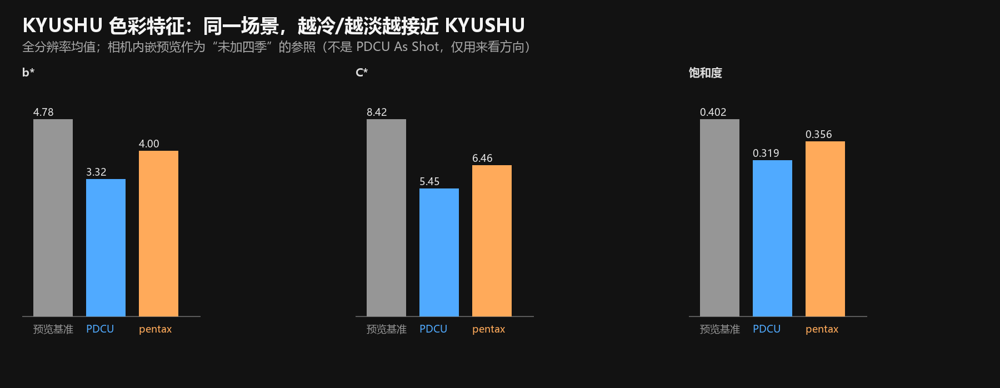
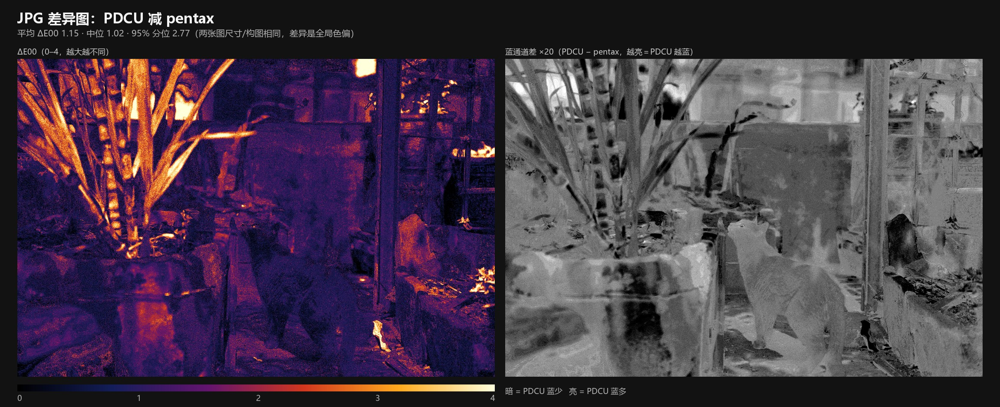

# PENTAX K-1 KYUSHU 四季文件对照判定

日期：2026-10-29

| 项目 | 内容 |
|---|---|
| 基准 | K-1 机内 KYUSHU（`PDCU测试素材/四季滤镜实拍测试/SMC用脚本拍摄的四季滤镜/IMGP0709.DNG`） |
| 对比 A | `sample/compare/PDCU-Season-Params.DNG` + `PDCU-Season-Params_KYUSHU.jpg` |
| 对比 B | `sample/compare/pentax_seasons.DNG` + `pentax_seasons_KYUSHU.jpg` |
| 渲染 | 两张 JPG 均为 PDCU 5.10.2.2 的“KYUSHU”自定义影像导出 |
| 判定 | **A 的 DNG 与 JPG 都更符合 K-1 KYUSHU** |

## 1. 结论

- **DNG：A（`PDCU-Season-Params.DNG`）明确更符合。**
  A 的 KYUSHU 9×Q13 色彩矩阵与 K-1 机内 KYUSHU 样本 **逐字节相同**，
  相对风格矩阵 `R = M_KYUSHU · inv(M_base)` 的最大绝对差为 **0.0**；
  B（`pentax_seasons.DNG`）的 KYUSHU 记录指向 **#24**，但文件里只有
  **#0–#20** 共 21 个矩阵，索引越界，读不到 KYUSHU 矩阵。
- **JPG：A（`PDCU-Season-Params_KYUSHU.jpg`）更符合。**
  两张 JPG 都是 KYUSHU 导出，差距很小（平均 ΔE00 **1.15**），但 A 更冷、
  更淡：b* 低 0.68、C* 低 1.01、饱和度低 0.038，明度几乎相同（L* 差 0.09）。
  这与 KYUSHU 的“压暗、偏冷/低饱和”方向一致。

| 项目 | 更符合 | 差距性质 |
|---|---|---|
| DNG | **A / PDCU-Season-Params** | 明确：原生矩阵逐字节相同 vs 矩阵索引越界 |
| JPG | **A / PDCU-Season-Params_KYUSHU** | 小幅但同向：平均 ΔE00 1.15 |

## 2. DNG：A 有完整的原生 KYUSHU 矩阵，B 没有

### 2.1 文件布局

两个 DNG 都是 43,381,640 B，raw、预览与顶层 EXIF 相同；逐字节只差 **478 B**，
全部落在 Pentax 私有块内（0x792–0x2A23），差异就是四季参数表。

| 项目 | A / PDCU-Season-Params.DNG | B / pentax_seasons.DNG |
|---|---:|---:|
| 文件大小 | 43,381,640 B | 43,381,640 B |
| 私有块 | 0x39E–0x27422（159,876 B） | 同左 |
| `0x021A` 位置 / 长度 | 0x2502–0x285E（860 B） | 0x2502–0x297C（1,146 B） |
| `0x021A` 布局 | nParams=12，nRecords=32，recSize=26 | nParams=12，nRecords=33，recSize=26 |
| `0x021A` 尾部填充 | 0 B | 260 B |
| `0x021B` 位置 / 长度 | 0x285E–0x2A24（454 B） | 0x297E–0x2AFC（382 B） |
| `0x021B` 矩阵数 | **25**（#0–#24） | **21**（#0–#20） |

### 2.2 四季记录指向

| 季节 | 记录 id | K-1 机内样本 | A 的矩阵索引 | B 的矩阵索引 |
|---|---:|---:|---:|---:|
| HARUBENI | 29 | #22 | #21（有效） | #22（越界） |
| KATEN | 30 | #23 | #22（有效） | #23（越界） |
| KYUSHU | 31 | #24 | **#23（有效）** | **#24（越界）** |
| FUYUNO | 32 | #25 | #24（有效） | #25（越界） |

KYUSHU 的 9 个 Q13 系数：

```
13532, -7116, 1776, 528, 8064, -400, -197, 825, 7564
```

A 的 `#23` 与 K-1 机内样本 `IMGP0709.DNG` 的 `#24` **逐字节相同**。
K-1 机内样本有 27 个矩阵，KYUSHU 原在 #24；A 所基于的目标文件只有 21 个基础矩阵，
所以本工具把四个季节矩阵追加到 #21–#24，并把记录索引从 22–25 重编号为
21–24——字节不变，只改变编号以适应目标，这是正确做法。

B 的问题不是“索引差一位”这么简单：它保留了机内样本的 22–25 编号，
却没有把四个季节矩阵追加进 `0x021B`。目标只有 #0–#20，因此 B 追加的
id 28–32 五条记录（索引 21–25）**全部越界**；KYUSHU #31 → #24 读不到矩阵。
换言之，**B 只写入了四季的影调记录，没有写入四季的色彩矩阵**；KYUSHU 只是其中一项。

### 2.3 季节记录逐字段比较

A 与 B 的 29–32 四条季节记录，除矩阵索引外**逐字段相同**：

| 季节 | A 的 10 个影调参数（不含 id、矩阵索引、末尾 0） | B 的 10 个影调参数 | 矩阵索引 A / B |
|---|---|---|---|
| HARUBENI | 1, 2, 3, -1, -1, -1, 0, 0, -2, 4 | 同左 | 21 / 22 |
| KATEN | 1, 8, 4, 1, -1, -1, 0, 3, -3, -1 | 同左 | 22 / 23 |
| KYUSHU | 1, 4, 1, 1, -1, -1, -1, 0, -1, -1 | 同左 | **23 / 24** |
| FUYUNO | 1, 8, 4, 1, -1, -1, 3, -4, 4, -1 | 同左 | 24 / 25 |

这解释了 JPG 的表现：**影调参数相同，所以两张 JPG 的明暗几乎一样；
矩阵索引不同，所以颜色/饱和度不同。**

### 2.4 根因

`pentax_seasons` 写的是固定的 156 字节表（6 条记录，id 28–33），
这套表按“目标已有 21–26 号矩阵”的机身编写。这份 K-1 目标文件只有 #0–#20，
工具既没有补矩阵，也没有把索引改成 21–24，所以：

- 29/HARUBENI → #22、30/KATEN → #23、31/KYUSHU → #24、32/FUYUNO → #25
  全部超过 #20；
- 连 id 28 的 #21 也越界；
- `nRecords` 从 28 改成 33，但固定表有 6 条（id 28–33），实际只计入
  5 条（id 28–32），第 6 条 id 33 没有进入计数。

仓库对 `pentax_seasons` 的分析也指出：它只写固定的 156 字节表，不做色彩计算、
不补矩阵、不改能力标记（见 [PDCU-pentax_seasons工具分析.md](PDCU-pentax_seasons工具分析.md)）。
本次文件结构与这个结论一致。

### 2.5 与机内基准的数值校验

| 检查 | A | B |
|---|---|---|
| KYUSHU 矩阵是否存在 | 是（#23） | 否（#24 越界） |
| 与机内 `IMGP0709.DNG` KYUSHU 逐字节 | **相同** | 无矩阵可比较 |
| `R = M_KYUSHU · inv(M_base)` 最大绝对差 | **0.0** | 无法计算 |

机内样本的基准矩阵 #0 为：

```
12032, -3872,    32
-1856, 12576, -2528
  288, -3392, 11296
```

A 的 #0 与它相同，KYUSHU #23 也相同，所以相对风格残差严格为 0。

## 3. JPG：两张几乎一样，但 A 更冷、更淡

### 3.1 对比公平性

两张 JPG 均为：

- 7360×4912，sRGB；
- PDCU 5.10.2，quality 100；
- 相同的 JPEG 量化表与采样；
- EXIF 除 MakerNote 长度外一致；
- 同一场景、同一构图（逐像素相关 0.9992）。

因此像素差不是构图、缩放或 JPEG 压缩造成的，而是渲染差异。

### 3.2 全分辨率色彩指标

| 指标 | 相机内嵌预览（参照） | A / PDCU | B / pentax |
|---|---:|---:|---:|
| L*（明度） | 29.861 | **26.238** | **26.152** |
| a*（红绿） | 2.624 | 1.645 | 1.653 |
| b*（黄蓝） | 4.780 | **3.321** | **4.002** |
| C*（彩度） | 8.424 | **5.447** | **6.460** |
| 饱和度 | 0.4024 | **0.3185** | **0.3564** |
| 线性 B/R | 0.7058 | **0.7519** | **0.7277** |
| sRGB 均值 | 78.93 / 70.65 / 64.90 | 68.36 / 62.85 / 58.82 | 68.45 / 62.57 / 57.51 |

相机内嵌预览不是 PDCU 的 As Shot，只用来看方向：两张 JPG 都比预览明显更暗、
更冷、更淡，说明都套用了 KYUSHU。差别在于 A 比 B 更冷、更淡：

- L* 只差 **0.086**（明暗几乎一样）；
- b* 低 **0.681**（更冷）；
- C* 低 **1.013**（更淡）；
- 饱和度低 **0.0379**；
- 线性 B/R 高 **0.0242**（更蓝）。

在 1840×1228 下采样上，82.0% 的像素 A 的 C* 更低，65.6% 的像素 A 的 b* 更低；颜色矩阵的效果随颜色
而变，不是每个像素都同向，但全局均值明确。

### 3.3 ΔE00

在 1840×1228 下采样上逐像素计算 CIE ΔE00：

| 统计量 | 数值 |
|---|---:|
| 平均 | 1.150 |
| 中位 | 1.024 |
| 95% 分位 | 2.775 |
| 最大 | 8.937 |
| >1 的像素 | 51.36% |
| >2 的像素 | 13.33% |
| >3 的像素 | 3.71% |

平均 1.15 属于**轻微但可测**的色偏；缩略图几乎一样，100% 下能看出背景和
竹叶的暖冷差异。

### 3.4 为什么两张这么像

因为 B 的四条季节记录**影调参数是对的**，只有矩阵索引错了：

- 影调参数相同 → 两张 JPG 都能套用 KYUSHU 的 tone curve，L* 几乎一样；
- 矩阵索引 22–25 越界 → B 的色彩矩阵只能走 PDCU 的默认/回退路径，所以差异
  集中在 b*/C*/饱和度，而不是明暗。

B 仍然“像 KYUSHU”，但它继承的是正确的 KYUSHU 影调，颜色不是 K-1 原生矩阵。
它不是“另一个季节”，而是**同一个 KYUSHU 的近似版**。

## 4. 图


左：A / PDCU；右：B / pentax。上为全图，下为 100% 裁切（猫头与背景）。





左：ΔE00（0–4）；右：蓝通道差 ×20（A − B，越亮表示 A 越蓝）。

## 5. 判定

| 项目 | 结论 | 说明 |
|---|---|---|
| DNG | **A / PDCU-Season-Params.DNG** | A 的 KYUSHU 矩阵与 K-1 机内逐字节相同，B 的索引越界、无矩阵 |
| JPG | **A / PDCU-Season-Params_KYUSHU.jpg** | 两张都是 KYUSHU，A 更冷/更淡，方向与 KYUSHU 定义一致 |

如果只保留一套，选 **A 的 DNG + JPG**。  
如果只看 JPG，差距只有约 1 ΔE00，属于“更接近”，不是“完全不同”。

按 KYUSHU 的公认特征“压暗、偏冷/低饱和”
（[PDCU-九机型四季实测.md](PDCU-九机型四季实测.md#L233)、
[PDCU-K50-K70四季对比.md](PDCU-K50-K70四季对比.md#L163)），
两张的“压暗”几乎一样，A 在“偏冷/低饱和”上更到位。

## 6. 复现

### 6.1 DNG 结构

```powershell
python tools\dng_season_params.py --target sample\compare\PDCU-Season-Params.DNG --list
python tools\dng_season_params.py --target sample\compare\pentax_seasons.DNG --list
python tools\dng_season_params.py --target "PDCU测试素材\四季滤镜实拍测试\SMC用脚本拍摄的四季滤镜\IMGP0709.DNG" --list
```

关键输出：

```text
A: table nParams=12 nRecords=32 recordSize=26
   0x021B matrices=25 x 18 B
   season matrices: 29/HARUBENI->#21, 30/KATEN->#22, 31/KYUSHU->#23, 32/FUYUNO->#24

B: table nParams=12 nRecords=33 recordSize=26
   0x021B matrices=21 x 18 B
   season matrices: 29/HARUBENI->#22, 30/KATEN->#23, 31/KYUSHU->#24, 32/FUYUNO->#25

IMGP0709: table nParams=12 nRecords=34 recordSize=26
          0x021B matrices=27 x 18 B
          season matrices: 29/HARUBENI->#22, 30/KATEN->#23, 31/KYUSHU->#24, 32/FUYUNO->#25
```

### 6.2 JPG 指标

- 将 JPG 按 sRGB 解码为 0–1；
- sRGB → 线性 → XYZ（D65）→ CIELAB；
- 全分辨率逐像素求 L*、a*、b*、C*、饱和度、线性 B/R；
- ΔE00 在 1840×1228 下采样上逐像素计算，再统计均值/中位/95% 分位。

本次全分辨率均值与上表一致；分析脚本在 `.tmp/r1_*.py`（未入库）。

## 7. 边界

- JPG 与 DNG 的对应关系按文件名建立；未从 JPG 内嵌数据反查 DNG 哈希。
- 相机内嵌预览不是 PDCU As Shot，只用于判断“是否加了四季”的方向，不参与
  DNG 判定。
- “B 走 PDCU 默认/回退路径”是根据越界索引与 JPG 色差做的推断；可复现的事实是
  B 的 KYUSHU 索引 #24 超出 #0–#20，文件里没有该矩阵。
- 只验证 PDCU 5.10.2.2；其他版本的界外处理可能不同。
- JPG 色差也可能包含其他 PDCU 导出设置的影响；DNG 的结构判定不受此影响。
- 本次未改动 `sample/compare` 下的原文件；对比图与指标图只写入 `docs/`。

---

版权所有 © 2026 KimHoLau X deepseek harness
