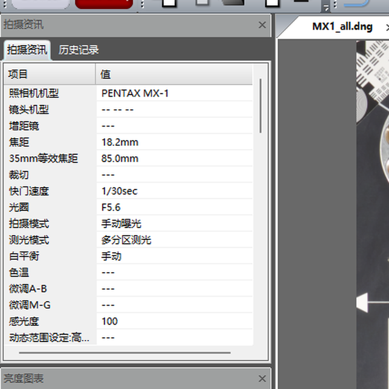
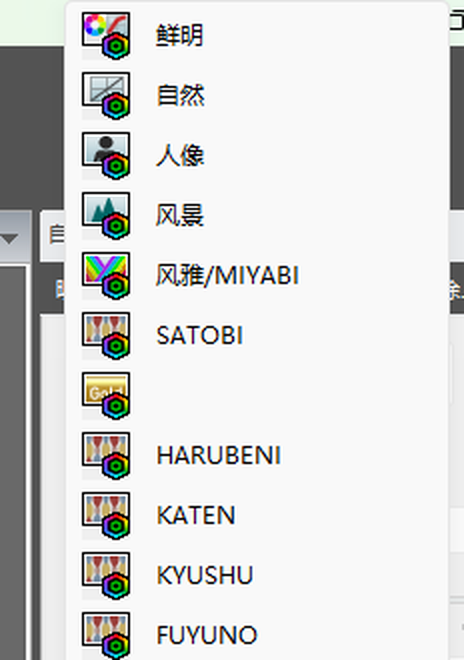
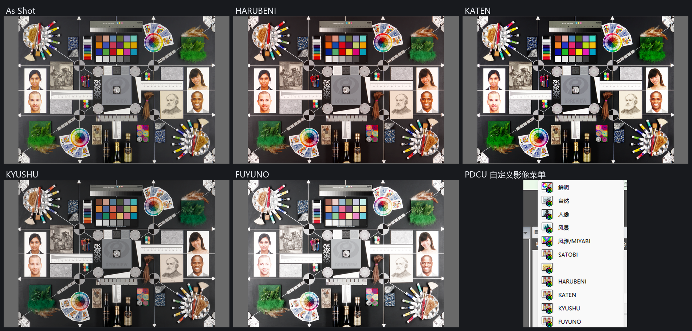

# PENTAX MX-1 移植 KF 四季数据实测

日期：2026-10-29

| 项目 | 文件 |
|---|---|
| 目标 | `sample/MX1.dng`（PENTAX MX-1，固件 MX-1 Ver. 1.00） |
| 数据来源 | 内置 KF 四季表（`sample/KF.DNG`） |
| 输出 | `sample/MX1_all.dng` |
| 工具 | `tools/dng_season_params.py --builtin mx1` |
| 内置数据 | `tools/season_mx1_data.py` |

## 1. 结论

MX-1 属于“**私有块里完全没有 `0x021A` / `0x021B`**”的一类机身，和
K-30 / K-01 / K-50 / Q7 一样；它的私有块是**小端**，但布局比 Q7 更紧：

| 项目 | MX-1 | 对照：Q7 |
|---|---:|---:|
| DNG 字节序 | `II`（小端） | `II`（小端） |
| 私有块长度 | **51,458 B** | 122,880 B |
| 私有 IFD 条目 | **82** | 99 |
| `0x021A` / `0x021B` | 不存在 | 不存在 |
| 预览 JPEG | 私有 +0x2902，35,900 B | 私有 +0x8D32，35,179 B |
| 预览后空闲区 | **5,060 B** | 51,555 B |
| 需要搬走的小标签 | 只有 `0x0222`（18 B） | `0x0200` / `0x0201` / `0x0206` |

工具沿用“新建标签”路径：

1. 把被扩大的 IFD 挤占的 `0x0222` 搬到预览 JPEG 后的空闲区；
2. 在原 IFD 位置重建 84 条条目，插入 `0x021A` / `0x021B`；
3. 写入 KF 的 4 条四季记录和 4 个 3×3 矩阵（小端）；
4. 用 MX-1 自己的 DNG ColorMatrix2 校准四季矩阵。

PDCU 5.10.2.2 实测：识别为 **PENTAX MX-1**，“自定义影像”列表出现
**HARUBENI / KATEN / KYUSHU / FUYUNO** 四项，四项都能选中并改变画面。
补丁前后 **As Shot 逐像素完全相同**（0 个像素变化）。

## 2. 文件结构

MX-1 样本：

```
文件大小        23,703,388 B
私有块          文件 0x666..0xCF68（51,458 B），小端
私有 IFD 条目   82
0x021A / 0x021B 不存在
0x0222           文件 0xA5A，18 B（落在扩容后的 IFD 内，需要搬走）
预览 JPEG        文件 0x2F68，35,900 B（到 0xBBA4）
预览后空闲区     文件 0xBBA4..0xCF68（5,060 B）
```

输出结构：

| 项目 | 位置 | 长度 |
|---|---:|---:|
| `0x021A` | 文件 0xBBB6（私有 +0xB550） | 132 B / 4 条 |
| `0x021B` | 文件 0xBC3A（私有 +0xB5D4） | 76 B / 4 个矩阵 |
| `0x0222` 新位置 | 文件 0xBBA4（私有 +0xB53E） | 18 B |
| 私有 IFD 条目 | 文件 0x666 起 | 82 → 84 条 |

四季记录：29→#0、30→#1、31→#2、32→#3。

## 3. 颜色校准

MX-1 没有 `0x021B` 基准可读，所以和 K-01 / K-50 / Q7 一样，用 DNG 的
ColorMatrix2（`0xC622`，D65）推算输入校准：

```
T(cam) = diag(1 / (ColorMatrix2 · W_D65)) · ColorMatrix2
Y      = T(KF) · inverse(T(MX-1))
M(MX-1 season) = M(KF season) · Y
```

MX-1 的 ColorMatrix2：

```
MX-1 CM2 = [[ 0.880447 -0.252304 -0.123764]
            [-0.242310  1.162735  0.085953]
            [-0.068161  0.177353  0.475311]]
KF   CM2 = [[ 0.823460 -0.210820 -0.129320]
            [-0.435870  1.295330  0.151460]
            [-0.107010  0.191850  0.593030]]
```

Y 为：

```
Y = [[ 0.98125510  0.06583130 -0.04708639]
     [-0.08496153  1.03942580  0.04553573]
     [-0.02081715 -0.04494669  1.06576384]]
```

这个 Y 离单反校准线**明显更远**：

| 对比 | max\|ΔY\| |
|---|---:|
| MX-1 vs K-3 | **1.04×10⁻¹** |
| MX-1 vs K-50 | 1.04×10⁻¹ |
| MX-1 vs K-30 | 1.04×10⁻¹ |
| MX-1 vs Q7 | 3.71×10⁻¹ |

K-30 / K-01 / K-50 的 Y 与 K-3 只差 10⁻⁵ 量级，而 MX-1 是 10⁻¹ 量级，
说明 1/1.7" 小底的 ColorMatrix2 与单反确实不在一条线上。MX-1 的
Y 比 Q7 更接近单反，但仍属于**按 ColorMatrix2 外推**，不是官方 MX-1 四季数据。

四个校准后的矩阵（Q13，小端）：

| 季节 | 9 个 int16 |
|---|---|
| HARUBENI | `13818, -2575, -3050, -4441, 16651, -4018, -2517, 1399, 9310` |
| KATEN | `15236, -6553, -491, -2870, 15467, -4405, 1366, -6014, 12840` |
| KYUSHU | `14746, -8086, 1533, 131, 7952, 109, -323, 209, 8306` |
| FUYUNO | `8767, -387, -188, -1703, 10341, -446, 180, 344, 7668` |

对应的 `BASE_MATRIX`（由 `M = M_KF · Y` 反推，供未来把 MX-1 当 donor 时用）：

```
12993, -4641,  -160
-2624, 12738, -1921
  384, -4289, 12096
```

量化后的风格残差 `R = M季节 · inv(M基准)` 与 KF 原生四季比：

| 季节 | max\|ΔR\| |
|---|---:|
| HARUBENI | 1.07×10⁻⁴ |
| KATEN | 9.87×10⁻⁵ |
| KYUSHU | 9.68×10⁻⁵ |
| FUYUNO | 4.89×10⁻⁵ |
| 中位 / 最大 | 9.77×10⁻⁵ / 1.07×10⁻⁴ |

Q13 一个 LSB 是 1.22×10⁻⁴，所以四个季节的残差都**小于 1 个 LSB**；比
K-50 / Q7（5×10⁻⁵ 量级）略大，是 `BASE_MATRIX` 量化后被 `inv` 放大所致。
用 D65 色卡做的 ΔE 代理值（M季节 · T(MX-1) 对 KF 原生）为：

| 季节 | ΔE 平均 | ΔE 最大 |
|---|---:|---:|
| HARUBENI | 0.0029 | 0.0047 |
| KATEN | 0.0008 | 0.0026 |
| KYUSHU | 0.0033 | 0.0049 |
| FUYUNO | 0.0021 | 0.0060 |

与 K-50（0.003 / 0.017）、Q7（0.004 / 0.018）同一量级。

## 4. PDCU 实测

用原版 PDCU 5.10.2.2 打开 `sample/MX1_all.dng`：

- 相机识别为 **PENTAX MX-1**；
- “自定义影像”列表原有机型项保持不变；
- 列表中出现 **HARUBENI / KATEN / KYUSHU / FUYUNO** 四项；
- 四项都能选中并改变画面；四项相对原片的画布平均绝对差为
  **8.1 / 16.8 / 8.8 / 24.3**（RGB 0–255），不是同一个画面。







### 4.1 As Shot 不变

同一台机器、同样的 PDCU 设置，分别打开原片 `sample/MX1.dng` 和补丁后的
`sample/MX1_all.dng`，进入 Laboratory，抓取图像画布：

| 对比 | 结果 |
|---|---|
| 原片 As Shot 均值 | 108.72 / 105.82 / 99.47 |
| 补丁后 As Shot 均值 | 108.72 / 105.82 / 99.47 |
| 平均绝对差 / 最大差 | **0.0 / 0.0** |
| 变化像素 | **0.0%** |

MX-1 的补丁表只有 29–32 四条季节记录，没有 mode 0 记录；PDCU 对 MX-1 的
As Shot 走自己的机身基准，不读补丁表里的 `0x021B[0]`。做了一次对照：
把 `0x021B[0]` 的 R/B 行对调后再渲染，As Shot 仍然逐像素相同
（平均差 0.0、最大差 0.0）。所以**补丁不会改变 MX-1 的默认显影**。

### 4.2 四季/As Shot 比值与九机一致

按九机实测同样的方法，用 `content()` 去掉画布灰边后计算

```
ratio(season) = mean_rgb(season) / mean_rgb(As Shot)
```

| 季节 | MX-1 比值 R/G/B | 九机均值 R/G/B | 原始比值最大差 | 去亮度后色向最大差 |
|---|---|---|---:|---:|
| HARUBENI | 1.031 / 0.944 / 0.949 | 1.034 / 0.932 / 0.922 | 2.96% | **1.67%** |
| KATEN | 0.957 / 0.951 / 0.956 | 0.938 / 0.925 / 0.918 | 4.11% | **1.13%** |
| KYUSHU | 0.916 / 0.918 / 0.946 | 0.908 / 0.910 / 0.923 | 2.53% | **1.07%** |
| FUYUNO | 1.232 / 1.248 / 1.313 | 1.240 / 1.251 / 1.287 | 2.04% | **1.62%** |

九机实测的原始比值最大差是 3.6%–4.7%，MX-1 的 4.11% 在同一量级；去掉
亮度后的色向差 ≤1.67%，与九机内部的 ≤1.65% 属同一量级。MX-1 原片平均亮度 104.7，
比九机（75.5–98.7）亮，比值法已经把整体曝光差约掉。

这说明：**按 MX-1 自己的 ColorMatrix2 推算的四季矩阵，在 PDCU 的 MX-1
显影链路上落到了与 KF 一致的位置**——四季的冷暖方向、强弱顺序和 KF 原生
一致，而不是套用单反矩阵后的偏色。

## 5. 完整性校验

对 `sample/MX1.dng` 与 `sample/MX1_all.dng` 逐字节比较：

| 检查 | 结果 |
|---|---|
| 文件大小 | 相同，23,703,388 B |
| 私有块偏移 / 长度 | 相同，0x666 / 51,458 B |
| 私有 IFD 条目数 | 82 → 84 |
| `0x0222` | 内容逐字节相同，仅从 0xA5A 移到 0xBBA4 |
| 其余 81 个私有标签 | 内容逐字节相同 |
| JPEG 预览 | 逐字节相同（0x2F68，35,900 B） |
| raw 像素 / 私有块之外 | 未改动 |
| 差异字节 | **230 B，93 段，全部落在私有块 0x666..0xCF68 内** |
| 四季矩阵索引 | 29→#0、30→#1、31→#2、32→#3，均在 0..3 内 |

输出 SHA-256：

```
6CCF0D6238B28CEDF2DB040552A5802A204A4A4BD62BDD3F3188B50C3CE9448F
```

原片 SHA-256：

```
EE4035614E4F38EEB2F77D9EF10D8441F7903FA5AA81B9EB27830933A76E566B
```

CLI 与 GUI 自检（`--selftest-mx1`）生成的输出逐字节相同，SHA-256 均为上值。

## 6. 复现

```powershell
python tools\dng_season_params.py --target sample\MX1.dng --builtin mx1 ^
    --out sample\MX1_all.dng --overwrite
```

GUI v2.3 添加 MX-1 文件后会自动选择“内置 KF→K-30 / K-01 / K-50 / Q7 / MX-1
四季参数”，处理时按机型选择 `mx1` 数据。

自检：

```powershell
python tools\dng_season_gui.py --selftest-mx1 sample\MX1.dng .tmp\MX1_gui.dng
Get-FileHash .tmp\MX1_gui.dng -Algorithm SHA256
```

本次全部数值（结构、Y / BASE_MATRIX、四季矩阵、风格残差、ΔE、渲染比值、
As Shot 对比）在 [`docs/PDCU-MX1-验证数据.json`](PDCU-MX1-验证数据.json)。

## 7. 边界

- MX-1 没有机内四季，也没有 `0x021B` 基准可对照；本移植是
  “新建标签 + ColorMatrix2 校准”，**不是官方固件数据**。
- Y 与 K-3 差 1.04×10⁻¹，比 K-30 / K-01 / K-50（10⁻⁵）远得多，属于外推；
  只有一份 MX-1 样本，没有第二份 MX-1 数据可交叉验证。
- 四季/As Shot 比值只能证明“相对风格与 KF 一致”，不能证明 Pentax 如果给
  MX-1 做四季会是什么绝对颜色。As Shot 本身不读补丁表，所以绝对色彩仍由
  PDCU 的 MX-1 机身基准决定。
- 只改 `0x021A` / `0x021B` 和被挤占的 `0x0222` 位置，不改 raw、预览、
  `0x021F` 等每张图的数据。
- PDCU 菜单截图与渲染来自 1920×1080 屏、PDCU 5.10.2.2、默认“颜色”设置；
  雷达图仍按当前照片计算，不同照片形状不同。
- 只验证 PDCU 5.10.2.2；Lightroom / Capture One / dcraw 本来就不读 Pentax
  四季，未逐一测试。

---

版权所有 © 2026 KimHoLau X deepseek harness
