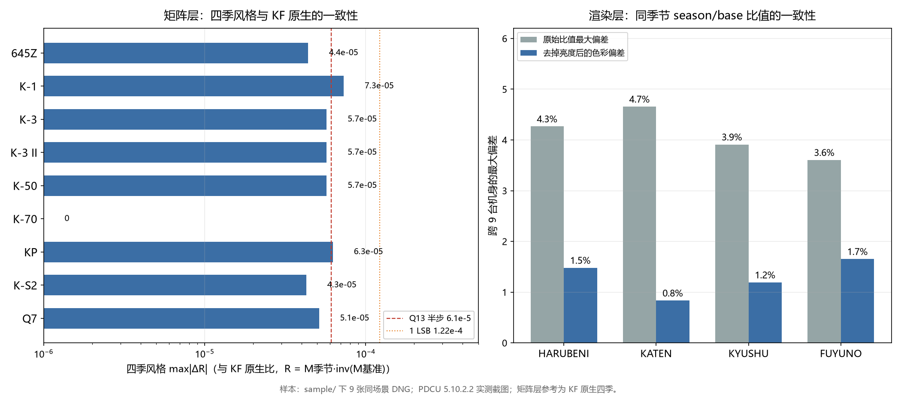
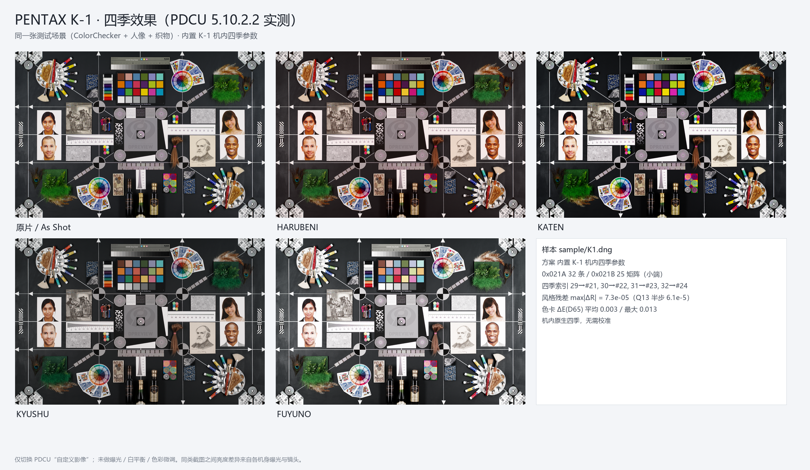
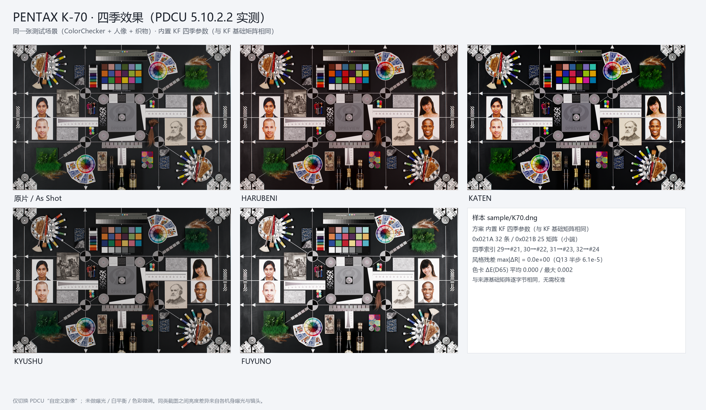
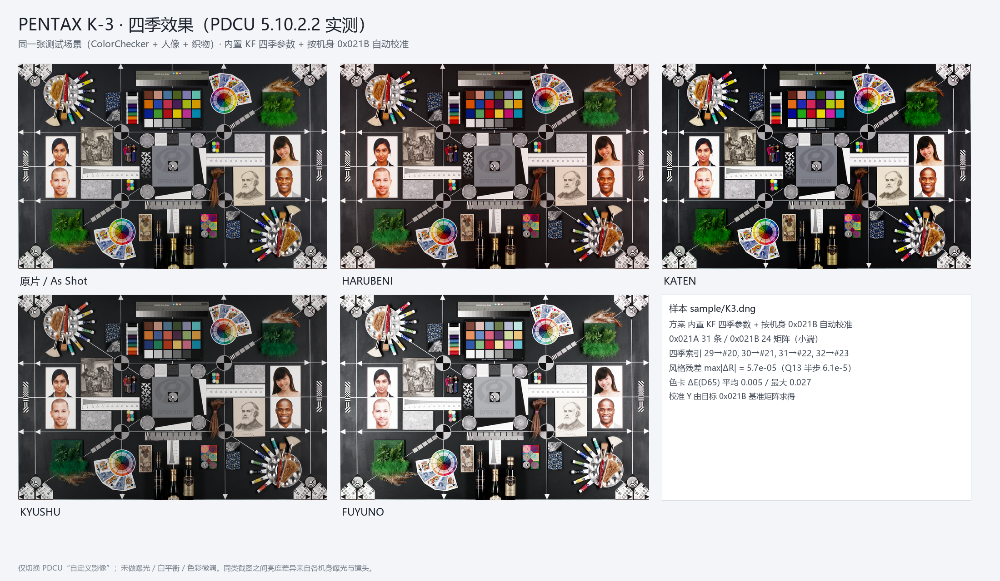
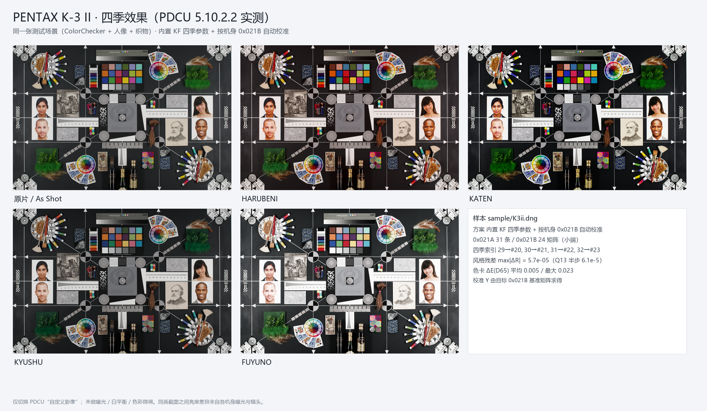
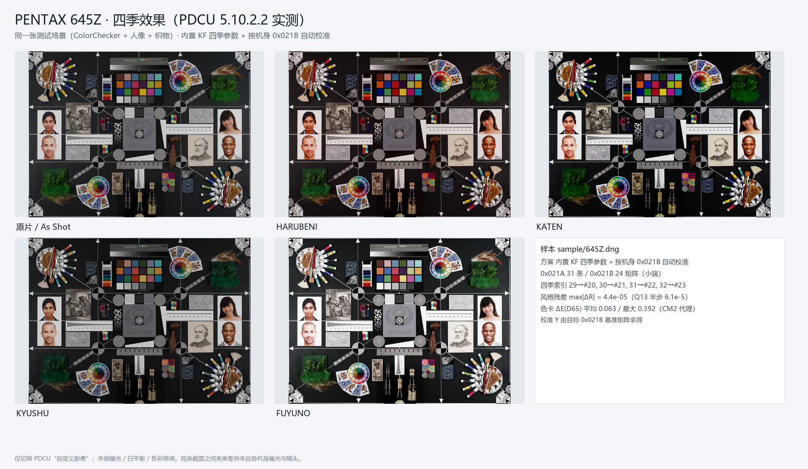
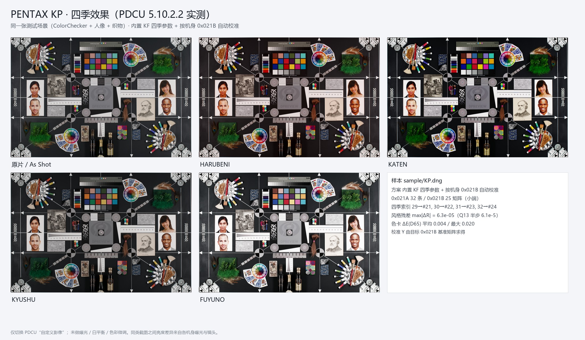
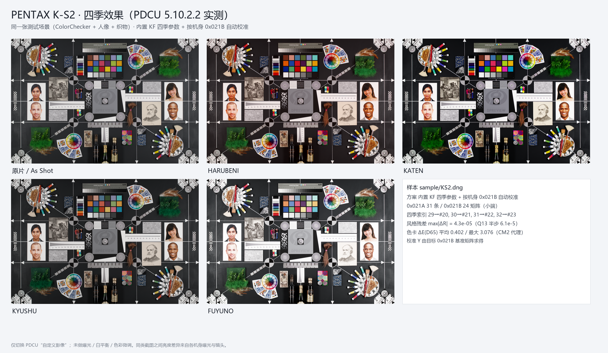
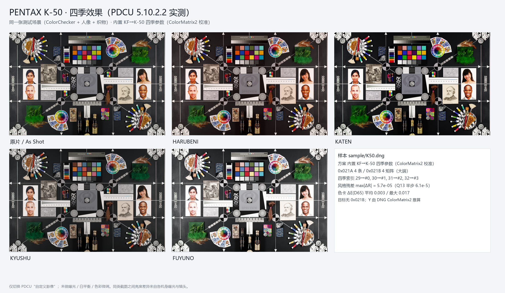
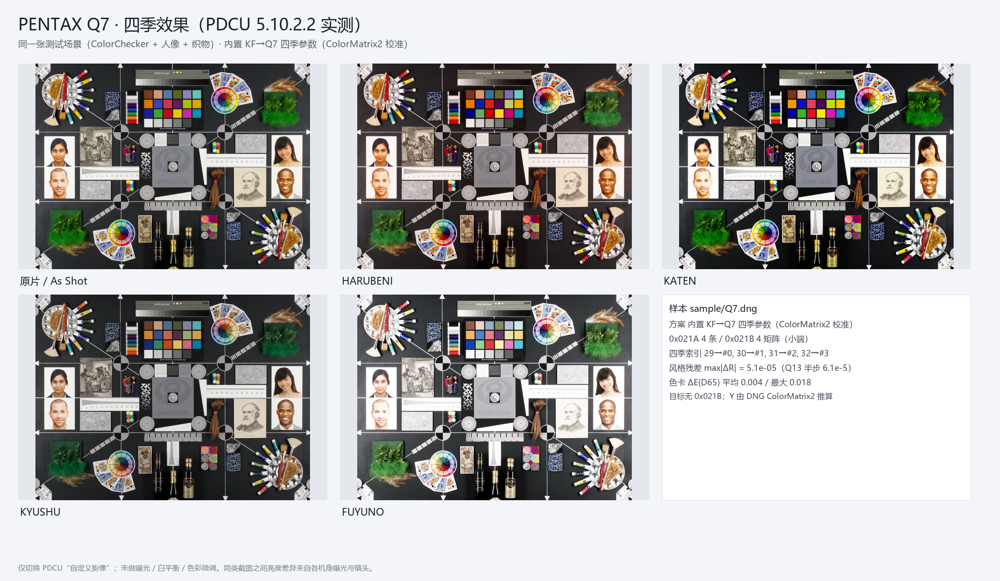

# PDCU 四季移植：九机型同场景实测

日期：2026-10-27

样本：sample/645Z.dng、K1.dng、K3.dng、K3ii.dng、K50.dng、K70.dng、KP.dng、KS2.dng、Q7.dng
（九台机身拍同一张测试场景：ColorChecker + 人像 + 织物/羽毛/酒瓶）

> v2.3 新增的 MX-1 也拍同一场景，作为第十台单独记录在
> [PDCU-MX1-KF四季移植.md](PDCU-MX1-KF四季移植.md)；本文的九台数值未改动。
>
> v2.4 新增的 K-1 Mark II 也拍同一场景（第 17 台）。它的 28 条模式记录和
> 21 个基础矩阵与 K-1 逐字节相同，因此直接复用 K-1 原生四季表；实测记录在
> [PDCU-K1II-四季移植.md](PDCU-K1II-四季移植.md)。

渲染：Digital Camera Utility 5 **5.10.2.2**（PDCU），直接打开补好的 DNG，
只在“自定义影像”里切换模式，不做曝光/白平衡/色彩微调。

## 0. 结论

**九台全部补出四季，PDCU 菜单能列出、能渲染，矩阵层和渲染层都一致。**

- **矩阵层**：四季风格 R = M季节 · inv(M基准) 与 KF 原生的最大差
  **0（K-70）～7.3×10⁻⁵（K-1）**，全部小于 1 个 Q13 LSB（1.22×10⁻⁴），
  与 Q13 半步 6.1×10⁻⁵ 同量级。也就是说：九台机身的四季是**同一套风格**，
  只是写在各机身的输入色彩空间里。
- **色卡 ΔE（D65，矩阵模型）**：七台与 ColorMatrix2 一致的机身
  **平均 ≤0.006、最大 ≤0.027**；645Z / K-S2 的 ColorMatrix2 与自身
  **0x021B** 基准有偏差（2.6×10⁻³ / 1.3×10⁻²），所以这个代理指标会高估，
  实际风格残差仍是 4.4×10⁻⁵ / 4.3×10⁻⁵（见 §4）。
- **渲染层**：同一场景下，各机型“季节 / 原片”的 RGB 比值跨九台最大差
  **3.6%～4.7%**；扣掉各机身亮度差后，**色彩方向的最大差只有 0.8%～1.7%**。
  九台原片平均亮度从 75.5（645Z）到 98.7（Q7）；同一季节模式作用在不同
  曝光/镜头的原片上，经过同一色调曲线后会产生几个百分点的比值差。把比值
  向量按亮度归一后，色彩方向的最大差只有 **0.8%～1.7%**（§5）。
- **这次全新样本九张全部原本没有四季**（0x021A 都缺 29–32），所以每条路径
  都是“从无到有”，不是“覆盖已有数据”。

新增/补强的机型支持：

| 机型 | 这次怎么补 | 说明 |
|---|---|---|
| **KP** | 内置 KF + 按机身 0x021B 自动校准 | 新增自动校准名单 |
| **K-S2** | 内置 KF + 按机身 0x021B 自动校准 | 新增自动校准名单 |
| **K-50** | 新增内置 KF→K-50 数据（ColorMatrix2 校准） | 无 0x021A/0x021B；大端 |
| **Q7** | 新增内置 KF→Q7 数据（ColorMatrix2 校准） | 无表；小端；与单反色彩空间差得远 |

---

## 1. 九张样本里原来有什么

| 机型 | 文件 | 原 0x021A | 原 0x021B | 字节序 | 补后 0x021A / 0x021B |
|---|---|---|---:|---:|---|---|
| PENTAX 645Z | sample/645Z.dng | 1120 B / 27 条 | 364 B / 20 矩阵 | 小端 | 834 B / 31 条 · 436 B / 24 矩阵 |
| PENTAX K-1 | sample/K1.dng | 1146 B / 28 条 | 382 B / 21 矩阵 | 小端 | 860 B / 32 条 · 454 B / 25 矩阵 |
| PENTAX K-3 | sample/K3.dng | 1120 B / 27 条 | 364 B / 20 矩阵 | 小端 | 834 B / 31 条 · 436 B / 24 矩阵 |
| PENTAX K-3 II | sample/K3ii.dng | 1120 B / 27 条 | 364 B / 20 矩阵 | 小端 | 834 B / 31 条 · 436 B / 24 矩阵 |
| PENTAX K-50 | sample/K50.dng | 无 | 无 | **大端** | 132 B / 4 条 · 76 B / 4 矩阵（新建） |
| PENTAX K-70 | sample/K70.dng | 1146 B / 28 条 | 382 B / 21 矩阵 | 小端 | 860 B / 32 条 · 454 B / 25 矩阵 |
| PENTAX KP | sample/KP.dng | 1146 B / 28 条 | 382 B / 21 矩阵 | 小端 | 860 B / 32 条 · 454 B / 25 矩阵 |
| PENTAX K-S2 | sample/KS2.dng | 1120 B / 27 条 | 364 B / 20 矩阵 | 小端 | 834 B / 31 条 · 436 B / 24 矩阵 |
| PENTAX Q7 | sample/Q7.dng | 无 | 无 | 小端 | 132 B / 4 条 · 76 B / 4 矩阵（新建） |

九张都是**相机 DNG**（私有块在 0xC634），不是 DCU 另存。

结构改动全部落在私有块内，文件大小、raw 条带、预览 JPEG 都不变：

| 检查 | 结果 |
|---|---|
| 文件大小 | 九张全部不变 |
| 私有块之前的前缀 | 逐字节相同 |
| 私有块之后（raw / 预览 / 尾部） | 逐字节相同 |
| 改动字节数 | 306 B（Q7）～523 B（K-1/K-70） |
| 改动范围 | 仅 0x021A、0x021B 及其重定位的空闲区 |

---

## 2. 三类方案

Pentax 的 0x021B 表 = **同一套风格表 × 每台机身一个 3×3 输入校准 Y**：

    Y = inv(M_KF[0]) · M_target[0]
    M_target_season = M_KF_season · Y
    R = M_season · inv(M_base)          ← 用户看到的“季节味道”

### 2.1 原生/同基础矩阵

- **K-1**：用内置 K-1 机内四季数据（K-1 原片本来也没四季，这次补的是真机内表）。
- **K-70**：内置 KF 数据。KF 与 K-70 的 21 个基础矩阵逐字节相同，Y = I。

### 2.2 有 0x021B，按目标机身校准

**645Z / K-3 / K-3 II / KP / K-S2**：工具运行时读目标模式 0 的基准矩阵，
算 Y，再把 KF 四季矩阵乘上去。五台的风格残差见 §4。

### 2.3 没有 0x021A/0x021B：K-50 / Q7

工具按 K-30/K-01 的路径新建两个 tag，并把 0x0200/0x0201/0x0205（K-50）
或 0x0200/0x0201/0x0206（Q7）搬到空闲区。Y 用目标 DNG 的 ColorMatrix2 推算：

    T(cam) = diag(1 / (ColorMatrix2 · W_D65)) · ColorMatrix2
    Y      = T(KF) · inv(T(cam))

- **K-50**：Y 与 K-3 的 Y 只差 **3.7×10⁻⁵**，写出的四季矩阵与 K-30 内置值
  最大只差 **1 个 Q13 LSB**。这是“有旁证”的推算：K-50 与 K-30/K-3 同一条校准线。
- **Q7**：1/1.7" 小底，ColorMatrix2 与单反差得远，Y 明显不同
  （见附录）。没有第二份 Q7 数据可交叉验证，所以这是**最佳推算**，
  不是官方固件数据；四季菜单、渲染结构可用，色彩方向按 KF 风格校准。

---

## 3. 工具改动（v2.0）

- 新增 tools/season_k50_data.py、tools/season_q7_data.py；
- dng_season_params.py 新增 --builtin k50 / q7；
- GUI 的自动校准名单加入 **KP / K-S2**；“内置 KF→K-30/K-01”一栏扩展为
  **K-30 / K-01 / K-50 / Q7**，按机型自动挑数据；
- GUI 版本号 **2.0**；
- GUI 自检（--selftest-k50 / --selftest-q7 / --selftest-kf）与 CLI
  输出**逐字节相同**（SHA-256 已比对）。

复现命令：

    # 有 0x021B 的机型
    python tools\dng_season_params.py --target sample\K3.dng  --builtin kf  --out .tmp\K3_all.dng  --overwrite
    python tools\dng_season_params.py --target sample\KP.dng  --builtin kf  --out .tmp\KP_all.dng  --overwrite
    python tools\dng_season_params.py --target sample\KS2.dng --builtin kf  --out .tmp\KS2_all.dng --overwrite
    # K-1 / K-70
    python tools\dng_season_params.py --target sample\K1.dng  --builtin k1  --out .tmp\K1_all.dng  --overwrite
    python tools\dng_season_params.py --target sample\K70.dng --builtin kf  --out .tmp\K70_all.dng --overwrite
    # 无表的 K-50 / Q7
    python tools\dng_season_params.py --target sample\K50.dng --builtin k50 --out .tmp\K50_all.dng --overwrite
    python tools\dng_season_params.py --target sample\Q7.dng  --builtin q7  --out .tmp\Q7_all.dng  --overwrite

---

## 4. 矩阵层：风格残差与色卡 ΔE

定义 R = M季节 · inv(M基准)，参考是 KF 原生四季的 R。对每台取四个季节的
max|ΔR|：

| 机型 | 季节来源 | 风格 median | 风格 max | 色卡 ΔE 平均 | ΔE 最大 | 备注 |
|---|---|---:|---:|---:|---:|---|
| 645Z | KF × Y(645Z) | 3.4×10⁻⁵ | 4.4×10⁻⁵ | 0.063 | 0.392 | CM2 与基准差 2.6×10⁻³，ΔE 为代理值 |
| K-1 | 内置 K-1 | 6.4×10⁻⁵ | 7.3×10⁻⁵ | 0.003 | 0.013 | 与 KF 同风格、差一次输入校准 |
| K-3 | KF × Y(K-3) | 5.3×10⁻⁵ | 5.7×10⁻⁵ | 0.005 | 0.027 | |
| K-3 II | KF × Y(K-3 II) | 5.3×10⁻⁵ | 5.7×10⁻⁵ | 0.005 | 0.023 | 与 K-3 的 Y 相同 |
| K-50 | KF × Y(K-50) | 4.4×10⁻⁵ | 5.7×10⁻⁵ | 0.003 | 0.017 | 无表，Y 由 CM2 |
| K-70 | KF（Y = I） | 0 | 0 | 0.0003 | 0.0017 | 基础矩阵逐字节相同 |
| KP | KF × Y(KP) | 5.2×10⁻⁵ | 6.3×10⁻⁵ | 0.004 | 0.020 | |
| K-S2 | KF × Y(K-S2) | 3.3×10⁻⁵ | 4.3×10⁻⁵ | 0.402 | 3.077 | CM2 与基准差 1.3×10⁻²，ΔE 为代理值 |
| Q7 | KF × Y(Q7) | 4.2×10⁻⁵ | 5.1×10⁻⁵ | 0.004 | 0.018 | 无表，Y 由 CM2 |

Q13 量化半步是 **6.1×10⁻⁵**，1 个 LSB 是 **1.22×10⁻⁴**。九台的风格 max
全部 ≤7.3×10⁻⁵，也就是**不超过 1 个 LSB**；K-70 是 0，因为它和 KF 用同一张表。

### 4.1 为什么 645Z / K-S2 的 ΔE 大

ΔE 这一列用 M季节 · T(cam) 与 M_KF季节 · T(KF) 比，其中 T(cam) 由
ColorMatrix2 推算。对 645Z / K-S2，T(cam) 与它们**自己的 0x021B 基准矩阵**
并不完全一致（差 2.6×10⁻³ / 1.3×10⁻²），所以这个 ΔE 把“ColorMatrix2
近似误差”也算进去了；PDCU 实际乘的是 0x021B，真正决定四季味道的 R 仍然
是 4×10⁻⁵ 量级。九台的**实测渲染**（§5）也给出同一结论：645Z、K-S2 的
season/base 单通道比值与九台均值的最大差约 3.2% / 1.4%，与其它机身
（最大 4.7%，Q7）同一量级。

v2.0 修订后，工具会把这条偏差直接打印出来：它用目标自己的 ColorMatrix2
（`0xC622`）另算一份 `Y`，与 `0x021B` 基准算出的 `Y` 对比。645Z / K-S2 会
触发 `CM2 check: WARNING`（2.7×10⁻³ / 1.3×10⁻²），其余机身 `pass`（≤1.8×10⁻⁵）；
校准仍然以 `0x021B` 为准。

### 4.2 K-1 的 7.3×10⁻⁵

K-1 用机内原生四季，不是 KF 数据。上一轮
[docs/PDCU-K5iis-K1-四季对比.md](PDCU-K5iis-K1-四季对比.md) 已证明 K-1 与 KF
是同一套风格、只差一次输入校准；这次 7.3×10⁻⁵ 就是两套原生表的量化差。

### 4.3 实测：As Shot 用 0x021B，不用 ColorMatrix2

拿一份 K-S2 样张做了“只改一处”的四份文件，在 PDCU 里看 As Shot：

| 改动 | 结果 |
|---|---|
| `0x021B[0]` 的 R/B 行对调 | R、B 渲染精确互换（70% 像素变化） |
| `0x021B[0]` ×1.2 | 整体提亮（96% 像素变化） |
| `0xC621` + `0xC622` 的 R/B 行对调 | **逐像素完全相同（0 个像素变化）** |

所以 PDCU 的 As Shot 直接乘 `0x021B[0]`，完全不看 DNG 的 ColorMatrix1/2。
“另存 JPEG”导出也一样：改掉两条 CM 再做全尺寸导出，像素与原始文件逐点相同，
只有 EXIF 时间戳和缩略图偏移不同。
这解释了 645Z / K-S2 的 ΔE 代理值为什么偏高（它按 CM2 推算），也说明
工具以 `0x021B` 为准是对的。完整数据、复现方式与边界见
[PDCU-AsShot基准矩阵验证.md](PDCU-AsShot基准矩阵验证.md)。

---

## 5. 渲染层：PDCU 实测与九机一致性

### 5.1 做法

1. 用工具生成九张 _all.dng；
2. PDCU 5.10.2.2 打开，进 Laboratory → “自定义影像”；
3. 依次选 HARUBENI / KATEN / KYUSHU / FUYUNO，等待渲染完成；
4. 用 PrintWindow 抓取图像画布（1326×869），不做屏幕截屏，避免窗口遮挡；
5. 每台原片（As Shot）也抓一张作基准。

色彩一致性用**比值**衡量，不用绝对 RGB：

    ratio(season) = mean_rgb(season) / mean_rgb(As Shot)

绝对值受机身曝光、镜头、拍摄距离影响；比值把“这台机身整体亮/暗”约掉，
剩下的就是四季本身把颜色往哪儿推。

### 5.2 结果

| 季节 | 九台平均比值 R/G/B | 原始比值最大差 | 去掉亮度后的色彩最大差 |
|---|---|---:|---:|
| HARUBENI | 1.034 / 0.932 / 0.922 | 4.3% | **1.5%**（645Z） |
| KATEN | 0.938 / 0.925 / 0.918 | 4.7% | **0.8%**（645Z） |
| KYUSHU | 0.908 / 0.910 / 0.923 | 3.9% | **1.2%**（Q7） |
| FUYUNO | 1.240 / 1.251 / 1.287 | 3.6% | **1.7%**（Q7） |

九台原片平均亮度：645Z 75.5、K-70 80.3、KP 83.0、K-3 II 86.7、K-50 87.8、
K-3 88.4、K-1 90.5、K-S2 91.0、Q7 98.7。原片亮度差 31%，同一模式经过
同一色调曲线后，落在不同亮度的原片上会得到略有差别的比值（单通道最大
4.7%）；把比值向量按亮度归一后，四季的色彩方向差 **≤1.7%**。

季节之间的区分很清楚，且九台排序一致：

- HARUBENI：提亮、偏暖（R↑，G/B↓）；
- KATEN：偏暖黄、略压暗；
- KYUSHU：压暗、偏冷/低饱和；
- FUYUNO：明显提亮、去饱和偏冷（高调）。

这与 K-70→KF 旧实测的观感一致（[docs/PDCU-K70-KF四季移植.md](PDCU-K70-KF四季移植.md)）。

---

## 6. 每个机型的四季效果图

每张图的版式：第一行 As Shot / HARUBENI / KATEN，第二行 KYUSHU / FUYUNO /
参数面板。全部来自同一次 PDCU 会话，仅切换“自定义影像”。

### 6.1 K-1（内置 K-1 四季）

### 6.2 K-70（内置 KF，基础矩阵相同）

### 6.3 K-3 / K-3 II（KF × 机身校准）

### 6.4 645Z（KF × 机身校准）

### 6.5 KP / K-S2（KF × 机身校准）

### 6.6 K-50 / Q7（新建标签 + ColorMatrix2 校准）

### 6.7 九机型同屏总览

---

## 7. 附录：各机身的校准 Y

    K-1  (仅作参照，实际用机内 K-1 表)   Y vs KF = inv(M_KF0)·M_K10
      [ 0.929360  0.126281 -0.055641]
      [-0.027097  1.050021 -0.022925]
      [-0.009396  0.034555  0.974842]

    K-70   Y = I（基础矩阵逐字节相同）

    K-3 / K-3 II
      [ 0.973741  0.095850 -0.069591]
      [-0.009796  1.068062 -0.058266]
      [-0.005150  0.041113  0.964038]

    645Z
      [ 0.960078  0.125483 -0.085561]
      [-0.025032  1.070903 -0.045871]
      [-0.006818  0.021745  0.985073]

    KP
      [ 0.925110  0.019801  0.055089]
      [ 0.015342  0.950095  0.034562]
      [ 0.023605 -0.055242  1.031637]

    K-S2
      [ 0.936564  0.100040 -0.036604]
      [-0.015541  1.055422 -0.039881]
      [-0.008715  0.053660  0.955055]

    K-50  (由 ColorMatrix2 推算，与 K-3 的 Y 差 3.7e-5)
      [ 0.973748  0.095813 -0.069562]
      [-0.009806  1.068064 -0.058258]
      [-0.005138  0.041122  0.964016]

    Q7    (由 ColorMatrix2 推算，小底，差异较大)
      [ 0.848232  0.436645 -0.284877]
      [-0.085262  1.228573 -0.143311]
      [-0.057392  0.004131  1.053261]

---

## 8. 边界与未验证项

1. **Q7 是推算，不是官方数据。** Q7 没有 0x021A/0x021B，也没有第二份
   Q7 四季样本可交叉验证。矩阵按 KF 风格 × ColorMatrix2 校准；结构上
   PDCU 能列出并渲染四项，但“Pentax 如果给 Q7 做过四季会是什么样”无法证实。
2. **K-50 也是推算，但有旁证。** 它的 Y 与 K-3 的 Y 只差 3.7×10⁻⁵，
   写出的矩阵与 K-30 内置值差 ≤1 LSB；比 Q7 可信得多，但仍不是官方 K-50 固件数据。
3. **645Z / K-S2 的 ΔE 代理值偏高**（0.39 / 3.08），原因是 ColorMatrix2
   与自身 0x021B 基准不完全一致；风格残差与实际渲染比值都在正常范围。
4. **截图不是全分辨率导出。** 这次抓的是 PDCU 图像画布 1326×869，
   足以比较四季与跨机型一致性，但不是 1:1 导出，也没有做打印级校验。
5. **没有消除机身/镜头/曝光差。** 一致性指标用的是 season/base 比值；
   原片亮度 78.8～99.4 的差异仍然存在，绝对色彩不能直接逐像素比较。
6. **只测了 PDCU 5.10.2.2。** Lightroom / Capture One / dcraw 本来就不读
   Pentax 四季，未逐一测试。
7. **雷达图形状不同照片不同。** 它按当前照片的颜色计算，这次没有把九台的
   雷达图叠在一起比较。
8. **九张样本都是相机 DNG。** DCU 另存（EXIF MakerNote 0x927C）路径
   上一版已单独验证，这次没有重复。

---

## 9. 复现

| 文件/脚本 | 作用 |
|---|---|
| tools/dng_season_params.py | 主工具；新增 --builtin k50 / q7 |
| tools/season_k50_data.py | K-50 四季记录/矩阵（大端，Y 由 CM2） |
| tools/season_q7_data.py | Q7 四季记录/矩阵（小端，Y 由 CM2） |
| .tmp/render_pdcu.py | PDCU 5.10.2.2 自动切四季 + PrintWindow 抓画布 |
| .tmp/verify_matrix2.py | 风格 R、Y、色卡 ΔE |
| .tmp/verify_struct.py | 补丁前后逐字节对比 |
| .tmp/consistency3.py | 九台渲染比值一致性 |
| .tmp/make_figures.py | 每机型四季图与九机型总览 |
| docs/PDCU-九机型验证数据.json | 本次全部数值（风格/ΔE/比值/Y） |

补好的 DNG 在 sample/season_all/（生成物，不覆盖原文件）：

    sample/season_all/645Z_all.dng   K1_all.dng   K3_all.dng   K3ii_all.dng
    sample/season_all/K50_all.dng    K70_all.dng  KP_all.dng   KS2_all.dng
    sample/season_all/Q7_all.dng

---

版权所有 © 2026 KimHoLau X deepseek harness