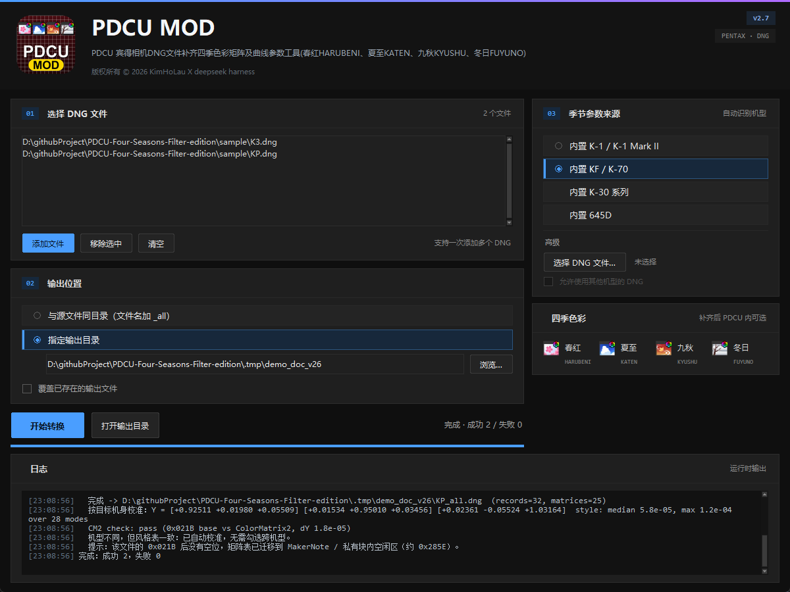

# PDCU MOD（GUI 版）v2.5

PDCU 宾得相机DNG文件补齐四季色彩矩阵及曲线参数工具
(春红HARUBENI、夏至KATEN、九秋KYUSHU、冬日FUYUNO)



## 运行

发布文件：`dist/PDCU-Season-Params.exe`（或 `dist/PDCU-Season-ParamsV2.5.zip`）

双击运行，不需要安装 Python。首次运行 Windows SmartScreen 可能提示
“未知发布者”，选择“更多信息 -> 仍要运行”。

## 界面

- 左侧：选择 DNG 文件（可多选）、输出位置、开始转换。
- 右侧：「季节参数来源」四个内置选项；添加文件后自动识别机型并选中。
- 底部：运行日志；校准、结构迁移等细节都在这里。

## 使用步骤

1. 点「添加文件…」选择一个或多个 `.DNG` 文件；
2. 选择「季节参数来源」（面板只显示来源名称）：
   - 内置 K-1 / K-1 Mark II：只适用于 PENTAX K-1、K-1 Mark II
   - 内置 KF / K-70：只适用于 PENTAX KF、K-70，以及 K-3、K-3 II、K-5 II、
     K-5 II s、645Z、KP、K-S2
   - 内置 645D：只适用于 PENTAX 645D
   - 内置 K-30 系列：只适用于 PENTAX K-30、K-01、K-50、Q7、MX-1
   - 高级：选择一张 DNG 作为来源；其他机型可勾选「允许使用其他机型的 DNG」
   内置来源与机型不匹配时，转换前会拒绝并提示，不生成输出文件；
   跨机型开关只影响「高级」里的自定义 DNG 来源。
3. 选择输出位置（默认同目录加 `_all`，或指定输出目录）；
4. 点「开始转换」，完成后点「打开输出目录」。

添加文件后，工具会自动读取机型并选中对应来源；K-1 Mark II 自动使用 `k1ii` 数据，
K-3 / K-5 / 645Z / KP / K-S2 使用 KF 数据并按机身自动适配。

## 注意

- 工具补的是 `0x021A` 季节记录和 `0x021B` 3×3 颜色矩阵，不修改 raw 像素，
  也不覆盖源文件。
- 支持老固件 K-1、DCU 5 另存的 DNG、大端 K-5 II / K-5 II s 等，详见仓库根目录 readme。
- 日志出现 `WARNING`（如 `CM2 check`）时请保留日志；645Z / K-S2 是已知的元数据差异。
- 勾选「覆盖已存在的输出文件」才会覆盖同名 `_all` 文件。
- 各机型验证记录见 `docs/` 下的分析文档。

## 从源码重新打包

推荐直接使用仓库里的 spec（会带入图标、logo、版本和版权信息）：

```powershell
python -m PyInstaller --noconfirm --clean PDCU-Season-Params.spec
```

---

版权所有 © 2026 KimHoLau X deepseek harness
