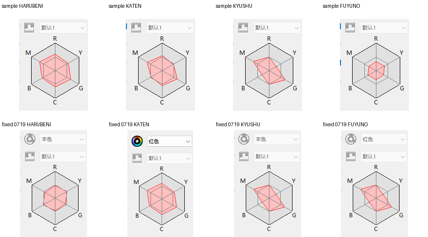
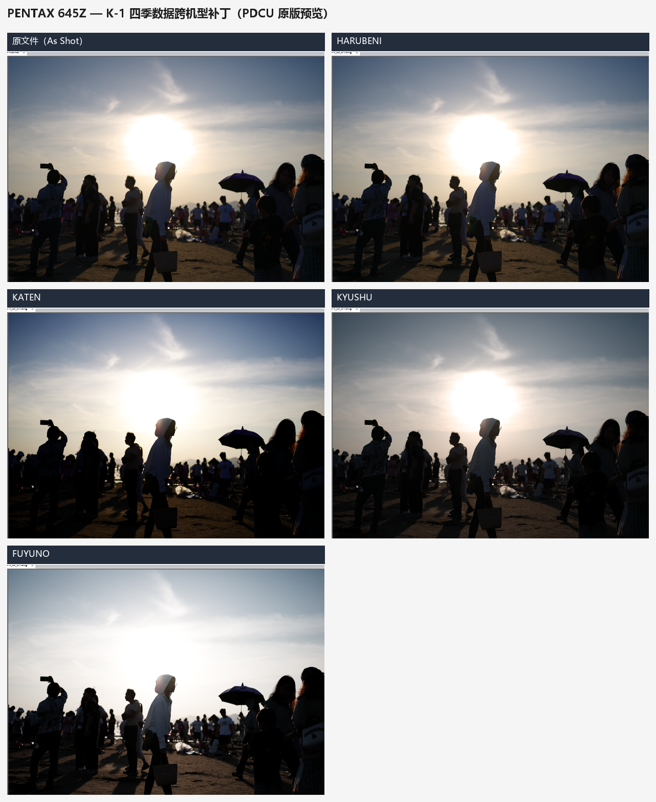
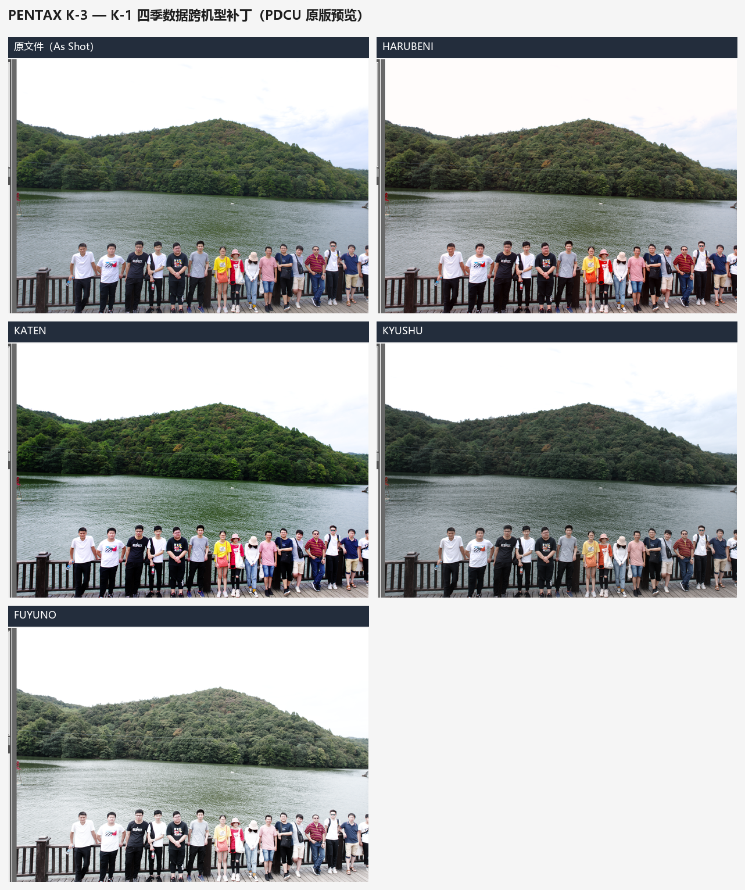

# PDCU 四季菜单、0x021A 模式表与 0x021B 颜色矩阵

日期：2026-10-25
样本：`sample/IMGP0709.DNG`、`sample/IMGP0719_KYUSHU.DNG`

## 1. 结论

PDCU 是否在“自定义影像”里显示 HARUBENI / KATEN / KYUSHU / FUYUNO，
由当前 DNG 的 Pentax 私有 IFD tag `0x021A`（`_PEF_MODEPRM_SET` 模式表）决定。

每条 26 字节记录的**倒数第二个 u16** 是一个矩阵索引，指向 tag `0x021B`
里的 18 字节 3×3 颜色矩阵。只有一条季节记录的 DNG，通常也只带那一个矩阵；
如果只补 `0x021A` 记录而不补矩阵，新记录会指向别人的矩阵或越界，
颜色和雷达图就会不对。

因此正确做法是同时补：

1. `0x021A` 里缺失的模式记录；
2. `0x021B` 里对应的 18 字节 3×3 矩阵；
3. 把新记录的矩阵索引改成新矩阵的编号。

## 2. 表结构

`0x021A`：

    u16 nParams
    nParams × u16
    u16 nRecords
    nRecords × recordSize（K-1：26 字节）_PEF_MODEPRM_SET

K-1 的 26 字节记录里，矩阵索引在偏移 22（倒数第二个 u16）。

`0x021B`：

    u32 count
    count × 18 字节 3×3 颜色矩阵

K-1 样本：

| 文件 | 0x021A | nRecords | 0x021B | count |
|---|---:|---:|---:|---:|
| IMGP0709.DNG | 912 B | 34 | 490 B | 27 |
| IMGP0719_KYUSHU.DNG | 834 B | 31 | 436 B | 24 |

IMGP0719 只带 KYUSHU 矩阵（#22）和 mode33 矩阵（#23）。
IMGP0709 的季节矩阵是 HARUBENI #22、KATEN #23、KYUSHU #24、FUYUNO #25。

补齐时把 donor 的三个季节矩阵追加到目标 `0x021B` 的空闲槽位（#24/#25/#26），
再把新记录的索引改成 #24/#25/#26；目标自己的 KYUSHU 矩阵 #22 保持不变。

## 3. 工具

`tools/dng_season_params.py`

    # 只看表
    python tools\dng_season_params.py --target sample\IMGP0719_KYUSHU.DNG --list

    # 预演
    python tools\dng_season_params.py --target sample\IMGP0719_KYUSHU.DNG ^
        --donor sample\IMGP0709.DNG --out out.dng --dry-run

    # 生成补齐后的 DNG
    python tools\dng_season_params.py --target sample\IMGP0719_KYUSHU.DNG ^
        --donor sample\IMGP0709.DNG --out out.dng

    # 直接改原文件（会生成 .bak）
    python tools\dng_season_params.py --target sample\IMGP0719_KYUSHU.DNG ^
        --donor sample\IMGP0709.DNG --in-place

工具会：

1. 找出目标缺失的季节模式；
2. 从 donor 复制 26 字节记录；
3. 从 donor 的 `0x021B` 复制对应 3×3 矩阵；
4. 为新记录分配新的矩阵编号并改写索引；
5. 更新 `0x021A` / `0x021B` 的 count 和长度；
6. 重新解析输出文件，验证记录和矩阵都正确。

如果空闲区不够、矩阵槽位不够、或 donor 与目标机型不一致，工具会拒绝写入。

## 4. 实测

对 `sample/IMGP0719_KYUSHU.DNG` 补齐后：

- `0x021A`：834 → 912 B，nRecords 31 → 34；
- `0x021B`：436 → 490 B，matrices 24 → 27；
- 季节记录/矩阵：
  - HARUBENI → target #24 = donor #22
  - KATEN → target #25 = donor #23
  - KYUSHU → target #22 = donor #24（原本就相同）
  - FUYUNO → target #26 = donor #25
- 文件只在 `0x792`、`0x2534`、`0x251A..0x28AA`、
  `0x79E`、`0x2A32..0x2C1C` 内变化，raw 数据和其余 tag 不变；
- 用原版 PDCU 5.10.2.2 打开，菜单四项都出现，且四项都使用 donor 的季节矩阵。

## 5. 关于雷达图

雷达图是 PDCU 按**当前这张图**的颜色算出来的，所以不同照片不可能得到完全相同的雷达形状。
工具保证的是：四个季节使用与 donor 相同的 `0x021A` 记录和 `0x021B` 3×3 矩阵。

另外，`sample/` 下的四张参考截图在 PDCU 里还把第二行的“颜色”设成了“红色”。
实测同一张 `IMGP0709.DNG` 直接打开、再选 HARUBENI，颜色是“本色”；
参考图里的“红色”是 PDCU 软件侧的额外设置，不由 DNG 的 0x021A/0x021B 决定。
如果要完全复刻参考截图，还需要在 PDCU 里把“颜色”也设成“红色”。
雷达图本身也按当前照片的颜色计算，不同照片不会得到完全相同的形状。

上排是 sample 参考图，下排是补齐后的 `IMGP0719_all.dng`；参考图额外设了“颜色=红色”，所以形状偏大。



## 6. 边界

- 工具补的是 `_PEF_MODEPRM_SET` 记录和 `0x021B` 3×3 颜色矩阵，不修改
  `0x021F` 等每张图自己的相机计算数据。
- K-1 有两种已实测布局：2.50 固件的 160,692 B 私有块（0x021A 紧凑）和
  1.50 固件的 159,876 B 私有块（0x021A 带 390 B 保留区）。
- 工具不改 raw 像素，也不执行 DNG。

## 7. 2026-10-26：老固件 K-1 的带填充 0x021A

`sample/IMGP0344.DNG`（K-1，固件 1.50）与 2.50 样本不同：

- `0x021A` tag 1146 B，nRecords=28，记录 26 B；有效记录区 756 B，
  尾部 390 B 是保留/填充（不是记录）；
- `0x021B` 382 B（21×18），后面到 `0x021C` 只有 2 B，
  放不下 4 个新矩阵（72 B）。

旧版工具会报 `mode table size 1118 not divisible by 28 records`。
现在工具会：

1. 长度不能整除时，按 `recordSize = 2 × (nParams + 1)` 识别记录区，
   尾部作为保留区忽略；
2. `0x021B` 没有空位时，把整个矩阵表迁移到私有块内安全空闲区
   （优先紧接新 `0x021A` 表尾，并避开 preview/其他 tag），
   同时更新 `0x021B` 的 offset/length；
3. 仍然只写私有块，不改 raw。

实测 `IMGP0344.DNG`：

- `0x021A`：1146 → 860 B，28 → 32 条；
- `0x021B`：382 → 454 B，21 → 25 个矩阵，迁移到文件 `0x285E`；
- 原始 28 条记录/21 个矩阵与 `IMGP0709.DNG` 逐字节相同，增量安全；
- 输出与原文件同大小 49,555,892 B，raw 49,393,851 B 不变；
- 原版 PDCU 5.10.2.2（未改 EXE）打开即可列出并渲染四季；
  打开原始 `IMGP0344.DNG` 则不列出。

## 8. 645Z 跨机型试验（2026-10-26）

> 本节是 v1.7 及更早的结论（未校准）。v1.8 起工具会按 645Z 自己的基准矩阵
> 重新校准，结论已改为“可精确移植”，见 §13。

`sample/IMGP2674.DNG`（PENTAX 645Z）的布局与老固件 K-1 类似：

- `0x021A` 1120 B，nRecords=27，记录 26 B，尾部 390 B 保留；
- `0x021B` 364 B（20×18），且与 `0x021A` **紧邻（0 字节间隔）**，
  旧解析器会把它误判成重叠；新版已支持相邻 tag；
- 没有四季记录，645Z 本身也没有机内四季数据。

用 K-1 的四季记录/矩阵做 `--allow-cross-model` 试验，可以生成结构合法的 DNG：

- `0x021A` 1120 → 834 B，27 → 31 条；
- `0x021B` 364 → 436 B，20 → 24 个矩阵，迁移到 `0x27D0`；
- raw 61,889,843 B 不变，文件大小不变；
- 原版 PDCU 5.10.2.2 会列出 HARUBENI / KATEN / KYUSHU / FUYUNO，
  选中后画面也会变化。

但**颜色不是真正的 645Z 四季**：

- HARUBENI 与原始画面几乎一样（平均差 0.68/255）；
- KATEN / KYUSHU / FUYUNO 主要变成高调/发白，缺少 K-1 上的暖色/红色特征；
- 原因是 0x021A 记录和 0x021B 矩阵是 K-1 专用的，645Z 没有对应的
  机内四季数据；跨机型直接套用只能得到“能显示、但颜色不对”的结果。

结论：**结构上可打补丁，但不能算 645Z 的四季支持**。GUI 默认会拒绝跨机型；
勾选“允许其他跨机型 donor（实验性）”后可以生成近似结果，但颜色不可靠，
不建议作为正式功能。要做到颜色正确，需要 645Z 的四季 donor（不存在）
或逆向 645Z 的色彩矩阵/引擎做专用换算。



## 9. K-3（初代）跨机型试验（2026-10-26）

> 同 §8：本节是未校准时的结论；v1.8 起按目标机身校准，见 §13。

`sample/IMGP4929.DNG` 是 **PENTAX K-3（初代，固件 1.40）**，不是 K-3 Mark III：

- 私有块 151,552 B，与 645Z 同布局；
- `0x021A` 1120 B，27 条记录，26 B/条，尾部 390 B 保留；
- `0x021B` 364 B（20×18），与 `0x021A` **紧邻（0 字节间隔）**；
- `0x021F` 1024 B；没有四季记录，初代 K-3 也没有机内四季数据。

用 K-1 的四季记录/矩阵做 `--allow-cross-model` 试验：

- `0x021A` 1120 → 834 B，27 → 31 条；
- `0x021B` 364 → 436 B，20 → 24 个矩阵，迁移到 `0x27C8`；
- raw 约 32.2 MB 不变，文件大小 32,206,053 B 不变；
- 原版 PDCU 5.10.2.2 会列出四项，四张画面也都有变化。

和 645Z 相比，K-3 的结果更“像”四季，但仍不是官方 K-3 四季色彩：

| 模式 | 与原图平均差 /255 | 观感 |
|---|---:|---|
| HARUBENI | 5.54 | 轻微偏暖，变化较小 |
| KATEN | 12.29 | 柔和、偏绿/偏黄，不是 K-1 的暖黄 |
| KYUSHU | 7.32 | 偏冷、略暗，不是 K-1 的红色调 |
| FUYUNO | 25.57 | 明显提亮、高调 |

结论：**初代 K-3 可以做“四种近似效果”的跨机型补丁，但不能算真正的 K-3 四季支持**。
GUI 默认拒绝跨机型；勾选“允许其他跨机型 donor（实验性）”后可以生成，
K-3 初代效果相对可用，但仍不是官方色彩。若要颜色正确，
需要 K-3 原生机内四季数据（初代没有）或 K-3 专用的矩阵/引擎换算。



## 10. KF / K-70（2026-10-26）

- **KF 原生带齐四季**：`0x021A` 912 B / 34 条，`0x021B` 490 B / 27 个矩阵，
  29→#22、30→#23、31→#24、32→#25；不需要补丁。
- KF 的 `0x021A` 与 K-1 **逐字节相同**；`0x021B` 27 个矩阵全部不同，但可用一个
  固定的 3×3 校准 X 从 K-1 精确复现（243 个系数最大误差 1.6×10⁻⁴）。
- KF 的 #0–#20 与 **K-70** 的前 21 个基础矩阵逐字节相同；KF 只多了 #21–#26
  六个矩阵（模式 28、29–32、33）。所以 KF 是 K-70 四季移植的**精确 donor**，
  不是 K-1 donor 那种近似。
- 工具 v1.4 起内置 KF 四季数据：K-70 直接选“内置 KF 四季参数”即可，
  不需要 donor DNG，也不需要勾选“允许其他跨机型 donor”。

实测（`sample/K70.DNG` → `sample/K70_KF_all.DNG`）：

- `0x021A` 1146 → 860 B，28 → 32 条；
- `0x021B` 382 → 454 B，21 → 25 个矩阵，迁移到 0xED2；
- 文件大小 31,600,349 B 不变，raw 与其余私有 tag 逐字节不变；
- PDCU 5.10.2.2 列出并渲染 HARUBENI / KATEN / KYUSHU / FUYUNO 四项。

完整数据对比见 [PDCU-KF四季差异分析.md](PDCU-KF四季差异分析.md)，
移植步骤和实测图见 [PDCU-K70-KF四季移植.md](PDCU-K70-KF四季移植.md)。

## 11. K-30（2026-10-26）

K-30 与前面所有机型都不同：它的私有块里**没有** `0x021A` / `0x021B`。

- 私有块 102,400 B，100 条 IFD 条目，私有字节序为 `MM`（大端）；
- 有 `0x0200` / `0x0201` / `0x0205` 等小标签，但没有模式表/矩阵表；
- 预览 JPEG 位于私有 +32,610，之后有大段 0xFF 空闲区。

工具的处理（v1.6 起；v2.0 修订把矩阵基准改成 K-30 自身 ColorMatrix2）：

1. 把 `0x0200` / `0x0201` / `0x0205` 搬到预览 JPEG 后的空闲区（私有 +69,916 起）；
2. 在原位置重建 102 条 IFD，按标签号插入 `0x021A` / `0x021B`；
3. 把 KF 的四季记录/矩阵转成大端；
4. 读 K-30 自己的 DNG ColorMatrix2，按 K-50 / K-01 同一公式校准：
   `Y = T(KF)·inverse(T(K-30))`，`M(K-30 season) = M(KF season) · Y`，
   其中 `T(cm) = diag(1/(cm·W))·cm`（D65）。

实测（`sample/K30.DNG` → `sample/K30_KF_all.DNG`）：

- `0x021A` 新建 132 B / 4 条，`0x021B` 新建 76 B / 4 个矩阵；
- 四季索引 29→#0、30→#1、31→#2、32→#3；
- 文件大小 14,367,772 B 不变，raw、JPEG 预览、其余私有标签逐字节不变；
- PDCU 5.10.2.2 列出并渲染 HARUBENI / KATEN / KYUSHU / FUYUNO 四项。

详细分析、校准矩阵和实测图见
[PDCU-K30-KF四季移植.md](PDCU-K30-KF四季移植.md)。

> 2026-10-27 变更：内置表由“K-3 基准代理”改为 K-30 自身 ColorMatrix2；
> 与旧表的四季矩阵相比只有 6 个 Q13 系数差 1 个 LSB，布局与流程不变。
> 后文及三篇“三方案”文档里与旧 K-30 表做逐字节比较的结论，现在应读作
> “差 ≤1 个 Q13 LSB”，方案排序与结论不变。

## 12. K-01（2026-10-26）

K-01 与 K-30 同属“无 0x021A/0x021B、私有块大端”的结构，但 IFD 条目数不同：

- 真实 K-01：95 条，预览 JPEG 在私有 +32,258、长 39,584 B；
- K-30：100 条，预览在私有 +32,610、长 37,306 B。

工具按实际条目数和实际 JPEG 长度寻找空闲区，所以两种布局共用同一套新建标签逻辑。
真实 K-01 的 ColorMatrix2 与 K-30 略有不同，v1.7 内置 `season_k01_data.py`
用 `Y = T(KF)·inverse(T(K-01))` 单独校准；与 K-30 的 Y 最大差约 2.7×10⁻⁵。

实测（`sample/K01.DNG` → `sample/K01_KF_all.DNG`）：

- 私有 IFD 95 → 97 条，其余标签/预览不变；
- 文件大小 14,928,589 B 不变；
- PDCU 5.10.2.2 识别为 PENTAX K-01，并列出四季四项。

详细说明和样本差异见 [PDCU-K01-KF四季移植.md](PDCU-K01-KF四季移植.md)。

## 13. v1.8：按目标机身运行时校准（2026-10-27）

v1.7 及更早把 K-3 / 645Z 当“近似跨机型”，原因是直接把 donor 的矩阵原样写入。
样本分析发现：**Pentax 各机身的 `0x021B` 表就是同一套风格表乘一个 3×3 输入校准**：

```
M(target, mode) = M(donor, mode) · Y
Y = inv(M_donor[mode 0]) · M_target[mode 0]
```

证据（逐矩阵验证）：

| 机身 | 验证结果 |
|---|---|
| K-3 | 23/27 个模式吻合到 1.6×10⁻⁴（4 个例外都指向矩阵 #2） |
| K-3 II | 27/27 吻合，且 #2 回到规则值 |
| 645Z | 27/27 吻合 |
| K-5 II / K-5 II s | 8/9 个被引用矩阵吻合（#2 与 K-3 同一张特例） |

因此四季矩阵的正确写法是 `M_target = M_donor_season · inv(M_donor_base) · M_target_base`：
风格 `R = M_season · inv(M_base)` 与 donor 完全一致（残差 1e-5 量级），
同时落在目标的色彩空间里。

实现（v1.8）：

- `tools/season_*_data.py` 增加 `BASE_MATRIX`（该套数据校准所用的模式 0 矩阵，Q13）；
- `dng_season_params.plan_calibration()` 读两边的模式 0 矩阵，算 `Y`，并检查
  共有模式的 `R` 是否一致（中位数 ≤ 3×10⁻³ 视为同一套风格表）；
- `build_new_table(..., xform=Y)` 在写入前把 donor 矩阵乘上 `Y`，按**目标字节序**重新量化；
- `convert_file(..., calibrate=True)`：风格表一致时**自动放行跨机型**，不再要求
  `--allow-cross-model`；`--no-calibrate` 可退回旧行为；
- `plan_calibration()` 额外用目标 DNG 的 ColorMatrix2 反算一份 `Y`，与 `0x021B`
  基准算出的 `Y` 对照：偏差 >1×10⁻³ 时 CLI / GUI 日志打印 `CM2 check: WARNING`
  （645Z 2.7×10⁻³、K-S2 1.3×10⁻²；K-3 / K-3 II / K-70 / KP 均 ≤1.8×10⁻⁵）。
  该检查只做提示，校准仍以 `0x021B` 为准。

回归结果：

- K-3 + 内置 KF（自动校准）与手工算的“KF→K-30 校准值”**逐字节相同**；
- 645Z + 内置 KF 与手工算的“KF×Y645”**逐字节相同**；
- K-70 / KF / K-1 / K-30 / K-01 的输出与 v1.7 一致；
- K-5 II / K-5 II s（大端、25 条 / 18 矩阵）转换正确。

详细分析见：

- [PDCU-K3-四季三方案对比.md](PDCU-K3-四季三方案对比.md)
- [PDCU-K3II-四季三方案对比.md](PDCU-K3II-四季三方案对比.md)
- [PDCU-K52-K52s-四季三方案对比.md](PDCU-K52-K52s-四季三方案对比.md)
- [PDCU-645Z-四季三方案对比.md](PDCU-645Z-四季三方案对比.md)

---

版权所有 © 2026 KimHoLau X deepseek harness

