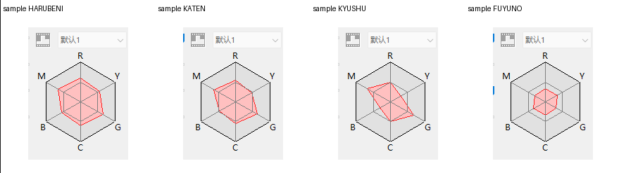
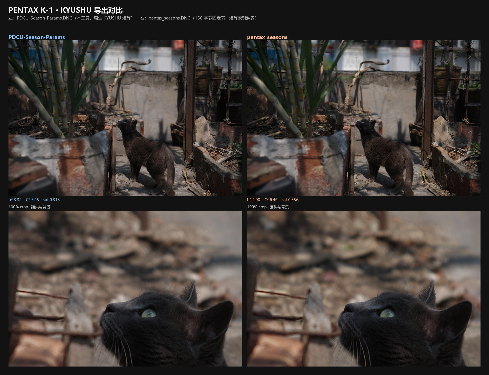

# PDCU MOD 工具

PDCU 宾得相机DNG文件补齐四季色彩矩阵及曲线参数工具(春红HARUBENI、夏至KATEN、九秋KYUSHU、冬日FUYUNO)


## 四季滤镜-色彩雷达图


## 四季滤镜-机型适配表（S档>A档>B档）
| # | 机型 | 档 | 四季数据来源 | max\|ΔR\| | 验证 |
|---:|---|---|---|---:|---|
| 1 | **PENTAX KF** | S | 机内原生四季表（本项目基准） | 0 | donor 本体 |
| 2 | **PENTAX K-70** | S | 内置 KF 表；21 个基础矩阵与 KF 逐字节相同，Y=I | 0 | 九机同场景 |
| 3 | **PENTAX K-1** | S | 机内原生 K-1 四季表 | 7.3×10⁻⁵ | 九机同场景 |
| 4 | **PENTAX K-1 Mark II** | S | 内置 K-1 原生四季表；28 条记录 / 21 个基础矩阵与 K-1 逐字节相同，Y=I | 7.3×10⁻⁵ | PDCU 菜单 + As Shot 零变化 + 同场景比值（v2.4） |
| 5 | **PENTAX K-3** | A | KF×Y，Y 来自自身 0x021B | 5.7×10⁻⁵ | 九机同场景，CM2 pass |
| 6 | **PENTAX K-3 II** | A | 同 K-3 的 Y | 5.7×10⁻⁵ | 九机同场景 |
| 7 | **PENTAX K-5 II** | A | 基准与 K-3 逐字节相同，同一张表 | 6.0×10⁻⁵ | 矩阵/画面 ΔE；未 PDCU 实测 |
| 8 | **PENTAX K-5 II s** | A | 同 K-5 II | 6.0×10⁻⁵ | 同 K-5 II |
| 9 | **PENTAX KP** | A | KF×Y(KP) | 6.3×10⁻⁵ | 九机同场景，CM2 pass |
| 10 | **PENTAX K-S2** | A | KF×Y(K-S2) | 4.3×10⁻⁵ | 九机同场景，CM2 警告 1.3×10⁻² |
| 11 | **PENTAX 645Z** | A | KF×Y(645Z) | 4.4×10⁻⁵ | 九机同场景，CM2 警告 2.7×10⁻³ |
| 12 | **PENTAX 645D** | A | KF×Y(645D)，Y 来自自身 0x021B；0x021A 重建为 12 参数 | 5.8×10⁻⁵ | PDCU 菜单 + 四季渲染实测（v2.2），CM2 pass 4.0×10⁻⁵ |
| 13 | **PENTAX K-50** | B | ColorMatrix2 推算 Y | 5.7×10⁻⁵ | 九机同场景 + K-3 渲染对照 |
| 14 | **PENTAX K-01** | B | ColorMatrix2 推算 Y | 5.5×10⁻⁵ | PDCU 渲染复核（舞狮），无同场景定量 |
| 15 | **PENTAX K-30** | B | ColorMatrix2 推算 Y | 5.4×10⁻⁵ | PDCU 渲染复核（街景），无同场景定量 |
| 16 | **PENTAX MX-1** | B | ColorMatrix2 推算 Y（1/1.7"） | 1.07×10⁻⁴ | PDCU 菜单 + 四季渲染 + 同场景比值 + As Shot 零变化（v2.3） |
| 17 | **PENTAX Q7** | B | ColorMatrix2 推算 Y（小底） | 5.1×10⁻⁵ | 九机同场景，但 Y 不在单反校准线上 |

> 表里的 max|ΔR| 是四季风格 R = M季节·inv(M基准) 与 KF 原生的最大差；Q13 一个 LSB
> 是 1.22×10⁻⁴，所以**全部机型都在一个量化步长以内**。
> S 档：原生或等价原生（4 台）
> A 档：机身 0x021B 基准精确校准（8 台）
这 8 台都有 `0x021B` 基准矩阵，工具运行时算 `Y = inv(M_KF[0])·M_body[0]`，
再把 KF 四季矩阵乘上 Y。数学上就是 Pentax 生成各机身表的做法，所以是“精确解”。
> B 档：ColorMatrix2 推算（5 台）
这 5 台没有 `0x021A`/`0x021B`，Y 只能由 DNG 的 ColorMatrix2 反推：

## 所有机型实测（2026-10-27）
九台机身、同一场景、同一套 PDCU 5.10.2.2 渲染，仅切换“自定义影像”。
每机型的四季效果图、矩阵残差、色卡 ΔE 与渲染一致性见
[`docs/PDCU-九机型四季实测.md`](docs/PDCU-九机型四季实测.md)。

## 工具对照判定（2026-10-29）

同一张 K-1 场景，比较本工具与3年前开发的 `pentax_seasons`工具 产出的四季 DNG/JPG：
本工具的 DNG 里 KYUSHU 矩阵与 K-1 机内 **逐字节相同**（相对风格残差 0），
`pentax_seasons` 工具的文件只有四季的影调记录、矩阵索引全部越界（KYUSHU 指向 #24，
但文件只有 #0–#20）。两张 PDCU KYUSHU JPG 平均只差 **ΔE00 1.15**，但本工具那张
更冷、更淡，方向与 KYUSHU 的“压暗、偏冷/低饱和”一致。分析见
[`docs/PDCU-KYUSHU-四季对比判定.md`](docs/PDCU-KYUSHU-四季对比判定.md)，
对比图 [`docs/PDCU-KYUSHU-四季对比.jpg`](docs/PDCU-KYUSHU-四季对比.jpg)。

## 所有机型排名统计（2026-10-29）
[`docs/PDCU-支持机型四季水准排名.md`](docs/PDCU-支持机型四季水准排名.md)。

## 运行

发布文件：`dist/PDCU-Season-Params.exe`（或 `dist/PDCU-Season-ParamsV2.5.zip`）

双击运行，首次运行 Windows SmartScreen 可能提示
“未知发布者”，选择“更多信息 -> 仍要运行”。

## 版本
- **v2.5**：界面改为 Lightroom 暗黑风格：近黑画布、深色卡片、蓝色强调色、
  圆角控件与深色对话框；工具更名为 **PDCU MOD**，标题区加入 logo 和新的
  功能说明。「季节参数来源」精简为四个内置选项（K-1 / K-1 Mark II、
  KF / K-70、645D、K-30 系列），不再显示技术说明；自定义 DNG 来源收进
  「高级」。转换逻辑与输出文件不变：14 组机型自检全部通过，与 v2.4 记录的
  8 个参考 SHA-256 逐字节相同；其余机型的 exe 输出也与源码 CLI 输出一致。
- **v2.4**：新增 **PENTAX K-1 Mark II**。K-1 Mark II 的 28 条 `0x021A` 模式记录、
  21 个 `0x021B` 基础矩阵与 K-1 **逐字节相同**，所以直接复用 K-1 原生四季表
  （Y=I），四季矩阵与 K-1 逐字节一致，相对风格残差为 0；与 KF 原生的差仍只有
  4.7×10⁻⁵～7.3×10⁻⁵。文件布局上 `0x021A` 从 1,146 B 缩到 860 B，`0x021B`
  后只有 2 B 空位（`0x021C` 在 0x2B06），工具把矩阵表迁到新表尾；补丁前后 As Shot
  逐像素相同，PDCU 5.10.2.2 实测识别为 PENTAX K-1 Mark II，四项都能列出并渲染。
  GUI 会自动识别 K-1 Mark II 并选 `k1ii` 内置数据。分析见
  [`docs/PDCU-K1II-四季移植.md`](docs/PDCU-K1II-四季移植.md)。
- **v2.3**：新增 **PENTAX MX-1**。MX-1 没有 `0x021A` / `0x021B`，私有块是
  小端、只有 51,458 B、82 条 IFD 条目；工具会新建两个标签，把被扩大的 IFD
  挤占的 `0x0222` 搬到预览 JPEG 后的空闲区，再用 MX-1 自己的 ColorMatrix2
  校准 KF 四季矩阵。PDCU 5.10.2.2 实测识别为 PENTAX MX-1，列出并渲染四项；
  补丁前后 As Shot 逐像素相同，四季/As Shot 比值与九机均值一致（色向偏差
  ≤1.67%）。Y 与 K-3 差 1.04×10⁻¹（Q7 为 3.4×10⁻¹），属于按 ColorMatrix2
  外推，不是官方 MX-1 四季数据。分析见
  [`docs/PDCU-MX1-KF四季移植.md`](docs/PDCU-MX1-KF四季移植.md)。
- **v2.2**：新增 **PENTAX 645D**。645D 的 `0x021A` 是旧布局（11 参数 / 24 B 记录、
  大端、表紧排），PDCU 5.10.2.2 只在 **12 参数 / 26 B** 布局下列出四季，所以工具会
  把整张表重建成 12 参数（原有 24 条记录逐字段保留，缺的参数 10 写 `0xFFFF`），
  并把 0x021A / 0x021B 一起迁到私有块空闲区。四季矩阵 = KF 四季矩阵 ×
  `Y = inv(M_KF[0])·M_645D[0]`，量化误差 ≤0.5 个 Q13 LSB、相对风格与 KF 差
  ≤5.8×10⁻⁵；645D 的 0x021B 基准与 ColorMatrix2 互证到 4.0×10⁻⁵。PDCU 实测
  能列出并渲染四项。注意：布局升级后 PDCU 对 645D 的默认显影会变（实测更接近
  机身 JPEG 预览）。四季效果总览见
  [`docs/PDCU-645D-四季效果.png`](docs/PDCU-645D-四季效果.png)，
  分析见 [`docs/PDCU-645D-KF四季移植.md`](docs/PDCU-645D-KF四季移植.md)。
- **v2.1**：K-30 的内置表改用 K-30 自己的 ColorMatrix2 校准（与 K-50 / K-01
  同一公式），不再用 K-3 基准代理，与旧表相比只有 6 个 Q13 系数差 1 个 LSB；
  K-01 的内置表也按 `sample/K01.DNG` 的 `0xC622` 原值重算，2 个系数各修正
  1 个 LSB。新增 `CM2 check`：用目标 DNG 的 ColorMatrix2 复核 `0x021B` 基准，
  偏差 >1×10⁻³ 时日志告警（645Z / K-S2 会触发；实测 PDCU 的屏幕渲染与
  另存 JPEG 都不读 CM2，校准仍以 `0x021B` 为准）。
- **v2.0**：新增 **PENTAX KP / K-S2 / K-50 / Q7**。KP、K-S2 与 K-3 一样，
  加文件即按目标自己的 `0x021B` 基准矩阵自动校准；K-50、Q7 机内完全没有
  `0x021A` / `0x021B`，工具新建标签，并用各自 DNG ColorMatrix2 推算的
  `Y` 校准 KF 四季矩阵（K-50 与 K-3 校准线只差 3.7×10⁻⁵，Q7 为小底推算）。
  九台同场景实测见
  [`docs/PDCU-九机型四季实测.md`](docs/PDCU-九机型四季实测.md)。
- **v1.9**：支持 **Digital Camera Utility 5 另存的 DNG**。这类文件的 Pentax
  MakerNote 在 EXIF `0x927C`（不是 `0xC634`）；工具现在按同样的私有 IFD
  结构读取，并在 `0x021B` 后没有空位时把矩阵表迁到 MakerNote 内空闲区。
  `sample/K5iis.dng`（K-5 II s，DCU 另存）已实测：直接加文件即可补四季，
  PDCU 能列出并渲染四项。
- **v1.8**：新增 **PENTAX K-3 / K-3 II / K-5 II / K-5 II s / 645Z** 的自动校准。
  工具在运行时读取目标自己的 `0x021B` 基准矩阵，算出 `Y = inv(M_donor[0])·M_target[0]`，
  再把 donor 的四季矩阵乘上 Y 写回——这就是 Pentax 生成各机身矩阵表的方式，
  所以跨机型从“近似”变成“精确”。这五台机型不需要勾选“跨机型”，加文件即用。
- **v1.7**：新增 PENTAX K-01 支持；K-01 与 K-30 同属“无 0x021A/0x021B、私有块大端”
  结构，但 IFD 条目数和预览偏移不同。K-01 自动识别，用 K-01 色彩空间单独校准。
- **v1.6**：新增 PENTAX K-30 支持；K-30 没有 0x021A/0x021B，工具会新建标签，
  并用 K-30 色彩空间校准 KF 四季矩阵。K-30 自动识别。
- **v1.5**：内置 KF 四季参数，K-70 自动识别。
- **v1.4**：内置 KF 数据；KF / K-70 按“基础矩阵相同”精确移植。

### v2.5 打包记录（2026-10-30）

构建：Python 3.14.3 + PyInstaller 6.22.3，`PDCU-Season-Params.spec`（onefile），
FileDescription / ProductName **PDCU MOD**，FileVersion / ProductVersion **2.5.0.0**。

| 产物 | 大小 |
|---|---:|
| `dist/PDCU-Season-Params.exe` | 12,892,397 B |
| `dist/PDCU-Season-ParamsV2.5.zip`（exe + 使用说明） | 12,643,922 B |

打包后 exe 的自检（`--selftest-*`），14 组机型自检全部通过，且与源码 CLI 输出逐字节相同：

| 机型 | 自检参数 | 自检输出 SHA-256 |
|---|---|---:|
| K-1 Mark II | `--selftest-k1ii` | `33FCCDF4D3DC42B0ED242673C9F0A7DCDABB5A07F247D86287B0058696971493` |
| K-1 | `--selftest` | `5F0B52CC1D116EAA48224C1A38722EBE6823ABADA3BDD7ED7F533C275E987584` |
| KP | `--selftest-kf` | `3BF7F56E17F2CDB83847E9C236B32F28F79E3A2CBC3C05330B83810601A91E22` |
| 645D | `--selftest-645d` | `E9497DE8099EB53401922103DC46144640EFE416080AE85B36AA40CD07AEBE62` |
| K-30 | `--selftest-k30` | `328E52A671C26AA5E8524003E51F78A2F55475AA9665E4C6EECA5EB648A25AEC` |
| K-01 | `--selftest-k01` | `06B87D743391237AC54EDC847CA8FA97982EDF87BC568F3311E5415B813B3745` |
| 645Z | `--selftest-kf` | `768EC1AAE05BD5E84AD374B7122DE711273054C8DE379BF1ECB89B4346988135` |
| MX-1 | `--selftest-mx1` | `6CCF0D6238B28CEDF2DB040552A5802A204A4A4BD62BDD3F3188B50C3CE9448F` |

前四项与 v2.4、后四项与 v2.3 / v2.2 记录逐字节相同；K-50 / Q7 / K-3 / K-3 II /
K-S2 / K-70 也全部通过，并与源码 CLI 输出逐字节一致。

SHA-256：

```
exe     841FB3B42E207EED8DF4196C94FA9039308BD5AAEEC465B46541DF73265F96B3
zip     E7346E5B58908E07366AC6EEF45B3CEB7C1D59ECBDEEF4385896592715470B4E
```

### v2.4 打包记录（2026-10-29）

构建：Python 3.14.3 + PyInstaller 6.22.3，`PDCU-Season-Params.spec`（onefile），
FileVersion / ProductVersion **2.4.0.0**。

| 产物 | 大小 |
|---|---:|
| `dist/PDCU-Season-Params.exe` | 12,601,356 B |
| `dist/PDCU-Season-ParamsV2.4.zip`（exe + 使用说明） | 12,355,557 B |

打包后 exe 的自检（`--selftest-*`），与 CLI 生成物逐字节比对：

| 机型 | 自检参数 | 自检输出 SHA-256 |
|---|---|---:|
| K-1 Mark II | `--selftest-k1ii` | `33FCCDF4D3DC42B0ED242673C9F0A7DCDABB5A07F247D86287B0058696971493` |
| K-1 | `--selftest` | `5F0B52CC1D116EAA48224C1A38722EBE6823ABADA3BDD7ED7F533C275E987584` |
| KP | `--selftest-kf` | `3BF7F56E17F2CDB83847E9C236B32F28F79E3A2CBC3C05330B83810601A91E22` |
| 645D | `--selftest-645d` | `E9497DE8099EB53401922103DC46144640EFE416080AE85B36AA40CD07AEBE62` |

K-1 / KP / 645D 与本次源码 CLI 及 v2.3 记录的参考值逐字节相同；v2.4 只新增 K-1 Mark II，其他机型输出不变。

SHA-256：

```
exe     F280A86927743B0050C1AB9AFE7C44DD0FB4B0EE8FDA8208B5E602DB95E83A2A
zip     2CE436146D39F9EC1237B9C693B4141F3E234F3851BDEA41147FB8CAF3F15FAC
K1II    33FCCDF4D3DC42B0ED242673C9F0A7DCDABB5A07F247D86287B0058696971493
```

### v2.3 打包记录（2026-10-29）

构建：Python 3.14.3 + PyInstaller 6.22.3，`PDCU-Season-Params.spec`（onefile），
FileVersion / ProductVersion **2.3.0.0**。

| 产物 | 大小 |
|---|---:|
| `dist/PDCU-Season-Params.exe` | 12,601,025 B |
| `dist/PDCU-Season-ParamsV2.3.zip`（exe + 使用说明） | 12,354,548 B |

打包后 exe 的自检（`--selftest-*`），与 CLI 生成物逐字节比对：

| 机型 | 自检参数 | 自检输出 SHA-256 |
|---|---|---:|
| MX-1 | `--selftest-mx1` | `6CCF0D6238B28CEDF2DB040552A5802A204A4A4BD62BDD3F3188B50C3CE9448F` |
| 645D | `--selftest-645d` | `E9497DE8099EB53401922103DC46144640EFE416080AE85B36AA40CD07AEBE62` |
| K-30 | `--selftest-k30` | `328E52A671C26AA5E8524003E51F78A2F55475AA9665E4C6EECA5EB648A25AEC` |
| K-01 | `--selftest-k01` | `06B87D743391237AC54EDC847CA8FA97982EDF87BC568F3311E5415B813B3745` |
| KP | `--selftest-kf` | `3BF7F56E17F2CDB83847E9C236B32F28F79E3A2CBC3C05330B83810601A91E22` |
| 645Z | `--selftest-kf` | `768EC1AAE05BD5E84AD374B7122DE711273054C8DE379BF1ECB89B4346988135` |

后五项与 v2.2 记录的参考值逐字节相同（v2.3 只新增 MX-1，其他机型输出不变）。

SHA-256：

```
exe     5EF5C37F4C33165FA54B1229334D5A2F7BD335596747BEFBAEAD105BF1E6D06C
zip     5908023ECC7C3D1453F31E313B9BD1D15F0F26B120D72A02C6A4CC1C04AF4ECA
MX1     6CCF0D6238B28CEDF2DB040552A5802A204A4A4BD62BDD3F3188B50C3CE9448F
```

### v2.2 打包记录（2026-10-28）

构建：Python 3.14.3 + PyInstaller 6.22.3，`PDCU-Season-Params.spec`（onefile、UPX），
FileVersion / ProductVersion **2.2.0.0**。

| 产物 | 大小 |
|---|---:|
| `dist/PDCU-Season-Params.exe` | 12,598,554 B |
| `dist/PDCU-Season-ParamsV2.2.zip`（exe + 使用说明） | 12,352,469 B |

打包后 exe 的自检（`--selftest-*`），与 CLI 生成物逐字节比对：

| 机型 | 自检参数 | 自检输出 SHA-256 |
|---|---|---:|
| 645D | `--selftest-645d` | `E9497DE8099EB53401922103DC46144640EFE416080AE85B36AA40CD07AEBE62` |
| K-30 | `--selftest-k30` | `328E52A671C26AA5E8524003E51F78A2F55475AA9665E4C6EECA5EB648A25AEC` |
| K-01 | `--selftest-k01` | `06B87D743391237AC54EDC847CA8FA97982EDF87BC568F3311E5415B813B3745` |
| KP | `--selftest-kf` | `3BF7F56E17F2CDB83847E9C236B32F28F79E3A2CBC3C05330B83810601A91E22` |
| 645Z | `--selftest-kf` | `768EC1AAE05BD5E84AD374B7122DE711273054C8DE379BF1ECB89B4346988135` |

后四项与 v2.1 记录的参考值逐字节相同（v2.2 只新增 645D，其他机型输出不变）。

SHA-256：

```
exe     E2608C9E9C02503A4F48214D0E8CD1EB0BC481BD04094ACF5FA147BAC0D36CD3
645D    E9497DE8099EB53401922103DC46144640EFE416080AE85B36AA40CD07AEBE62
```

### v2.1 打包记录（2026-10-28）

构建：Python 3.14.3 + PyInstaller 6.22.3，`PDCU-Season-Params.spec`（onefile、UPX），
FileVersion / ProductVersion **2.1.0.0**。

| 产物 | 大小 |
|---|---:|
| `dist/PDCU-Season-Params.exe` | 12,594,289 B |
| `dist/PDCU-Season-ParamsV2.1.zip`（exe + 使用说明） | 12,347,171 B |

打包后 exe 的自检（`--selftest-*`），与 CLI 生成物逐字节比对：

| 机型 | 自检输出 = 参考文件 | CM2 check |
|---|---|---:|
| K-30 | `sample/K30_KF_all.DNG` | 无（无 0x021B，不校准） |
| K-01 | `sample/K01_KF_all.DNG` | 无（同上） |
| KP | `sample/season_all/KP_all.dng` | pass，dY 1.8×10⁻⁵ |
| 645Z | `sample/season_all/645Z_all.dng` | **WARNING**，dY 2.7×10⁻³ |

645Z 的告警在打包版 GUI 里同样出现：加文件 → 开始转换，日志为

```
按目标机身校准：Y = [...]  style: median 7.2e-05, max 9.8e-05 over 27 modes
CM2 check: WARNING - the target's 0x021B base and its ColorMatrix2 imply
different Y (dY 2.7e-03); using the 0x021B base
```

SHA-256（v2.1 发布物与 K-30 / K-01 新内置表的输出）：

```
exe     64C9240D90F8E81C1239857D9BEE2844EBA0DCD5D9FBF8E01DAF532B50AFA89A
K30     328E52A671C26AA5E8524003E51F78A2F55475AA9665E4C6EECA5EB648A25AEC
K01     06B87D743391237AC54EDC847CA8FA97982EDF87BC568F3311E5415B813B3745
KP      3BF7F56E17F2CDB83847E9C236B32F28F79E3A2CBC3C05330B83810601A91E22
645Z    768EC1AAE05BD5E84AD374B7122DE711273054C8DE379BF1ECB89B4346988135
```

## 支持机型

| 机型 | 推荐用法 | 说明 |
|---|---|---|
| **PENTAX K-1** | 内置 K-1 四季参数 | 原有支持；兼容老固件带填充的 `0x021A` |
| **PENTAX K-1 Mark II** | 内置 K-1 / K-1 Mark II 四季参数 | v2.4 新增；28 条记录 / 21 个基础矩阵与 K-1 逐字节相同，Y=I；`0x021B` 自动迁移 |
| **PENTAX KF** | 内置 KF / K-70 四季参数 / 同机型 donor | KF 文件通常已自带四季；也可作为 K-70 的 donor |
| **PENTAX K-70** | 内置 KF / K-70 四季参数 | KF 与 K-70 共用同一套 21 个基础色彩矩阵，可精确补四季 |
| **PENTAX K-30** | 内置 K-30 系列四季参数 | K-30 无 0x021A/0x021B；工具新建标签并用其 ColorMatrix2 校准 |
| **PENTAX K-01** | 内置 K-30 系列四季参数 | K-01 同样无表、大端；IFD 95 条，工具按实际布局重建 |
| **PENTAX K-3** | 内置 KF 四季参数 + 自动校准 | 与 K-3 II / K-5 II / K-5 II s 共用同一张基准矩阵，校准后精确 |
| **PENTAX K-3 II** | 内置 KF 四季参数 + 自动校准 | 矩阵表与 K-3 只差第 2 号一格，自动校准结果与 K-3 完全相同 |
| **PENTAX K-5 II / K-5 II s** | 内置 KF 四季参数 + 自动校准 | 私有块是**大端**、25 条记录 / 18 个矩阵；两台矩阵表逐字节相同 |
| **PENTAX 645Z** | 内置 KF 四季参数 + 自动校准 | 基准矩阵与 K-3 不同，工具会算出 645Z 自己的 Y |
| **PENTAX 645D** | 内置 645D 四季参数 | v2.2 新增；11 参数表自动重建为 12 参数，四季矩阵按机身校准 |
| **PENTAX KP** | 内置 KF 四季参数 + 自动校准 | v2.0 新增；有 `0x021B`，按机身校准 |
| **PENTAX K-S2** | 内置 KF 四季参数 + 自动校准 | v2.0 新增；有 `0x021B`，按机身校准 |
| **PENTAX K-50** | 内置 K-30 系列四季参数 | v2.0 新增；无表、大端；Y 由 ColorMatrix2 推算 |
| **PENTAX Q7** | 内置 K-30 系列四季参数 | v2.0 新增；无表、小端；Y 由 ColorMatrix2 推算 |
| **PENTAX MX-1** | 内置 K-30 系列四季参数 | v2.3 新增；无表、小端；82 条 IFD，只搬 `0x0222`；Y 由 ColorMatrix2 推算 |

KF / K-70 的四季记录来自同一套模式表，矩阵也按同一套基础色彩矩阵校准；
v1.4 起内置 KF 数据，K-70 不需要再准备 donor DNG，也不需要勾选“跨机型”复选框。

K-3 / K-3 II / K-5 II / K-5 II s / 645Z / KP / K-S2 没有机内四季数据，但它们的
`0x021B` 矩阵表就是 KF 的表乘一个 3×3 输入校准 `Y`（K-3、645Z 已逐矩阵验证到
1.5×10⁻⁴；KP、K-S2 在 v2.0 的九机型实测中残差 ≤6.3×10⁻⁵）。
v1.8 起工具在运行时按目标的基准矩阵算 `Y`，把 KF 四季矩阵乘上去再写入，
所以四季风格与 KF 原生一致，不再是“近似”。判据与误差见
[`docs/PDCU-K3-四季三方案对比.md`](docs/PDCU-K3-四季三方案对比.md)、
[`docs/PDCU-K3II-四季三方案对比.md`](docs/PDCU-K3II-四季三方案对比.md)、
[`docs/PDCU-K52-K52s-四季三方案对比.md`](docs/PDCU-K52-K52s-四季三方案对比.md)、
[`docs/PDCU-645Z-四季三方案对比.md`](docs/PDCU-645Z-四季三方案对比.md)。

K-30 / K-01 / K-50 / Q7 / MX-1 是另一种情况：它们的私有块里完全没有
`0x021A` / `0x021B`；K-30 / K-01 / K-50 的私有块是大端，Q7 / MX-1 是小端。
工具会：

1. 把被扩大的 IFD 挤占的小标签搬到预览 JPEG 后的空闲区：
   K-30 / K-01 的 `0x0200` / `0x0201` / `0x0205`、Q7 的
   `0x0200` / `0x0201` / `0x0206`、MX-1 的 `0x0222`；
2. 按目标实际的条目数重建 IFD（K-30 为 102 条，K-01 为 97 条，
   MX-1 为 84 条），插入 `0x021A` / `0x021B`；
3. 把 KF 的 4 条四季记录、4 个矩阵转换成目标的字节序；
4. K-30 / K-01 / K-50 都用各自 DNG 的 ColorMatrix2 单独校准，
   `Y = T(KF)·inverse(T(机身))`；三台的 Y 最大只差 3.2×10⁻⁵。
5. K-30 的 Y 与 K-3 的 Y 差 2.2×10⁻⁵，量化后的四季矩阵与 K-3 的精确解
   只差 1 个 Q13 LSB；Q7 / MX-1 用各自的 ColorMatrix2 校准，1/1.7" 小底的
   Y 离单反线较远（Q7 3.4×10⁻¹、MX-1 1.0×10⁻¹），属于最佳推算。

详细分析见 [`docs/PDCU-K30-KF四季移植.md`](docs/PDCU-K30-KF四季移植.md)、
[`docs/PDCU-K01-KF四季移植.md`](docs/PDCU-K01-KF四季移植.md) 和
[`docs/PDCU-MX1-KF四季移植.md`](docs/PDCU-MX1-KF四季移植.md)。

v1.9 起还支持 **DCU 5 另存的 DNG**：它们的 Pentax MakerNote 在 EXIF `0x927C`，
不是相机 DNG 的 `0xC634`。工具会按同样的私有 IFD 结构读写；如果 `0x021B`
后面没有空位，矩阵表会自动迁到 MakerNote 内的空闲区。K-5 II s 的 DCU 文件
`sample/K5iis.dng` 已实测，生成 `sample/K5iis_all.dng` 后 PDCU 能列出并渲染四季。
与 K-1 原生的对比见
[`docs/PDCU-K5iis-K1-四季对比.md`](docs/PDCU-K5iis-K1-四季对比.md)。

## 使用步骤

1. 点“添加文件…”选择一个或多个 `.DNG` 文件（相机 DNG 和 DCU 另存的 DNG 都可以）；
2. 选择「季节参数来源」（四个内置选项，添加文件后自动识别机型）：
   - **内置 K-1 / K-1 Mark II**：适用于 `PENTAX K-1`、`PENTAX K-1 Mark II`；
   - **内置 KF / K-70**：适用于 `PENTAX KF / K-70`，以及
     `K-3 / K-3 II / K-5 II / K-5 II s / 645Z / KP / K-S2`；
   - **内置 645D**：适用于 `PENTAX 645D`；
   - **内置 K-30 系列**：适用于 `PENTAX K-30 / K-01 / K-50 / Q7 / MX-1`；
   - **高级**：选择一张 DNG 作为来源；其他机型可勾选「允许使用其他机型的 DNG」。
3. 选择输出位置：
   - 默认与源文件同目录，文件名加 `_all`；
   - 也可以指定输出目录；
4. 点“开始转换”，完成后点“打开输出目录”。

添加文件后，工具会自动读取机型并选中对应来源；K-1 Mark II 自动使用 `k1ii` 数据，
K-3 / K-5 / 645Z / KP / K-S2 使用 KF 数据并按机身自动适配。

日志里的 `按目标机身校准：Y = … style: median 8.2e-05 …` 就是这次校准：
`median` 越小说明两台机身的风格表越一致；超过 3×10⁻³ 会提示“风格表不一致”。

## 注意

- 工具补的是 `0x021A` 季节记录和 `0x021B` 3×3 颜色矩阵，
  不修改 raw 像素，也不覆盖源文件。
- 已兼容老固件 K-1：`0x021A` 带保留填充、`0x021B` 后没有空位时，
  工具会自动识别记录区并把矩阵表迁移到私有块内安全空闲区。
- K-1 Mark II 与 K-1 的 28 条模式记录、21 个基础矩阵逐字节相同，写入的四季
  矩阵与 K-1 完全一致（相对风格残差 0），不是推算值；它的 `0x021B` 后同样
  只有 2 B 空位（`0x021C` 在 0x2B06），工具会把矩阵表迁到新表尾。详见
  [`docs/PDCU-K1II-四季移植.md`](docs/PDCU-K1II-四季移植.md)。
- KF / K-70 是“跨机型但基础矩阵相同”的特例：工具会自动按精确移植处理，
  日志会写“KF / K-70 基础矩阵相同”。
- K-3 / K-3 II / K-5 II / K-5 II s / 645Z：工具用目标自己的 `0x021B` 基准矩阵
  算出 `Y`，把 KF 四季矩阵乘上去再写入；即使勾了“跨机型”也会校准。
  想退回“原样搬 donor 矩阵”，命令行加 `--no-calibrate`。
- K-5 II / K-5 II s 的私有块是**大端**（K-3 / 645Z 是小端），工具按目标文件的
  字节序自动转换。
- K-30 没有机内四季，也没有 `0x021B` 可对照；校准使用它自己的 DNG ColorMatrix2
  （`sample/K30.DNG`），Y 与 K-3 只差 2.2×10⁻⁵，写出的矩阵与 K-3 精确解
  只差 1 个 Q13 LSB。结构上四季菜单和渲染都可用，但这是本工具的最佳推算，
  不是官方 K-30 固件数据。
- K-01 与 K-30 同代同像素，真实 K-01 的 ColorMatrix2 与 K-30 只有极小差异；
  工具为 K-01 单独内置了校准数据。`sample/K01.DNG` 是真实 K-01 文件，
  v1.7 已在 PDCU 中实测识别为 PENTAX K-01 并列出四季。
- 645D 有 0x021A / 0x021B，但记录是 **11 参数 / 24 字节**（PDCU 只认 12 参数 /
  26 字节）。工具会把整张表重建成 12 参数：原有 24 条记录逐字段保留，只补一个
  `0xFFFF` 的参数 10 槽；实测 `0xFFFF` 与 `0` 渲染逐像素相同。副作用是 PDCU
  对 645D 的默认显影会切到新路径，实测比旧路径更接近机身 JPEG 预览
  （均值 154.6/114.8/100.6 vs 预览 161.9/115.3/100.5；旧路径 121.2/83.7/74.0）。
  如果不希望默认显影改变，请不要对 645D 用本工具。
- 645D 的四季相对风格与 KF 差 ≤5.8×10⁻⁵，但它自己的旧风格表与 KF 不同
  （24 个同名模式的中位差 7.3×10⁻²），所以工具用 645D 专用内置数据，
  不会被“风格表不一致”拦住。
- 645Z / K-3 / K-S2 / KP 没有机内四季数据，但它们的矩阵表与 KF 只差一次输入校准，
  v1.8 / v2.0 按目标机身校准后四季风格与 KF 原生一致（645Z、KP、K-S2 需要自己的 `Y`）。
- 工具会用目标 DNG 的 `0xC622`（ColorMatrix2）复核 `0x021B` 基准：两条路算出的
  `Y` 相差超过 1×10⁻³ 时日志会打印 `CM2 check: WARNING`（645Z / K-S2 是已知情况，
  校准仍以 `0x021B` 为准，因为 PDCU 实际乘的是它——屏幕渲染和另存 JPEG 都验证过；
  实测见 [`docs/PDCU-AsShot基准矩阵验证.md`](docs/PDCU-AsShot基准矩阵验证.md)）。
- K-50 没有机内四季，也没有 `0x021B` 可对照；v2.0 用它的 DNG ColorMatrix2
  校准，Y 与 K-3 的 Y 只差 3.7×10⁻⁵，四季矩阵与 K-30 内置值差 ≤1 LSB。
  以 K-70 为基准的同场景复核（矩阵残差 < 半个 LSB、与精确校准的 K-3
  渲染差 ≤0.67%、As Shot 逐像素不变）见
  [`docs/PDCU-K50-K70四季对比.md`](docs/PDCU-K50-K70四季对比.md)。
- Q7 没有机内四季，1/1.7" 小底与单反色彩空间差得远，v2.0 用 Q7 自己的
  ColorMatrix2 校准。结构上四季菜单和渲染都可用，但这是**最佳推算**，
  不是官方 Q7 固件数据。
- MX-1 是 v2.3 新增：没有机内四季，私有块只有 51,458 B，工具只搬 `0x0222`；
  用 MX-1 自己的 ColorMatrix2 校准。PDCU 实测识别为 PENTAX MX-1，四项都能
  列出并渲染；补丁前后 As Shot 逐像素相同，四季/As Shot 比值与九机均值一致
  （色向偏差 ≤1.67%）。它的 Y 与 K-3 差 1.04×10⁻¹，仍是**最佳推算**，
  不是官方 MX-1 固件数据。详见
  [`docs/PDCU-MX1-KF四季移植.md`](docs/PDCU-MX1-KF四季移植.md)。
- 九台机身的同场景实测、四季效果图和全部数值见
  [`docs/PDCU-九机型四季实测.md`](docs/PDCU-九机型四季实测.md)，
  九机总览图 [`docs/PDCU-九机型四季总览.png`](docs/PDCU-九机型四季总览.png)。
  第十台 MX-1 的菜单、四季效果与九机比值对照见
  [`docs/PDCU-MX1-KF四季移植.md`](docs/PDCU-MX1-KF四季移植.md)。
  K-1 Mark II（第 17 台）与 K-1 逐字节同表，实测见
  [`docs/PDCU-K1II-四季移植.md`](docs/PDCU-K1II-四季移植.md)。
- `sample/` 下的参考截图额外在 PDCU 里把“颜色”设成了“红色”。
  这个设置不在 DNG 的季节数据里；要完全复刻参考图，需要在 PDCU 里
  把“颜色”也设成“红色”。
- 雷达图本身按当前照片的颜色计算，不同照片不会得到完全相同的形状。
- 勾选“覆盖已存在的输出文件”才会覆盖同名的 `_all` 文件。

---

版权所有 © 2026 KimHoLau X deepseek harness
