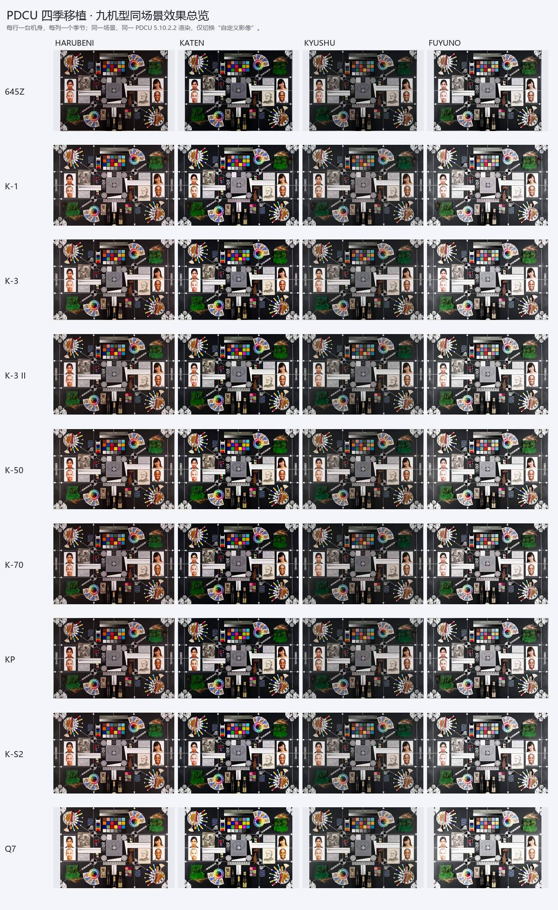

# PDCU 四季参数补齐工具（GUI 版）v2.1


## PDCU4季滤镜-色彩雷达图


## K70->KF(4季滤镜实测)


## 九机型四季实测（2026-10）


九台机身、同一场景、同一套 PDCU 5.10.2.2 渲染，仅切换“自定义影像”。
每机型的四季效果图、矩阵残差、色卡 ΔE 与渲染一致性见
[`docs/PDCU-九机型四季实测.md`](docs/PDCU-九机型四季实测.md)。
## 运行

发布文件：`dist/PDCU-Season-Params.exe`（或 `dist/PDCU-Season-ParamsV2.1.zip`）

双击运行，不需要安装 Python。首次运行 Windows SmartScreen 可能提示
“未知发布者”，选择“更多信息 -> 仍要运行”。

## 版本

- **v2.0**：新增 **PENTAX KP / K-S2 / K-50 / Q7**。KP、K-S2 与 K-3 一样，
  加文件即按目标自己的 `0x021B` 基准矩阵自动校准；K-50、Q7 机内完全没有
  `0x021A` / `0x021B`，工具新建标签，并用各自 DNG ColorMatrix2 推算的
  `Y` 校准 KF 四季矩阵（K-50 与 K-3 校准线只差 3.7×10⁻⁵，Q7 为小底推算）。
  九台同场景实测见
  [`docs/PDCU-九机型四季实测.md`](docs/PDCU-九机型四季实测.md)。
- **v2.1**：K-30 的内置表改用 K-30 自己的 ColorMatrix2 校准（与 K-50 / K-01
  同一公式），不再用 K-3 基准代理，与旧表相比只有 6 个 Q13 系数差 1 个 LSB；
  K-01 的内置表也按 `sample/K01.DNG` 的 `0xC622` 原值重算，2 个系数各修正
  1 个 LSB。新增 `CM2 check`：用目标 DNG 的 ColorMatrix2 复核 `0x021B` 基准，
  偏差 >1×10⁻³ 时日志告警（645Z / K-S2 会触发；实测 PDCU 的屏幕渲染与
  另存 JPEG 都不读 CM2，校准仍以 `0x021B` 为准）。
- **v1.9**：支持 **Digital Camera Utility 5 另存的 DNG**。这类文件的 Pentax
  MakerNote 在 EXIF `0x927C`（不是 `0xC634`）；工具现在按同样的私有 IFD
  结构读取，并在 `0x021B` 后没有空位时把矩阵表迁到 MakerNote 内空闲区。
  `sample/K5iis.dng`（K-5 II s，DCU 另存）已实测：直接加文件即可补四季，
  PDCU 能列出并渲染四项。
- **v1.8**：新增 **PENTAX K-3 / K-3 II / K-5 II / K-5 II s / 645Z** 的自动校准。
  工具在运行时读取目标自己的 `0x021B` 基准矩阵，算出 `Y = inv(M_donor[0])·M_target[0]`，
  再把 donor 的四季矩阵乘上 Y 写回——这就是 Pentax 生成各机身矩阵表的方式，
  所以跨机型从“近似”变成“精确”。这五台机型不需要勾选“跨机型”，加文件即用。
- **v1.7**：新增 PENTAX K-01 支持；K-01 与 K-30 同属“无 0x021A/0x021B、私有块大端”
  结构，但 IFD 条目数和预览偏移不同。K-01 自动识别，用 K-01 色彩空间单独校准。
- **v1.6**：新增 PENTAX K-30 支持；K-30 没有 0x021A/0x021B，工具会新建标签，
  并用 K-30 色彩空间校准 KF 四季矩阵。K-30 自动识别。
- **v1.5**：内置 KF 四季参数，K-70 自动识别。
- **v1.4**：内置 KF 数据；KF / K-70 按“基础矩阵相同”精确移植。

### v2.1 打包记录（2026-10-28）

构建：Python 3.14.3 + PyInstaller 6.22.3，`PDCU-Season-Params.spec`（onefile、UPX），
FileVersion / ProductVersion **2.1.0.0**。

| 产物 | 大小 |
|---|---:|
| `dist/PDCU-Season-Params.exe` | 12,594,289 B |
| `dist/PDCU-Season-ParamsV2.1.zip`（exe + 使用说明） | 12,347,171 B |

打包后 exe 的自检（`--selftest-*`），与 CLI 生成物逐字节比对：

| 机型 | 自检输出 = 参考文件 | CM2 check |
|---|---|---:|
| K-30 | `sample/K30_KF_all.DNG` | 无（无 0x021B，不校准） |
| K-01 | `sample/K01_KF_all.DNG` | 无（同上） |
| KP | `sample/season_all/KP_all.dng` | pass，dY 1.8×10⁻⁵ |
| 645Z | `sample/season_all/645Z_all.dng` | **WARNING**，dY 2.7×10⁻³ |

645Z 的告警在打包版 GUI 里同样出现：加文件 → 开始转换，日志为

```
按目标机身校准：Y = [...]  style: median 7.2e-05, max 9.8e-05 over 27 modes
CM2 check: WARNING - the target's 0x021B base and its ColorMatrix2 imply
different Y (dY 2.7e-03); using the 0x021B base
```

SHA-256（v2.1 发布物与 K-30 / K-01 新内置表的输出）：

```
exe     64C9240D90F8E81C1239857D9BEE2844EBA0DCD5D9FBF8E01DAF532B50AFA89A
K30     328E52A671C26AA5E8524003E51F78A2F55475AA9665E4C6EECA5EB648A25AEC
K01     06B87D743391237AC54EDC847CA8FA97982EDF87BC568F3311E5415B813B3745
KP      3BF7F56E17F2CDB83847E9C236B32F28F79E3A2CBC3C05330B83810601A91E22
645Z    768EC1AAE05BD5E84AD374B7122DE711273054C8DE379BF1ECB89B4346988135
```

## 支持机型

| 机型 | 推荐用法 | 说明 |
|---|---|---|
| **PENTAX K-1** | 内置 K-1 四季参数 | 原有支持；兼容老固件带填充的 `0x021A` |
| **PENTAX KF** | 内置 KF 四季参数 / 同机型 donor | KF 文件通常已自带四季；也可作为 K-70 的 donor |
| **PENTAX K-70** | 内置 KF 四季参数 | KF 与 K-70 共用同一套 21 个基础色彩矩阵，可精确补四季 |
| **PENTAX K-30** | 内置 KF→K-30 四季参数 | K-30 无 0x021A/0x021B；工具新建标签并用其 ColorMatrix2 校准 |
| **PENTAX K-01** | 内置 KF→K-30 / K-01 四季参数 | K-01 同样无表、大端；IFD 95 条，工具按实际布局重建 |
| **PENTAX K-3** | 内置 KF 四季参数 + 自动校准 | 与 K-3 II / K-5 II / K-5 II s 共用同一张基准矩阵，校准后精确 |
| **PENTAX K-3 II** | 内置 KF 四季参数 + 自动校准 | 矩阵表与 K-3 只差第 2 号一格，自动校准结果与 K-3 完全相同 |
| **PENTAX K-5 II / K-5 II s** | 内置 KF 四季参数 + 自动校准 | 私有块是**大端**、25 条记录 / 18 个矩阵；两台矩阵表逐字节相同 |
| **PENTAX 645Z** | 内置 KF 四季参数 + 自动校准 | 基准矩阵与 K-3 不同，工具会算出 645Z 自己的 Y |
| **PENTAX KP** | 内置 KF 四季参数 + 自动校准 | v2.0 新增；有 `0x021B`，按机身校准 |
| **PENTAX K-S2** | 内置 KF 四季参数 + 自动校准 | v2.0 新增；有 `0x021B`，按机身校准 |
| **PENTAX K-50** | 内置 KF→K-50 四季参数 | v2.0 新增；无表、大端；Y 由 ColorMatrix2 推算 |
| **PENTAX Q7** | 内置 KF→Q7 四季参数 | v2.0 新增；无表、小端；Y 由 ColorMatrix2 推算 |

KF / K-70 的四季记录来自同一套模式表，矩阵也按同一套基础色彩矩阵校准；
v1.4 起内置 KF 数据，K-70 不需要再准备 donor DNG，也不需要勾选“跨机型”复选框。

K-3 / K-3 II / K-5 II / K-5 II s / 645Z / KP / K-S2 没有机内四季数据，但它们的
`0x021B` 矩阵表就是 KF 的表乘一个 3×3 输入校准 `Y`（K-3、645Z 已逐矩阵验证到
1.5×10⁻⁴；KP、K-S2 在 v2.0 的九机型实测中残差 ≤6.3×10⁻⁵）。
v1.8 起工具在运行时按目标的基准矩阵算 `Y`，把 KF 四季矩阵乘上去再写入，
所以四季风格与 KF 原生一致，不再是“近似”。判据与误差见
[`docs/PDCU-K3-四季三方案对比.md`](docs/PDCU-K3-四季三方案对比.md)、
[`docs/PDCU-K3II-四季三方案对比.md`](docs/PDCU-K3II-四季三方案对比.md)、
[`docs/PDCU-K52-K52s-四季三方案对比.md`](docs/PDCU-K52-K52s-四季三方案对比.md)、
[`docs/PDCU-645Z-四季三方案对比.md`](docs/PDCU-645Z-四季三方案对比.md)。

K-30 / K-01 / K-50 是另一种情况：它们的私有块里完全没有 `0x021A` / `0x021B`；
K-30 / K-01 / K-50 的私有块是大端，Q7 是小端。工具会：

1. 把 `0x0200` / `0x0201` / `0x0205` 三个小标签搬到预览 JPEG 后的空闲区；
2. 按目标实际的条目数重建 IFD（K-30 为 102 条，K-01 为 97 条），
   插入 `0x021A` / `0x021B`；
3. 把 KF 的 4 条四季记录、4 个矩阵转换成大端；
4. K-30 / K-01 / K-50 都用各自 DNG 的 ColorMatrix2 单独校准，
   `Y = T(KF)·inverse(T(机身))`；三台的 Y 最大只差 3.2×10⁻⁵。
5. K-30 的 Y 与 K-3 的 Y 差 2.2×10⁻⁵，量化后的四季矩阵与 K-3 的精确解
   只差 1 个 Q13 LSB；Q7 用 Q7 ColorMatrix2 校准（小底，Y 与单反差别较大，
   属于最佳推算）。

详细分析见 [`docs/PDCU-K30-KF四季移植.md`](docs/PDCU-K30-KF四季移植.md)
和 [`docs/PDCU-K01-KF四季移植.md`](docs/PDCU-K01-KF四季移植.md)。

v1.9 起还支持 **DCU 5 另存的 DNG**：它们的 Pentax MakerNote 在 EXIF `0x927C`，
不是相机 DNG 的 `0xC634`。工具会按同样的私有 IFD 结构读写；如果 `0x021B`
后面没有空位，矩阵表会自动迁到 MakerNote 内的空闲区。K-5 II s 的 DCU 文件
`sample/K5iis.dng` 已实测，生成 `sample/K5iis_all.dng` 后 PDCU 能列出并渲染四季。
与 K-1 原生的对比见
[`docs/PDCU-K5iis-K1-四季对比.md`](docs/PDCU-K5iis-K1-四季对比.md)。

## 使用步骤

1. 点“添加文件...”选择一个或多个 `.DNG` 文件（相机 DNG 和 DCU 另存的 DNG 都可以）；
2. 选择“季节参数来源”：
   - **内置 K-1 四季参数**：适用于 `PENTAX K-1`；
   - **内置 KF 四季参数**：适用于 `PENTAX KF / K-70`，以及
     `K-3 / K-3 II / K-5 II / K-5 II s / 645Z / KP / K-S2`（后七台会自动按机身校准）；
   - **内置 KF→K-30 / K-01 四季参数**：适用于 `PENTAX K-30 / K-01 / K-50 / Q7`；
   - **同机型 DNG 作为 donor**：选择一张带四季参数的同机型 DNG；
   - **允许其他跨机型 donor**：目标有 `0x021B` 时仍会按机身校准；
     只有风格表与 donor 不一致的未知机型才会写近似值。
3. 选择输出位置：
   - 默认与源文件同目录，文件名加 `_all`；
   - 也可以指定输出目录；
4. 点“开始转换”，完成后点“打开输出目录”。

添加文件后，工具会自动读取机型并切换内置来源：K-1 → 内置 K-1；KF / K-70 →
内置 KF；K-30 / K-01 / K-50 / Q7 → 内置 KF→K-30 / K-01（按机型挑数据）；
K-3 / K-3 II / K-5 II / K-5 II s / 645Z / KP / K-S2 → 内置 KF + 自动校准
（日志会打印 `Y` 与风格一致性）；其他机型会在状态栏提示选择 donor。

日志里的 `按目标机身校准：Y = … style: median 8.2e-05 …` 就是这次校准：
`median` 越小说明两台机身的风格表越一致；超过 3×10⁻³ 会提示“风格表不一致”。

## 注意

- 工具补的是 `0x021A` 季节记录和 `0x021B` 3×3 颜色矩阵，
  不修改 raw 像素，也不覆盖源文件。
- 已兼容老固件 K-1：`0x021A` 带保留填充、`0x021B` 后没有空位时，
  工具会自动识别记录区并把矩阵表迁移到私有块内安全空闲区。
- KF / K-70 是“跨机型但基础矩阵相同”的特例：工具会自动按精确移植处理，
  日志会写“KF / K-70 基础矩阵相同”。
- K-3 / K-3 II / K-5 II / K-5 II s / 645Z：工具用目标自己的 `0x021B` 基准矩阵
  算出 `Y`，把 KF 四季矩阵乘上去再写入；即使勾了“跨机型”也会校准。
  想退回“原样搬 donor 矩阵”，命令行加 `--no-calibrate`。
- K-5 II / K-5 II s 的私有块是**大端**（K-3 / 645Z 是小端），工具按目标文件的
  字节序自动转换。
- K-30 没有机内四季，也没有 `0x021B` 可对照；校准使用它自己的 DNG ColorMatrix2
  （`sample/K30.DNG`），Y 与 K-3 只差 2.2×10⁻⁵，写出的矩阵与 K-3 精确解
  只差 1 个 Q13 LSB。结构上四季菜单和渲染都可用，但这是本工具的最佳推算，
  不是官方 K-30 固件数据。
- K-01 与 K-30 同代同像素，真实 K-01 的 ColorMatrix2 与 K-30 只有极小差异；
  工具为 K-01 单独内置了校准数据。`sample/K01.DNG` 是真实 K-01 文件，
  v1.7 已在 PDCU 中实测识别为 PENTAX K-01 并列出四季。
- 645Z / K-3 / K-S2 / KP 没有机内四季数据，但它们的矩阵表与 KF 只差一次输入校准，
  v1.8 / v2.0 按目标机身校准后四季风格与 KF 原生一致（645Z、KP、K-S2 需要自己的 `Y`）。
- 工具会用目标 DNG 的 `0xC622`（ColorMatrix2）复核 `0x021B` 基准：两条路算出的
  `Y` 相差超过 1×10⁻³ 时日志会打印 `CM2 check: WARNING`（645Z / K-S2 是已知情况，
  校准仍以 `0x021B` 为准，因为 PDCU 实际乘的是它——屏幕渲染和另存 JPEG 都验证过；
  实测见 [`docs/PDCU-AsShot基准矩阵验证.md`](docs/PDCU-AsShot基准矩阵验证.md)）。
- K-50 没有机内四季，也没有 `0x021B` 可对照；v2.0 用它的 DNG ColorMatrix2
  校准，Y 与 K-3 的 Y 只差 3.7×10⁻⁵，四季矩阵与 K-30 内置值差 ≤1 LSB。
- Q7 没有机内四季，1/1.7" 小底与单反色彩空间差得远，v2.0 用 Q7 自己的
  ColorMatrix2 校准。结构上四季菜单和渲染都可用，但这是**最佳推算**，
  不是官方 Q7 固件数据。
- 九台机身的同场景实测、四季效果图和全部数值见
  [`docs/PDCU-九机型四季实测.md`](docs/PDCU-九机型四季实测.md)，
  九机总览图 [`docs/PDCU-九机型四季总览.png`](docs/PDCU-九机型四季总览.png)。
- `sample/` 下的参考截图额外在 PDCU 里把“颜色”设成了“红色”。
  这个设置不在 DNG 的季节数据里；要完全复刻参考图，需要在 PDCU 里
  把“颜色”也设成“红色”。
- 雷达图本身按当前照片的颜色计算，不同照片不会得到完全相同的形状。
- 勾选“覆盖已存在的输出文件”才会覆盖同名的 `_all` 文件。

---

版权所有 © 2026 KimHoLau X deepseek harness